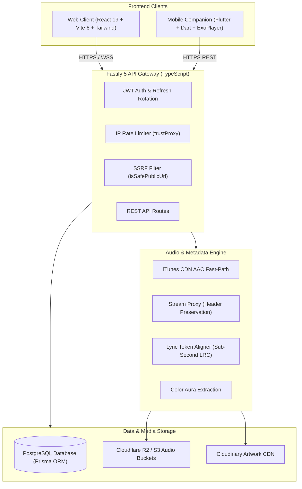

<div align="center">
  <br />
  <a href="https://listenzenify.vercel.app">
    
  </a>
  <br />
  <br />
  <h1>Zenify — Open-Source Music Streaming App & Spotify Alternative</h1>
  <p>
    <b>High-Performance Audio Streaming • AI Synchronized Multilingual Lyrics • Liquid Glassmorphism UI • Native Flutter Companion App</b>
  </p>
  <p>
    <em>Fast audio stream resolution, sub-second synced lyrics for Tamil, Hindi, Tanglish, Malayalam & English, gapless playback, and cross-platform listening.</em>
  </p>

  <p>
    <a href="https://listenzenify.vercel.app"></a>
    <a href="https://github.com/hackerstudent29/Zenify"></a>
    <a href="https://github.com/hackerstudent29/Zenify/discussions"></a>
    <a href="CONTRIBUTING.md"></a>
    <a href="LICENSE"></a>
  </p>

  <p>
    
    
    
    
    
    
  </p>

  <p>
    <em>Built with ❤️ by <a href="https://github.com/hackerstudent29"><b>Ramanathan B (hackerstudent29)</b></a></em>
  </p>
</div>

---

## 📑 Table of Contents

- [⚡ What is Zenify?](#-what-is-zenify)
- [🎯 Key Highlights & Why Zenify?](#-key-highlights--why-zenify)
- [✨ Core Features](#-core-features)
  - [🎤 Sub-Second Synchronized Multilingual Lyrics](#-sub-second-synchronized-multilingual-lyrics)
  - [🎧 Dual-Buffer Audio Engine & Instant CDN Streaming](#-dual-buffer-audio-engine--instant-cdn-streaming)
  - [📱 Native Flutter Companion Mobile App](#-native-flutter-companion-mobile-app)
  - [🔮 Liquid Glassmorphic UI & Real-Time Color Aura](#-liquid-glassmorphic-ui--real-time-color-aura)
  - [🛡️ Production Security & Hardened Architecture](#️-production-security--hardened-architecture)
- [📸 Screenshots & Interface Showcase](#-screenshots--interface-showcase)
- [🏗️ System Architecture & Data Flow](#️-system-architecture--data-flow)
- [💻 Technology Stack Matrix](#-technology-stack-matrix)
- [🚀 Quickstart & Self-Hosting Guide](#-quickstart--self-hosting-guide)
  - [1. Prerequisites](#1-prerequisites)
  - [2. Backend Configuration & Setup](#2-backend-configuration--setup)
  - [3. Frontend Web Player Setup](#3-frontend-web-player-setup)
- [🔍 SEO, Keywords & Search Taxonomy](#-seo-keywords--search-taxonomy)
- [🤝 Contributing & Community](#-contributing--community)
- [💖 Support & Sponsor the Developer (UPI)](#-support--sponsor-the-developer-upi)
- [📜 License](#-license)

---

## ⚡ What is Zenify?

**Zenify** is an **open-source music streaming platform and self-hosted Spotify alternative** built for music enthusiasts who demand uncompromising visual aesthetics, ultra-low playback latency, and **native synchronized lyrics for Indian and global regional languages**.

Standard commercial music streaming apps often ignore non-English music synchronization—falling back to unsynced blocks of text, missing romanized lyrics (Tanglish, Hinglish, Manglish), or failing during instrumental intervals. Zenify fixes this by pairing a custom **karaoke-grade lyric synchronization engine** with an **adaptive dual-buffer Web Audio player**, a modern **React 19 + Vite** web client, and an ultra-smooth **Flutter mobile app**.

> 💡 **Educational & Open-Source Purpose:** Zenify is an educational showcase of modern full-stack web audio engineering, Web Audio API DSP routing, stream proxying, and multilingual NLP token alignment.

---

## 🎯 Key Highlights & Why Zenify?

| Feature | Standard Platforms | 🌟 Zenify Music |
| :--- | :--- | :--- |
| **Multilingual Lyrics** | Basic English / Partial regional | **Deep support for Tamil, Tanglish, Hindi, Malayalam, & English** with sub-second timestamps |
| **Instrumental Gaps** | Lines stretch awkwardly during solos | **Smart Instrumental Protection** (`[Guitar Solo]`, `[BGM]`, `[Interlude]`) |
| **Audio Start Time** | Buffered pre-roll wait | **Instant iTunes CDN AAC stream resolution** with YouTube stream proxy fallback |
| **Transition Gaps** | Noticeable silence between songs | **Dual-Buffer Audio Engine** with crossfade and preloaded warm buffers |
| **User Interface** | Monolithic boxy card grids | **Liquid Glassmorphism**, dynamic album art palette extraction, and ambient glow |
| **Open Source & Self-Hostable** | Closed proprietary ecosystem | **100% Free & Open Source (MIT)** with Docker-ready Fastify backend |

---

## ✨ Core Features

### 🎤 Sub-Second Synchronized Multilingual Lyrics
* **Karaoke-Grade Alignment:** High-precision LRC timestamps (`[mm:ss.xx]`) synchronized to the vocal cadence of songs.
* **Romanized Regional Script Support:** Full fidelity for **Tanglish** (Tamil in Latin script), **Hinglish**, and local colloquial lyrics.
* **Instrumental Protection & Silence Detection:** Detects non-vocal interludes (`[BGM]`, `[Violin Solo]`, `[Outro]`) to prevent display distortion.
* **Lyric Sync Studio:** Built-in interactive administrative editor to paint, adjust, test, and save word-level and line-level timestamps.

### 🎧 Dual-Buffer Audio Engine & Instant CDN Streaming
* **Instant AAC Resolution:** Direct stream resolution via iTunes CDN for immediate playback onset.
* **HTTP 206 Partial Content Seeking:** Full Range request support via the backend audio proxy with audio container header preservation (`ftyp` box for MP4 and EBML for WebM).
* **Dual-Buffer Web Audio Architecture:** Runs dual `<audio>` players in parallel to preload the next track into memory and eliminate buffering latency.

### 📱 Native Flutter Companion Mobile App
* **Background Audio Daemon:** Android `AudioService` and `Media3/ExoPlayer` integration with lock screen controls and Bluetooth media triggers.
* **3D Flip Card:** Smooth 90-degree 3D flip card transition between high-resolution album cover art and real-time scrolling lyrics.
* **Floating Glass Miniplayer:** Translucent persistent player with hardware-accelerated real-time blur (`BackdropFilter`).
* **Offline Audio Scanner:** Built-in local storage scanner to play MP3, AAC, and FLAC files directly from device storage.

### 🔮 Liquid Glassmorphic UI & Real-Time Color Aura
* **Vibrant Canvas Extraction:** Dynamically extracts the 4 most prominent hex hues from album artwork using `node-vibrant` and CSS filters.
* **Ambient Aura Fullview:** Full-screen ambient visualizer that bathes the viewport in dynamic, flowing color gradients matching the music's mood.
* **Micro-Interactions:** Physics-based spring animations powered by `framer-motion` and sleek dark charcoal palettes (`#0A0A0B` obsidian / `#121214` surface).

### 🛡️ Production Security & Hardened Architecture
* **Zero Shell Injection (RCE-Immune):** Process execution runs exclusively via strict argument arrays (`safeExecFile`) with no shell string interpolation.
* **SSRF Guard:** Strict URL validation (`isSafePublicUrl`) blocking internal networks, link-local IPs, and cloud metadata endpoints.
* **Timing-Safe Auth & Cryptographic OTPs:** Secure authentication with `crypto.timingSafeEqual`, 5-attempt rate-limiting guards, and JWT refresh token rotation.
* **Role-Based Authorization:** Protected administrative studio endpoints with Fastify guards and Zod schema validation.

---

## 📸 Screenshots & Interface Showcase

<div align="center">

### 🎵 Glassmorphic Home Dashboard & Persistent Miniplayer


<br/>

| 🎤 Real-Time Synchronized Lyrics | 🔮 Fullview Ambient Aura Player |
| :---: | :---: |
|  |  |

<br/>

| 🌟 Artist Spotlight & Discography | 📜 Multilingual Lyrics Drawer |
| :---: | :---: |
|  |  |

<br/>

| 🎧 Track View & Dynamic Color Aura | 🔑 Secure Authentication & Session Login |
| :---: | :---: |
|  |  |

</div>

---

## 🏗️ System Architecture & Data Flow



---

## 💻 Technology Stack Matrix

| Domain | Framework / Library | Primary Role |
| :--- | :--- | :--- |
| **Web Frontend** | `React 19`, `Vite 6`, `TypeScript`, `Zustand` | Ultra-fast single page application with client-side routing & Web Audio management |
| **Mobile App** | `Flutter 3`, `Dart`, `Android Media3` | Native Android mobile app with background audio daemon & lock-screen playback controls |
| **Styling & UI** | `Tailwind CSS 3.4`, `Framer Motion`, `Lucide Icons` | Liquid glassmorphism, responsive media layout, and smooth spring physics |
| **Backend API** | `Fastify 5`, `Node.js`, `TypeScript` | High-throughput async REST API server with low memory overhead |
| **Database & ORM** | `PostgreSQL`, `Prisma ORM 5.10` | Strongly-typed schema modeling, relational indexing, and database migrations |
| **Audio Processing** | `HTML5 Web Audio API`, `ffmpeg`, `yt-dlp` | Real-time dual-buffer audio crossfade, format transcoding, and container demuxing |
| **Cloud Storage** | `Cloudflare R2`, `AWS S3 SDK`, `Cloudinary` | Scalable object storage for audio tracks and high-res album covers |
| **Security & Auth** | `Bcrypt/Argon2`, `Fastify JWT`, `Zod`, `Helmet` | Token rotation, timing-safe cryptographic comparisons, and strict payload validation |

---

## 🚀 Quickstart & Self-Hosting Guide

### 1. Prerequisites
Ensure you have the following installed on your machine:
- **Node.js**: `v18.x` or `v20.x`+
- **npm** or **pnpm**
- **PostgreSQL**: `v14`+ (local instance or cloud like Supabase/Neon/Railway)
- **Flutter SDK**: `v3.x` (optional, only needed for compiling the Android APK)

### 2. Backend Configuration & Setup

```bash
# Clone the repository
git clone https://github.com/hackerstudent29/Zenify.git
cd Zenify/backend

# Copy environment template
cp .env.example .env

# Install dependencies
npm install

# Run database migrations and generate Prisma client
npx prisma generate
npx prisma db push

# Start the Fastify backend server in development mode
npm run dev
```
> The backend server initializes at **`http://localhost:3000`**.

### 3. Frontend Web Player Setup

```bash
# Navigate to the frontend directory
cd ../frontend

# Copy environment template
cp .env.example .env

# Install frontend dependencies
npm install

# Start Vite development server
npm run dev
```
> The web application will launch at **`http://localhost:3001`** (or `http://localhost:5173`).

---

## 🔍 SEO, Keywords & Search Taxonomy

To help open-source builders, music enthusiasts, and developers find this project on GitHub and search engines, Zenify indexes under the following topics:

| Category | High-Intent Search Keywords & Tags |
| :--- | :--- |
| **Music Streaming & Players** | `spotify-alternative`, `open-source-music-player`, `music-streaming-app`, `self-hosted-music`, `web-music-player`, `audiophile-music-player`, `free-music-player` |
| **Lyrics & Karaoke** | `synced-lyrics`, `karaoke-player`, `lrc-lyrics`, `multilingual-lyrics`, `tamil-lyrics-player`, `tanglish-lyrics`, `hindi-synced-lyrics`, `timed-lyrics-sync` |
| **Modern Web Stack** | `react19`, `vite`, `fastify`, `prisma`, `typescript`, `tailwind-css`, `glassmorphism`, `web-audio-api`, `pwa-music-player` |
| **Mobile Audio & Cross-Platform** | `flutter-music-player`, `android-audio-player`, `exoplayer`, `flutter-audio-service`, `lockscreen-audio-controls` |

---

## 🤝 Contributing & Community

Contributions make the open-source community an incredible place to learn, inspire, and create. Any contributions you make are **greatly appreciated**.

1. Fork the Project (`https://github.com/hackerstudent29/Zenify/fork`)
2. Create your Feature Branch (`git checkout -b feature/AmazingFeature`)
3. Commit your Changes (`git commit -m 'feat: Add some AmazingFeature'`)
4. Push to the Branch (`git push origin feature/AmazingFeature`)
5. Open a Pull Request via our [PR Template](.github/PULL_REQUEST_TEMPLATE.md)

Join the conversation on [GitHub Discussions](https://github.com/hackerstudent29/Zenify/discussions) to request features or share song lyric alignments!

---

## 💖 Support & Sponsor the Developer (UPI)

**Zenify** is maintained as a 100% free, ad-free, open-source audio streaming platform by a solo developer (**Ram / hackerstudent29**).

Running and scaling Zenify requires ongoing domain name renewals, backend server infrastructure, and dedicated full-time engineering hours. If Zenify has enriched your music experience or helped your open-source journey, please consider sending a contribution to keep the project active!

### 📱 Indian UPI Contribution (GPay / PhonePe / Paytm / BHIM)
* **UPI ID:** `ramanathanb86@oksbi`
* **Recipient Name:** Ramanathan B
* **Supported Apps:** Google Pay (GPay), PhonePe, Paytm, BHIM, Amazon Pay, & all Indian Banking UPI apps.
* **Direct Impact:** Cloud server hosting, domain renewals (`listenzenify.com`), and supporting independent open-source engineering.

> *"Every contribution—big or small—helps keep our servers running, pays for domain renewals, and supports a developer working hard to create free, open-source software for everyone."*

---

## 📜 License

Distributed under the **MIT License**. See [`LICENSE`](LICENSE) for more information.

```
MIT License
Copyright (c) 2026 Zenify (hackerstudent29 - Ramanathan B)
```

---

<div align="center">
  <b><a href="https://listenzenify.vercel.app">Zenify</a></b> • Built with ❤️ by <a href="https://github.com/hackerstudent29"><b>Ramanathan B (hackerstudent29)</b></a>
</div>
