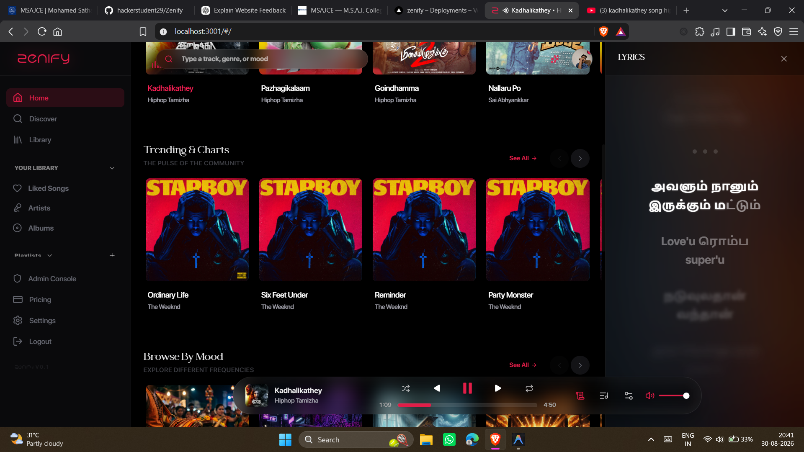

<div align="center">
  <br />
  <a href="https://listenzenify.vercel.app">
    
  </a>
  <br />
  <br />
  <h1>Zenify — Free Web Music Player & Synced Multilingual Lyrics</h1>
  <p>
    <b>Sub-Second Synced Lyrics • Studio Equalizer & 8D Audio • In-Browser Local Audio Player • Liquid Glass UI</b>
  </p>
  <p>
    <em>Listen to music online for free with synchronized lyrics for Tamil, Tanglish, Hindi, Malayalam & English. Ad-free, fast streaming, and cross-platform listening.</em>
  </p>

  <p>
    <a href="https://listenzenify.vercel.app"></a>
    <a href="DEVELOPER.md"></a>
    <a href="https://github.com/hackerstudent29/Zenify"></a>
    <a href="https://github.com/hackerstudent29/Zenify/discussions"></a>
    <a href="LICENSE"></a>
  </p>

  <p>
    <em>Built with ❤️ by <a href="https://github.com/hackerstudent29"><b>Ramanathan S (hackerstudent29)</b></a></em>
  </p>
</div>

---

## ⚡ What is Zenify?

**Zenify** is an **open-source music streaming platform** built for music lovers who value pristine audio quality, comprehensive multilingual synced lyrics, and professional-grade audio customization. Born from the need for better regional language support and transparent audio processing, Zenify combines the best of modern streaming with studio-grade audio tools.

Unlike commercial platforms that treat non-English content as secondary, Zenify provides **karaoke-grade synchronized lyrics** with **Deepgram AI-powered onset alignment** for perfect timing, **automatic romanization** for 9 Indian languages, and **intelligent instrumental gap detection**. The built-in **Studio FX Engine** delivers hardware-accelerated audio DSP (3-band EQ, 8D spatial audio, vocal isolation, reorderable FX chain) alongside **vibe-based smart recommendations**, an **in-browser local file player**, and a stunning **liquid glassmorphism UI** with palette-reactive backgrounds.

> 🎧 **Start listening immediately:** Visit **[listenzenify.vercel.app](https://listenzenify.vercel.app)** — no account or download required!

---

## ✨ Why Listen on Zenify?

* 🎤 **Sub-Second Synced Lyrics with AI Onset Alignment:** Real-time karaoke-grade lyric synchronization powered by **Deepgram AI** for precise onset detection. Supports **Tamil, Tanglish, Hindi, Malayalam, Telugu, Kannabi, Bengali, Punjabi, Gujarati, and English** with automatic romanization. Features intelligent instrumental gap detection (`• • •` markers during breaks >3.2s) and word-level timing.

* 🎛️ **Professional Studio FX Engine (Right-Side Glass Panel):**
  * **Collapsible Accordion Sections:** Six organized sections (Presets, Tune, Space, Voice, Chain, Tempo) in a 320px glass panel matching Queue/Lyrics style
  * **3-Band Parametric Equalizer:** Bass (110Hz), Mid (1.5kHz), Treble (8kHz) with ±12dB adjustment
  * **Reorderable FX Chain:** Customize signal routing order (EQ → Filter → Drive → Chorus → Echo → Reverb)
  * **Native Vocal Isolation:** Zero-latency WebAudio Mid-Side processor for karaoke and vocal enhancement
  * **8D Spatial Audio:** Bi-directional panner-based 3D sound with adjustable orbit speed
  * **DJ-Style Filter:** High-pass/low-pass with frequency visualization (20Hz-20kHz sweep)
  * **Advanced Effects:** Chorus, Echo (with feedback control), Reverb (Small Hall/Cathedral), Warmth/Drive saturation, Stereo Width (mono to 200%)
  * **Speed & Pitch Control:** Independent speed (0.5x-2x) and pitch shifting for Nightcore/Daycore
  * **Night Mode:** Dynamics compression with makeup gain for comfortable late-night listening
  * **10+ Built-in Presets:** After Hours, Immersive, Studio Clarity, Headphones, Bass Boost, Vocal Boost, Concert Hall, Lo-Fi, Dream Echo

* 📁 **Local Audio Player (Zero Upload):** Drag and drop **MP3, FLAC, WAV, M4A, AAC** files directly into your browser. Zenify extracts embedded cover art and ID3 tags client-side—your files never leave your device.

* 🎵 **Intelligent 3-Tier Queue System:**
  * **User Queue:** FIFO queue for manually added tracks (preserves order during shuffle)
  * **Context Queue:** Tracks from album/playlist (affected by shuffle)
  * **Play History:** Last 50 tracks for seamless backward navigation
  * **Vibe-Based Autoplay:** Automatically continues with similar tracks when queue ends
  * **Repeat Modes:** Off, Repeat One (1x), Repeat Two (2x), Repeat All

* 🔮 **Liquid Glassmorphism & Palette Reactive Backgrounds:** Dynamic canvas-based reactive animations extract and pulse dominant colors from your album art in sync with the music's beat. Customizable per surface (Full Player, Track Page, Album Page).

* 🚀 **Gapless Playback with Dual-Buffer Preloading:** Seamless transitions between tracks with intelligent preloading and configurable crossfade (0-10 seconds).

* 📱 **Progressive Web App (PWA):** Install on **Windows, macOS, Linux, Android, and iOS** with native features:
  - Lock screen media controls
  - Bluetooth media button support (headphone play/pause, next/prev)
  - Offline playback capability
  - App-like experience without app store downloads

---

## 📸 Interface Showcase

<div align="center">

### 🎵 Glassmorphic Home Dashboard & Persistent Miniplayer


<br/>

| 🎤 Real-Time Synchronized Lyrics | 🔮 Fullview Ambient Aura Player |
| :---: | :---: |
|  |  |

<br/>

| 🌟 Artist Spotlight & Discography | 📜 Multilingual Lyrics Drawer |
| :---: | :---: |
|  |  |

</div>

---

## 🛠️ For Developers & Self-Hosters

Looking to contribute, inspect the Web Audio DSP routing, self-host a backend instance, or compile the Flutter Android companion app?

👉 **See the complete [Developer & Architecture Guide (DEVELOPER.md)](DEVELOPER.md)** for:
- System architecture & Mermaid data flow diagrams
- Technology stack specifications (`React 19`, `Vite 6`, `Fastify 5`, `Prisma`, `PostgreSQL`, `Flutter 3`)
- Local development setup & environment variable guide
- REST API endpoint documentation
- Production security & contribution instructions

---

## 🔍 Topics & Keywords

`music-streaming` • `open-source-music-player` • `spotify-alternative` • `synced-lyrics` • `karaoke-player` • `ai-lyrics-alignment` • `deepgram-integration` • `tamil-lyrics` • `hindi-lyrics` • `tanglish-lyrics` • `malayalam-lyrics` • `telugu-lyrics` • `romanization` • `studio-fx` • `audio-equalizer` • `8d-audio` • `spatial-audio` • `vocal-isolation` • `web-audio-api` • `nightcore` • `daycore` • `slowed-reverb` • `local-music-player` • `flac-player` • `mp3-player` • `pwa-music-app` • `glassmorphism-ui` • `react-music-player` • `vite-app` • `fastify-backend` • `prisma-orm` • `postgresql` • `typescript` • `real-time-lyrics` • `music-recommendation` • `playlist-manager` • `free-streaming` • `ad-free-music`

---

## 💖 Support & Sponsor the Developer (UPI)

**Zenify** is maintained as a 100% free, ad-free, open-source audio streaming platform by independent developer **Ram ([Ramanathan S / hackerstudent29](https://github.com/hackerstudent29))**.

Running and scaling Zenify requires ongoing domain renewals (`listenzenify.com`), backend server hosting, and dedicated engineering hours. If Zenify has enriched your music listening experience, please consider sending a contribution to keep the project active!

### 📱 Indian UPI Contribution (GPay / PhonePe / Paytm / BHIM)
* **UPI ID:** `ramanathanb86@oksbi`
* **Recipient Name:** Ramanathan S
* **Supported Apps:** Google Pay (GPay), PhonePe, Paytm, BHIM, Amazon Pay, & all Indian Banking UPI apps.
* **Direct Impact:** Server hosting, domain renewals, and supporting independent open-source development.

> *"Every contribution—big or small—helps keep our servers running and supports building free software for music lovers worldwide."*

---

## 📜 License

Distributed under the **MIT License**. See [`LICENSE`](LICENSE) for more information.

```
MIT License
Copyright (c) 2026 Zenify (hackerstudent29 - Ramanathan S)
```

---

<div align="center">
  <b><a href="https://listenzenify.vercel.app">Zenify</a></b> • Built with ❤️ by <a href="https://github.com/hackerstudent29"><b>Ramanathan S (hackerstudent29)</b></a>
</div>
