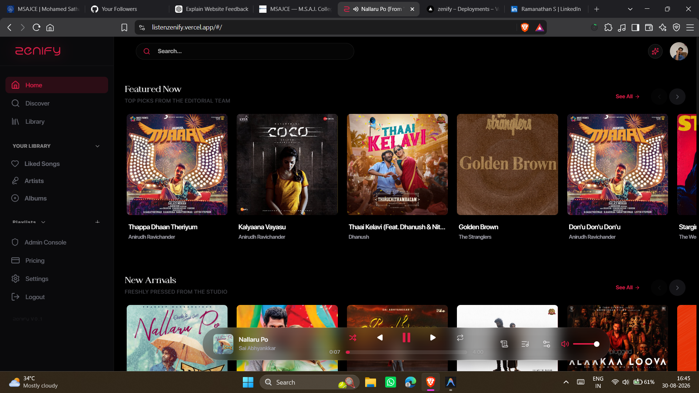
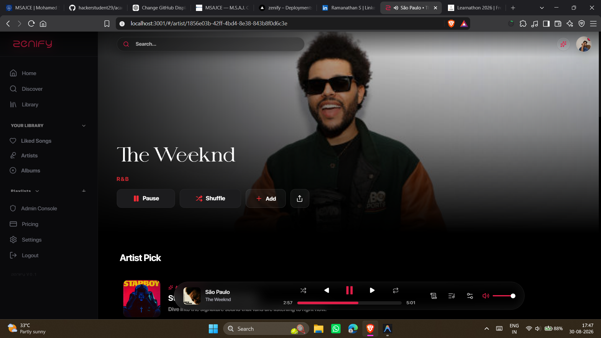

<div align="center">
  <br />
  <a href="https://listenzenify.com">
    
  </a>
  <br />
  <br />
  <h1>Zenify: Free Ad-Free Music Streaming App</h1>
  <p>
    <b>The beautiful, ad-free music streaming platform with Apple-grade design, real-time synced lyrics, studio equalizer & 8D audio, and native mobile client.</b>
  </p>

  <p>
    <a href="https://listenzenify.com"></a>
    <a href="https://listenzenify.com/download"></a>
    <a href="https://github.com/hackerstudent29/Zenify/releases"></a>
    <a href="LICENSE"></a>
    <a href="https://github.com/hackerstudent29/Zenify"></a>
  </p>

  <p>
    <a href="#-download-mobile-app-android-apk"><b>Download App</b></a> •
    <a href="#-try-it-now">Try Web App</a> •
    <a href="#-features">Features</a> •
    <a href="#-screenshots">Screenshots</a> •
    <a href="#-why-zenify">Why Zenify</a> •
    <a href="#-architecture--tech-stack">Tech Stack</a> •
    <a href="#-quickstart--local-development">Development</a> •
    <a href="#-faq">FAQ</a>
  </p>
</div>

---

## 🎧 Hero

<div align="center">
  
</div>

Zenify is a free, open-source online music streaming player and mobile application designed with an Apple Music-inspired visual aesthetic. Listen to your favorite tracks with sub-second synchronized karaoke lyrics, sculpt your sound with a hardware-accelerated studio equalizer and 8D spatial audio, host shared listening sessions with Room Together, or play your personal offline music library without uploads.

---

## 📱 Download Mobile App (Android APK)

Install the native **Zenify Android application** directly to your phone for seamless background playback, lock-screen controls, and offline listening:

<div align="center">
  <br />
  <a href="https://listenzenify.com/downloads/zenify.apk">
    
  </a>
  <br />
  <p><i>Direct download link: <a href="https://listenzenify.com/downloads/zenify.apk">https://listenzenify.com/downloads/zenify.apk</a> or mirror via <a href="https://github.com/hackerstudent29/Zenify/raw/main/frontend/public/downloads/zenify.apk">GitHub Raw</a></i></p>
  <br />
  
  <p><b>Scan with your phone's camera to download directly</b></p>
</div>

### 📲 How to Install the APK on Your Android Phone

1. **Download the APK Package**: Tap the **[Download Zenify APK](https://listenzenify.com/downloads/zenify.apk)** button or scan the QR code above with your phone camera.
   > *Note*: If Google Chrome or your browser displays *"File might be harmful"*, tap **Download anyway**. This is standard Android security verification for apps downloaded outside the Google Play Store.
2. **Open the File**: When the download finishes, tap **Open** from your notification tray, or open your phone's **Files** or **Downloads** folder and tap `zenify.apk`.
3. **Allow Unknown Apps**: If prompted with *"For your security, your phone is not allowed to install unknown apps from this source"*, tap **Settings** and turn on **Allow from this source**.
4. **Tap Install**: Tap **Install**. In a few seconds, installation will finish. Open Zenify to stream high-bitrate ad-free music with synced lyrics and lock-screen controls!

### 🍎 Install on iPhone & iPad (PWA)
1. Open **[listenzenify.com](https://listenzenify.com)** or **[listenzenify.vercel.app](https://listenzenify.vercel.app)** in **Safari**.
2. Tap the **Share** button (box with an upward arrow) at the bottom.
3. Scroll down and tap **Add to Home Screen**, then tap **Add**.
4. Launch Zenify directly from your home screen for a full-screen, standalone app experience!

### 💻 Install on Desktop (Windows, macOS, Linux PWA)
1. Open Zenify in Google Chrome, Microsoft Edge, or Brave.
2. Click the **Install** icon in the address bar (or Menu → *Install Zenify*).
3. Zenify will launch in a dedicated borderless window with keyboard shortcuts and media key support.

---

## 🚀 Try It Now

Start listening immediately — **no sign-up or credit card required**.

* **Live Web Player**: Open **[listenzenify.com](https://listenzenify.com)** or **[listenzenify.vercel.app](https://listenzenify.vercel.app)** in any modern web browser.
* **Download APK**: Visit **[listenzenify.com/download](https://listenzenify.com/download)** for package details and instant QR code installation.

---

## ✨ Features

| Feature | Description |
|---|---|
| **100% Free & Ad-Free** | Uninterrupted music streaming with zero audio ads, banner popups, or subscription fees. |
| **Pristine 320kbps Akamai CDN Audio** | Full-length high-fidelity audio streams with instant seeking and zero buffering. |
| **Apple-Grade Fluid UI** | Glassmorphic design, spring physics, and dynamic artwork mesh palettes inspired by Apple Music. |
| **Real-Time Synced Karaoke Lyrics** | Sub-second word-level synchronization with automatic instrumental break markers across 50+ languages. |
| **Studio 3-Band Equalizer** | Hardware-accelerated parametric EQ (Bass, Mid, Treble) with live parameter interpolation. |
| **8D Spatial Audio & Audio FX** | Headphone-orbiting 8D sound, dynamic room reverb, tube warmth, and DJ pitch/tempo control. |
| **Room Together (Live Listening)** | Synchronized group listening rooms with low-drift playback for you and your friends. |
| **Local Music Player (MP3 / FLAC)** | Drop personal audio files to play privately offline without uploading to any cloud server. |
| **Continuous Smart Autoplay** | Vibe-based recommendation engine that auto-queues similar music when your playlist finishes. |
| **Cross-Platform** | Web (Vite + React 19), Native Android (Flutter 3.44 + Kotlin ExoPlayer), and PWA (iOS/Desktop). |

---

## 📸 Screenshots

| 🏠 Home Dashboard | 🎛️ Studio Player & Audio Controls |
| :---: | :---: |
|  |  |
| *Discover trending releases and personalized collections* | *Sculpt your sound with real-time EQ and spatial audio* |

| 🎤 Real-Time Synced Lyrics | 👤 Artist Discography |
| :---: | :---: |
|  |  |
| *Sub-second karaoke lyrics with instrumental pause indicators* | *Explore full discographies, popular songs, and related artists* |

---

## ⚡ Why Zenify?

| Feature | Zenify | Spotify Free | Apple Music | YouTube Music Free |
|---|:---:|:---:|:---:|:---:|
| **Price** | **100% Free** | Free with ads | Paid ($10.99/mo) | Free with ads |
| **Audio Ads Between Songs** | **Zero** | Frequent audio ads | None (Paid) | Frequent video/audio ads |
| **Account Required to Listen** | **No** | Yes | Yes | Yes |
| **Real-Time Synced Lyrics** | **Included** | Limited | Included (Paid) | Basic text |
| **Studio Equalizer & 8D Audio** | **Included** | Basic presets only | Basic presets only | None |
| **Plays Local Files Privately** | **Yes (Client-side)** | Complex sync | Desktop only | Upload to cloud |
| **Native Android APK Package** | **Yes (Direct APK)** | Play Store only | Play Store only | Play Store only |
| **Open Source** | **Yes (MIT)** | Closed source | Closed source | Closed source |

---

## 🏛️ Architecture & Tech Stack

```
Zenify Workspace
├── frontend/               # Web Application (Vite, React 19, Tailwind v4, Framer Motion)
│   ├── public/downloads/   # Distributed release packages (zenify.apk)
│   └── src/app/download/   # Dedicated interactive download page with QR code
├── mobile/                 # Native Mobile Client (Flutter 3.44, Dart 3.12, Android Media3)
│   ├── android/            # Kotlin audio plugins (ZenAudioPlugin, ZenFxProcessor)
│   └── lib/                # Cross-platform views, services, state stores, and player engine
├── backend/                # API Server (Fastify, Prisma ORM, PostgreSQL, WebSockets)
│   ├── src/routes/         # Tracks, search, albums, artists, auth, lyrics, and downloads
│   └── src/services/       # JioSaavn Clean CDN, Innertube, personalization, and cron schedulers
└── docs/                   # Visual documentation, parity guides, and schemas
```

- **Frontend**: React 19, Vite, Tailwind CSS v4, Framer Motion, TanStack Query, Zustand, Radix UI.
- **Mobile**: Flutter 3.44.2, Dart 3.12.2, Android Media3 ExoPlayer, Provider, Cupertino Icons.
- **Backend**: Node.js, Fastify, TypeScript, Prisma ORM, PostgreSQL, `@fastify/websocket`, JWT.
- **Audio Resolution**: Pristine JioSaavn Akamai 320kbps CDN resolution + yt-dlp / Innertube stream fallback.

---

## 🛠️ Quickstart & Local Development

### 1. Clone the Repository
```bash
git clone https://github.com/hackerstudent29/Zenify.git
cd Zenify
```

### 2. Run the Backend
```bash
cd backend
npm install
npx prisma generate
npm run dev
```

### 3. Run the Frontend
```bash
cd frontend
npm install
npm run dev
# Web player will be accessible at http://localhost:3001
```

### 4. Run the Mobile App
```bash
cd mobile
flutter pub get
flutter run
# To build release APK:
flutter build apk --release
```

---

## ❓ Frequently Asked Questions (FAQ)

### 1. Is Zenify really free?
Yes. Zenify is completely free and open-source under the MIT license. There are no paid subscription plans, no paywalls, and no audio advertisements interrupting your listening sessions.

### 2. Do I need an account to listen to music?
No. You can open Zenify and begin listening to songs, albums, and radios immediately without creating an account or providing an email address. Creating an account is optional to sync favorite songs across devices.

### 3. How do I download the Android APK?
Visit **[listenzenify.com/download](https://listenzenify.com/download)** on your browser, click **Download APK**, or scan the QR code with your phone camera. Follow the brief prompt to allow installation of unknown apps in Android Settings, and tap Install.

### 4. Can I play my own audio files from my computer or phone?
Yes. The **My Library / Local Library** feature allows you to select MP3, FLAC, WAV, and M4A audio files from your device storage. Files play entirely inside your device using hardware audio decoding; your files are never uploaded to any remote server.

### 5. How do the synchronized lyrics work?
Zenify aligns timestamped syllable and line timings with the audio timeline. Words light up in real time with the vocals, and visual pause markers (`• • •`) indicate instrumental passages.

---

## 🤝 Contribute & Support

Zenify is free and open-source software built for music lovers around the world. If you enjoy listening with Zenify, please **star this repository on GitHub** and share it with your friends!

---

## 📜 License

Distributed under the **MIT License**. Created by [Ramanathan S](https://github.com/hackerstudent29).
