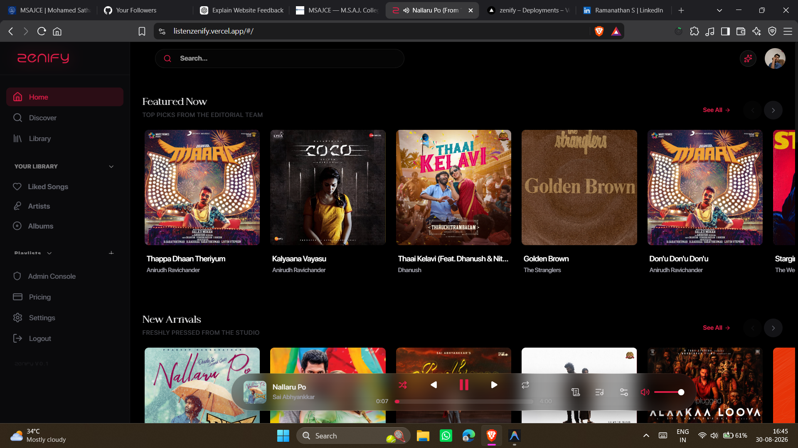
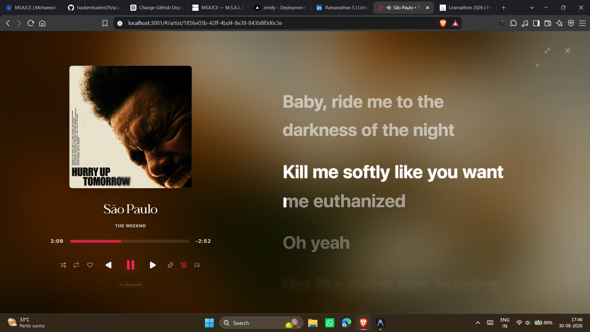
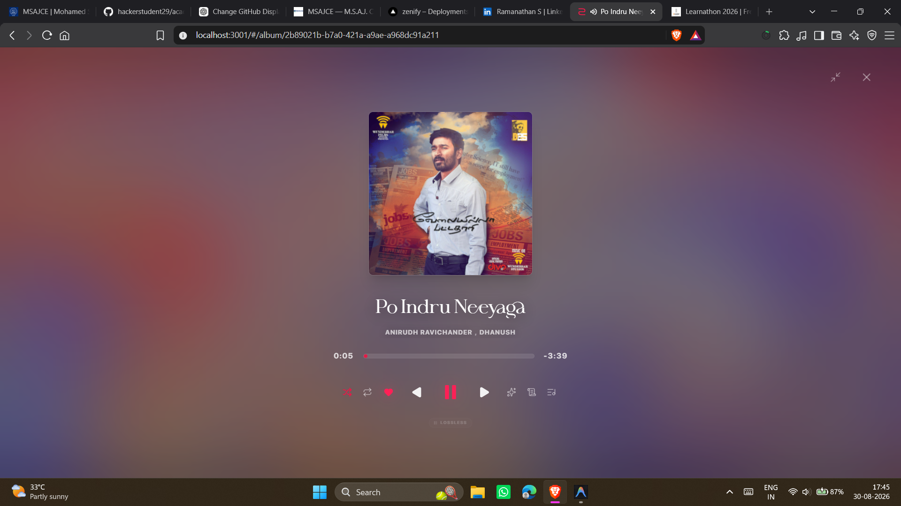
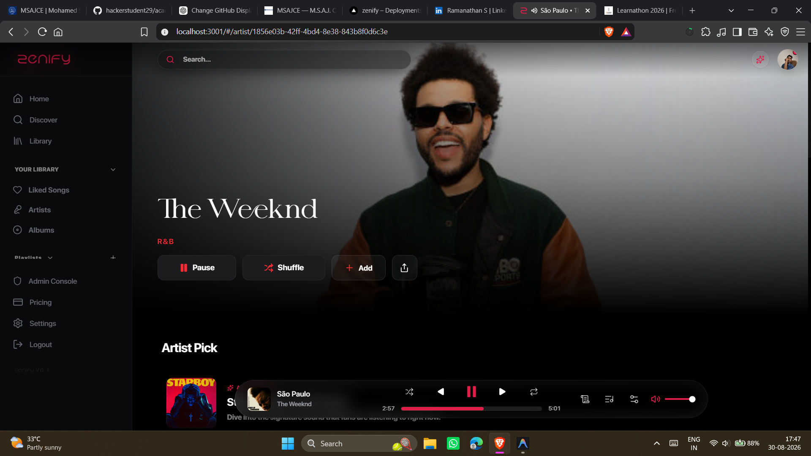
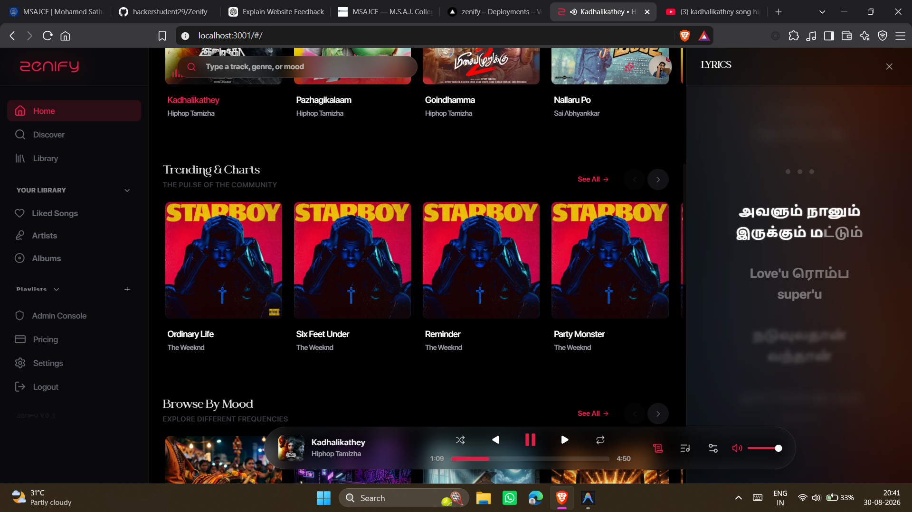

<div align="center">
  <br />
  <a href="https://listenzenify.vercel.app">
    
  </a>
  <br />
  <br />
  <h1>Zenify — Free Web Music Player & Synced Multilingual Lyrics</h1>
  <p>
    <b>Sub-Second Synced Lyrics • Studio Equalizer & 8D Audio • In-Browser Local Audio Player • Liquid Glass UI</b>
  </p>
  <p>
    <em>Listen to music online for free with synchronized lyrics for Tamil, Tanglish, Hindi, Malayalam & English. Ad-free, fast streaming, and cross-platform listening.</em>
  </p>

  <p>
    <a href="https://listenzenify.vercel.app"></a>
    <a href="DEVELOPER.md"></a>
    <a href="https://github.com/hackerstudent29/Zenify"></a>
    <a href="https://github.com/hackerstudent29/Zenify/discussions"></a>
    <a href="LICENSE"></a>
  </p>

  <p>
    <em>Built with ❤️ by <a href="https://github.com/hackerstudent29"><b>Ramanathan S (hackerstudent29)</b></a></em>
  </p>
</div>

---

## ⚡ What is Zenify?

**Zenify** is an **open-source web music player and ad-free Spotify alternative** created for music lovers who appreciate clean visuals, instant playback, and **native synchronized lyrics for Indian and global regional languages**.

Commercial music apps often treat non-English lyrics as an afterthought—showing unsynced blocks of text or missing romanized words entirely. Zenify features a custom **karaoke-grade lyric alignment engine**, a hardware-accelerated **Studio Audio DSP Suite** (3-band EQ, 8D spatial sound, nightcore/slowed modes), an **in-browser local audio player**, and a dynamic liquid glass UI that flows with your album's colors.

> 🎧 **Start listening immediately in your browser:** Visit **[listenzenify.vercel.app](https://listenzenify.vercel.app)** — no account or download required!

---

## ✨ Why Listen on Zenify?

* 🎤 **Sub-Second Synced Lyrics:** Real-time karaoke alignment for **Tamil, Tanglish, Hindi, Malayalam, and English** with smart protection during instrumental guitar and violin solos (`[BGM]`, `[Interlude]`).
* 🎛️ **Studio Audio Suite & 8D Sound:**
  * **3-Band Equalizer:** Fine-tune Bass, Mid, and Treble with instant **Bass Boost** and **Vocal Booster** presets.
  * **8D Spatial Audio:** Immersive sound that dynamically orbits around your headphones.
  * **DJ Playback Modes:** One-click **Nightcore** (1.5x speed) and **Daycore / Slowed** (0.75x speed + reverb).
  * **Acoustic Reverb Spaces:** Simulate Small Hall and Cathedral listening rooms.
* 📁 **In-Browser Local Audio Player:** Drag and drop your device's **MP3, FLAC, WAV, M4A, or AAC** files directly into Zenify to play them offline with embedded cover art and ID3 tags.
* 🔮 **Liquid Glassmorphism & Reactive Aura:** Dynamic canvas visualizer that extracts dominant colors from your album art and pulses with the music's bass.
* 🚀 **Instant Audio Playback:** Dual-buffer streaming preloads upcoming songs for seamless, gapless playback.
* 📱 **Installable Everywhere (PWA):** Install Zenify directly on Windows, macOS, Android, or iOS with full lock-screen playback controls and Bluetooth media button support.

---

## 📸 Interface Showcase

<div align="center">

### 🎵 Glassmorphic Home Dashboard & Persistent Miniplayer


<br/>

| 🎤 Real-Time Synchronized Lyrics | 🔮 Fullview Ambient Aura Player |
| :---: | :---: |
|  |  |

<br/>

| 🌟 Artist Spotlight & Discography | 📜 Multilingual Lyrics Drawer |
| :---: | :---: |
|  |  |

</div>

---

## 🛠️ For Developers & Self-Hosters

Looking to contribute, inspect the Web Audio DSP routing, self-host a backend instance, or compile the Flutter Android companion app?

👉 **See the complete [Developer & Architecture Guide (DEVELOPER.md)](DEVELOPER.md)** for:
- System architecture & Mermaid data flow diagrams
- Technology stack specifications (`React 19`, `Vite 6`, `Fastify 5`, `Prisma`, `PostgreSQL`, `Flutter 3`)
- Local development setup & environment variable guide
- REST API endpoint documentation
- Production security & contribution instructions

---

## 🔍 Topics & Keywords

`spotify-alternative` • `synced-lyrics` • `karaoke-player` • `tamil-lyrics-online` • `tanglish-lyrics` • `hindi-synced-lyrics` • `8d-audio` • `web-equalizer` • `nightcore-player` • `slowed-and-reverb` • `local-music-player` • `flac-player` • `pwa-music-player` • `open-source-music-player` • `free-music-streaming`

---

## 💖 Support & Sponsor the Developer (UPI)

**Zenify** is maintained as a 100% free, ad-free, open-source audio streaming platform by independent developer **Ram ([Ramanathan S / hackerstudent29](https://github.com/hackerstudent29))**.

Running and scaling Zenify requires ongoing domain renewals (`listenzenify.com`), backend server hosting, and dedicated engineering hours. If Zenify has enriched your music listening experience, please consider sending a contribution to keep the project active!

### 📱 Indian UPI Contribution (GPay / PhonePe / Paytm / BHIM)
* **UPI ID:** `ramanathanb86@oksbi`
* **Recipient Name:** Ramanathan S
* **Supported Apps:** Google Pay (GPay), PhonePe, Paytm, BHIM, Amazon Pay, & all Indian Banking UPI apps.
* **Direct Impact:** Server hosting, domain renewals, and supporting independent open-source development.

> *"Every contribution—big or small—helps keep our servers running and supports building free software for music lovers worldwide."*

---

## 📜 License

Distributed under the **MIT License**. See [`LICENSE`](LICENSE) for more information.

```
MIT License
Copyright (c) 2026 Zenify (hackerstudent29 - Ramanathan S)
```

---

<div align="center">
  <b><a href="https://listenzenify.vercel.app">Zenify</a></b> • Built with ❤️ by <a href="https://github.com/hackerstudent29"><b>Ramanathan S (hackerstudent29)</b></a>
</div>
