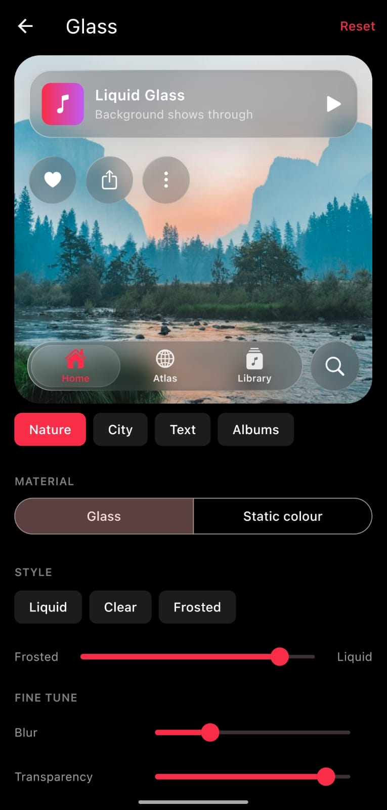
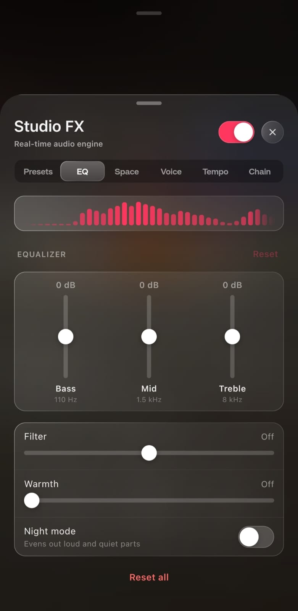
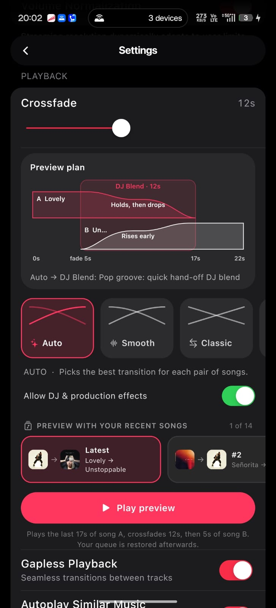
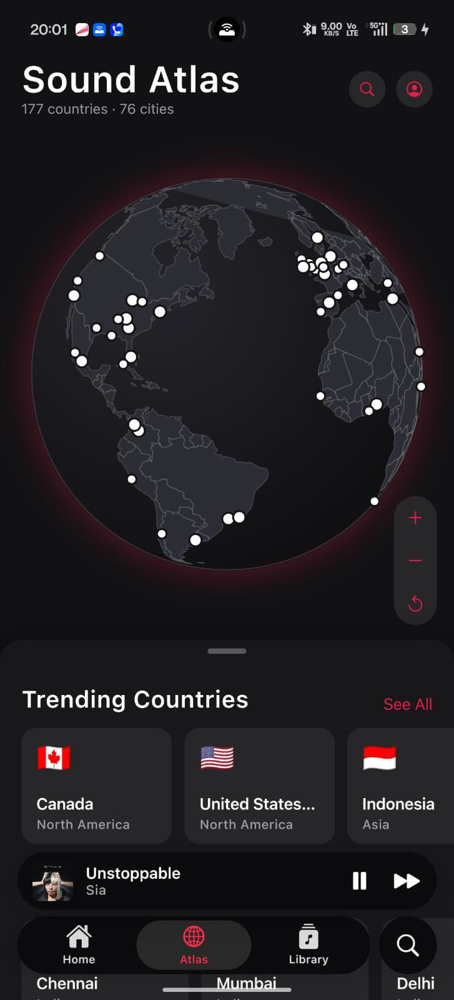

<div align="center">

  <br />

  <a href="https://github.com/hackerstudent29/Zenify">
    
  </a>

  <br /><br />

  

  <h3>Your music. Pure. Free. Yours.</h3>
  <h1> Zenify — the ad-free, 320kbps music app for Android</h1>

  <p><b>Stream in studio quality · Sing along word-by-word · Listen with friends · Watch music videos · Never see an ad.</b></p>
  <p><sub>Open-source • No subscription • No tracking • No account needed</sub></p>

  <br />

  <p>
    <a href="https://github.com/hackerstudent29/Zenify/releases/download/v1.1.22/zenify-v1.1.22.apk">
      
    </a>
    &nbsp;&nbsp;&nbsp;
    <a href="https://github.com/hackerstudent29/Zenify/releases/tag/v1.1.22">
      
    </a>
  </p>

  <br />

  <p>
    <code>Android 8.0+</code> &nbsp;•&nbsp;
    <code>Tested on Android 8 → 15</code> &nbsp;•&nbsp;
    <code>Only 16.2 MB</code> &nbsp;•&nbsp;
    <code>100% Free (MIT)</code>
  </p>

  <br />

  <p>
    
    &nbsp;
    
    &nbsp;
    
    &nbsp;
    
    &nbsp;
    
    &nbsp;
    
  </p>

  <br />

  <p align="center">
    
  </p>
  <p align="center">
    <sub><b>Now Playing (Hi-Res)</b> &nbsp;•&nbsp; <b>Album &amp; Floating Dock</b> &nbsp;•&nbsp; <b>16:9 Video Player</b> &nbsp;•&nbsp; <b>Karaoke Lyrics</b></sub>
  </p>

  <br />

</div>

> [!IMPORTANT]
> **🎉 Zenify v1.1.22 (Stable Version 1) is live!**  
> New Zendrum app icon • More stable audio &amp; video playback • Cleaner full-lyrics view that keeps your mini-player and dock in place • Better soundtrack album info • Still zero ads. Still zero subscriptions. Still free.

---

<div align="center">

## ✨ Zenify in 10 seconds

<table width="100%">
  <tr>
    <td width="20%" align="center" valign="top">
      <h3>🎧</h3>
      <b>320 kbps</b><br />
      <sub>full-quality sound</sub>
    </td>
    <td width="20%" align="center" valign="top">
      <h3>🆓</h3>
      <b>₹0 / $0</b><br />
      <sub>forever free</sub>
    </td>
    <td width="20%" align="center" valign="top">
      <h3>🎤</h3>
      <b>Karaoke</b><br />
      <sub>word-by-word lyrics</sub>
    </td>
    <td width="20%" align="center" valign="top">
      <h3>👯</h3>
      <b>Jam together</b><br />
      <sub>with live voice</sub>
    </td>
    <td width="20%" align="center" valign="top">
      <h3>🎬</h3>
      <b>Music videos</b><br />
      <sub>in 16:9 HD</sub>
    </td>
  </tr>
  <tr>
    <td width="20%" align="center" valign="top">
      <h3>🚫</h3>
      <b>Zero ads</b><br />
      <sub>not even one</sub>
    </td>
    <td width="20%" align="center" valign="top">
      <h3>📴</h3>
      <b>Offline</b><br />
      <sub>download &amp; go</sub>
    </td>
    <td width="20%" align="center" valign="top">
      <h3>🎛️</h3>
      <b>20 DJ</b><br />
      <sub>crossfade styles</sub>
    </td>
    <td width="20%" align="center" valign="top">
      <h3>🌍</h3>
      <b>177 countries</b><br />
      <sub>to explore</sub>
    </td>
    <td width="20%" align="center" valign="top">
      <h3>🔒</h3>
      <b>Zero tracking</b><br />
      <sub>your data stays yours</sub>
    </td>
  </tr>
</table>

</div>

---

## 🙋 Zenify is made for you

<table width="100%">
  <tr>
    <td width="33.3%" valign="top" align="center">
      <h3>🎶 Everyday listeners</h3>
      Open the app and play. No sign-up wall, no ads between songs, no 30-second previews — just full songs, beautifully presented.
    </td>
    <td width="33.3%" valign="top" align="center">
      <h3>🎧 Audiophiles</h3>
      Pristine 320 kbps streams, a 3-band parametric EQ, 8D spatial audio, reverb, loudness normalization and a live spectrum.
    </td>
    <td width="33.3%" valign="top" align="center">
      <h3>🎛️ DJs &amp; party hosts</h3>
      20 handcrafted transitions — Bass Swap, Tape Stop, Vinyl Brake and more — plus shared rooms with host and DJ roles.
    </td>
  </tr>
  <tr>
    <td width="33.3%" valign="top" align="center">
      <h3>🎤 Singers &amp; language lovers</h3>
      Word-by-word synced lyrics with romanization for Japanese, Korean, Hindi, Tamil, Telugu and more. Sing along in any language.
    </td>
    <td width="33.3%" valign="top" align="center">
      <h3>👫 Friends &amp; long-distance couples</h3>
      Listen in perfect sync from anywhere on Earth. Chat by voice, react with emojis, and share the vibe.
    </td>
    <td width="33.3%" valign="top" align="center">
      <h3>📶 Travelers &amp; data savers</h3>
      Download songs, art and lyrics for offline play. Wi-Fi-only mode and a 70 kbps Data Saver protect your mobile plan.
    </td>
  </tr>
  <tr>
    <td width="33.3%" valign="top" align="center">
      <h3>🎬 Video fans</h3>
      Hardware-accelerated music videos up to 4K 60fps, with background audio when your screen is off.
    </td>
    <td width="33.3%" valign="top" align="center">
      <h3>🔐 Privacy-minded people</h3>
      No telemetry, no tracking SDKs, no phone number. A Private Listening Mode keeps guilty pleasures to yourself.
    </td>
    <td width="33.3%" valign="top" align="center">
      <h3>👩‍💻 Developers</h3>
      Fully open source (MIT) — built with Flutter, Dart and native Kotlin. Fork it, learn from it, improve it.
    </td>
  </tr>
</table>

---

## 📱 See it in action

### 🎨 Looks that feel like magic

<table width="100%">
  <tr>
    <td width="33.3%" align="center" valign="top">
      
      <br /><br />
      <b>Bleed Artwork Player</b><br />
      <sub>Album covers melt softly into the player with feathered edges, paired with Hi-Res Lossless playback.</sub>
    </td>
    <td width="33.3%" align="center" valign="top">
      
      <br /><br />
      <b>Liquid Glass Studio</b><br />
      <sub>Switch between Liquid, Clear and Frosted glass with live Blur and Transparency sliders.</sub>
    </td>
    <td width="33.3%" align="center" valign="top">
      
      <br /><br />
      <b>Rich Artist Pages</b><br />
      <sub>Headers, monthly listeners, Latest Releases and Top Songs — with your mini-player and dock always in reach.</sub>
    </td>
  </tr>
</table>

### 🔊 Sound that you control

<table width="100%">
  <tr>
    <td width="33.3%" align="center" valign="top">
      
      <br /><br />
      <b>Studio FX &amp; Parametric EQ</b><br />
      <sub>36-band spectrum, Bass/Mid/Treble EQ, Warmth, Filter, Spatial 8D and Night Mode — all in real time.</sub>
    </td>
    <td width="33.3%" align="center" valign="top">
      
      <br /><br />
      <b>20-Style DJ Crossfade</b><br />
      <sub>Preview and customize handcrafted transitions — Auto, Smooth, Bass Swap, Tape Stop, Vinyl Brake — with a live curve.</sub>
    </td>
    <td width="33.3%" align="center" valign="top">
      
      <br /><br />
      <b>Smart Queue &amp; Infinite Autoplay</b><br />
      <sub>Drag-to-reorder Up Next, Shuffle, Repeat — and Autoplay that never lets the music stop.</sub>
    </td>
  </tr>
</table>

### 🌍 Discover &amp; download

<table width="100%">
  <tr>
    <td width="33.3%" align="center" valign="top">
      
      <br /><br />
      <b>Sound Atlas 3D Globe</b><br />
      <sub>Spin a 3D globe across 177 countries and 76 cities to find trending local music and global charts.</sub>
    </td>
    <td width="33.3%" align="center" valign="top">
      
      <br /><br />
      <b>Offline Downloads Manager</b><br />
      <sub>Fast multi-threaded downloads with separate Songs and Music Videos tabs and local search. No internet? No problem.</sub>
    </td>
    <td width="33.3%" align="center" valign="top">
      
      <br /><br />
      <b>Zero-Friction Onboarding</b><br />
      <sub>Sign in with Google or Email — or jump straight in as a Guest. No mandatory account, no tracking.</sub>
    </td>
  </tr>
</table>

### 👯 Listen together — anywhere in the world

<table width="100%">
  <tr>
    <td width="33.3%" align="center" valign="top">
      
      <br /><br />
      <b>1 · Room Together Hub</b><br />
      <sub>Host or join DJ &amp; Jam Sessions with a room code. Sound Insights and Achievements are one tap away.</sub>
    </td>
    <td width="33.3%" align="center" valign="top">
      
      <br /><br />
      <b>2 · Custom Listening Rooms</b><br />
      <sub>Set room artwork, participant limits, public or password access, approval mode, timers and Co-host roles.</sub>
    </td>
    <td width="33.3%" align="center" valign="top">
      
      <br /><br />
      <b>3 · Live Synchronized Jam</b><br />
      <sub>Sub-15ms sync with live voice, emoji reactions, synced lyrics, room chat and participant controls.</sub>
    </td>
  </tr>
</table>

### 🎬 Widescreen, the way it should be

<table width="100%">
  <tr>
    <td width="33.3%" align="center" valign="top">
      
      <br /><br />
      <b>90° Landscape Player</b><br />
      <sub>Rotate into a dual-pane player: album art on the left, scrubber, controls and volume on the right.</sub>
    </td>
    <td width="33.3%" align="center" valign="top">
      
      <br /><br />
      <b>Landscape Live Lyrics</b><br />
      <sub>Full-height artwork beside real-time karaoke lyrics, side by side in widescreen.</sub>
    </td>
    <td width="33.3%" align="center" valign="top">
      
      <br /><br />
      <b>Fullscreen 16:9 Video Theater</b><br />
      <sub>Hardware-accelerated music videos with ±10s skip, double-tap seeking and fit/fill zoom.</sub>
    </td>
  </tr>
</table>

---

## ⚡ Everything Zenify does — at a glance

<table width="100%">
  <tr>
    <td width="50%" valign="top">
      <h3>🎵 Full-quality audio, always</h3>
      Pristine 320 kbps streaming from Akamai CDN. <b>No 30-second previews, ever</b> — every song plays in full. Pick your quality: 320 kbps, 160 kbps Opus, 128 kbps AAC, or 70 kbps Data Saver.
    </td>
    <td width="50%" valign="top">
      <h3>🎛️ DJ-grade crossfade</h3>
      Two synchronized players give you gapless playback and 20 transition styles with a 1–12 second duration slider and smart silence skipping.
    </td>
  </tr>
  <tr>
    <td width="50%" valign="top">
      <h3>🎤 Lyrics that keep up with the singer</h3>
      Two lyrics providers race in parallel to deliver synced lyrics in under 300ms. Glowing word-by-word highlighting, instrumental countdown dots (<code>• • •</code>), romanization, and a ±5 second timing fix.
    </td>
    <td width="50%" valign="top">
      <h3>👯 Room Together</h3>
      Sub-15ms synced listening, LiveKit voice chat, Host / Co-Host / DJ / Guest roles, six room themes, floating emoji reactions and PIN-protected private rooms.
    </td>
  </tr>
  <tr>
    <td width="50%" valign="top">
      <h3>🎬 16:9 video engine</h3>
      Native hardware video up to 4K 60fps (360p / 480p / 720p / 1080p / 4K). Video thumbnails in search, history and queue. Minimize the app and it smoothly continues as audio.
    </td>
    <td width="50%" valign="top">
      <h3>🎚️ Studio FX</h3>
      3-band EQ (±12 dB), 8D orbital audio, Warehouse &amp; Cathedral reverb, Drive &amp; Warmth, stereo widener, delay, vocal boost / reduction for karaoke, and a 36-band live spectrum.
    </td>
  </tr>
  <tr>
    <td width="50%" valign="top">
      <h3>📥 Smart offline downloads</h3>
      Chunked parallel downloader grabs audio (<code>.m4a</code>), offline music videos (<code>.mp4</code>), HD artwork, and synced/plain lyrics in one go. <b>Wi-Fi Only Guardian</b> keeps your mobile data safe.
    </td>
    <td width="50%" valign="top">
      <h3>💎 Liquid Glass, Song Credits &amp; Pure OLED</h3>
      Apple-style glass with real-time blur, rim lighting, dedicated <b>Song Credits</b>, and stationary plain full lyrics. Switch on Pure OLED <code>#000000</code> Blackout Mode to turn off AMOLED pixels and save battery.
    </td>
  </tr>
  <tr>
    <td width="50%" valign="top">
      <h3>🔍 Search that finds everything</h3>
      Full YouTube Music catalog parity: songs, videos, artists, albums and playlists. Live autocomplete, filter chips, and paste any YouTube / YouTube Music link to play or import instantly.
    </td>
    <td width="50%" valign="top">
      <h3>🗺️ Sound Atlas (177 Countries &amp; 76 Cities)</h3>
      Explore an interactive 177-country vector world map, 76 curated global music cities, and 11 live country chart feeds spanning 50+ languages across the globe.
    </td>
  </tr>
  <tr>
    <td width="50%" valign="top">
      <h3>📊 Insights, Replay &amp; 16 Story Templates</h3>
      Track 27 Replay listening telemetry metrics, monthly/all-time recaps, top artists, heatmaps, achievements, and shareable Story Cards plus song dedications.
    </td>
    <td width="50%" valign="top">
      <h3>🌐 Open-source &amp; global PWA</h3>
      100% MIT open-source with zero trackers, on-device encrypted storage, Android App Links, and an instant installable PWA at <a href="https://listenzenify.vercel.app">listenzenify.vercel.app</a>.
    </td>
  </tr>
</table>

---

## 🆚 Why people switch to Zenify

| What you get |  **Zenify** | 🟢 Spotify Free | 🍎 Apple Music | 🔴 YouTube Music Free |
|---|:---:|:---:|:---:|:---:|
| **Price** | **Free forever** | Free with ads / paid plan | Paid | Free with ads / paid plan |
| **Ads** | **Zero** | Audio &amp; banner ads | None (paid) | Video &amp; audio ads |
| **Streaming quality** | **320 kbps** | 160 kbps (capped) | 256 kbps AAC | 128 kbps (capped) |
| **DJ crossfade** | **20 styles** | 1 basic style | Basic | None |
| **Word-by-word lyrics** | **Yes** | Basic | Line-by-line (paid) | Static / line-by-line |
| **Romanization (Kanji, Hangul, Indic)** | **Built-in** | None | Limited | None |
| **Music videos** | **Hardware 16:9** | None | Paid | With ads / screen lock |
| **Background video playback** | **Included** | None | None | Behind paywall |
| **Listen together + voice** | **Yes, free** | Jam (paid only) | SharePlay (Apple only) | None |
| **Offline audio + art + lyrics** | **Yes, free** | Paywalled | Paid only | Paywalled |
| **Equalizer &amp; 8D audio** | **3-band + 8D orbit** | Basic presets | System EQ only | Basic presets |
| **Account required** | **No** | Yes | Apple ID | Google account |
| **Tracking &amp; telemetry** | **None** | Behavioral tracking | Telemetry | Ad profiling |

---

## ⬇️ Get Zenify in under a minute

<table width="100%">
  <thead>
    <tr>
      <th align="left">Package</th>
      <th align="left">Best for</th>
      <th align="center">Size</th>
      <th align="right">Download</th>
    </tr>
  </thead>
  <tbody>
    <tr>
      <td><b>🤖 Android ARM64 (Recommended)</b></td>
      <td>Pixel, Galaxy, OnePlus, Xiaomi, Nothing, Vivo, OPPO, Motorola</td>
      <td align="center"><code>16.2 MB</code></td>
      <td align="right"><a href="https://github.com/hackerstudent29/Zenify/releases/download/v1.1.22/zenify-v1.1.22.apk"><b>⬇️ Download APK</b></a></td>
    </tr>
    <tr>
      <td><b>🌐 Android Universal</b></td>
      <td>Every architecture (<code>arm64-v8a</code>, <code>armeabi-v7a</code>, <code>x86_64</code>), including emulators</td>
      <td align="center"><code>36.8 MB</code></td>
      <td align="right"><a href="https://github.com/hackerstudent29/Zenify/releases/download/v1.1.22/zenify-v1.1.22-universal.apk"><b>⬇️ Download Universal</b></a></td>
    </tr>
    <tr>
      <td><b>📦 All GitHub Releases</b></td>
      <td>Changelogs and SHA-256 checksums <i>(25 releases — click Next on GitHub to see all)</i></td>
      <td align="center"><code>Build 2036</code></td>
      <td align="right"><a href="https://github.com/hackerstudent29/Zenify/releases"><b>View all 25 releases →</b></a></td>
    </tr>
  </tbody>
</table>

<br />

<table width="100%">
  <tr>
    <td width="25%" align="center" valign="top">
      <h3>1️⃣ Download</h3>
      <p>Tap <a href="https://github.com/hackerstudent29/Zenify/releases/download/v1.1.22/zenify-v1.1.22.apk"><b>Download APK</b></a> on your phone.</p>
    </td>
    <td width="25%" align="center" valign="top">
      <h3>2️⃣ Open</h3>
      <p>Tap the download notification or find <code>zenify-v1.1.22.apk</code> in <b>Downloads</b>.</p>
    </td>
    <td width="25%" align="center" valign="top">
      <h3>3️⃣ Allow</h3>
      <p>If asked about <i>"Install unknown apps"</i>, tap <b>Settings</b> and enable <b>Allow from this source</b>.</p>
    </td>
    <td width="25%" align="center" valign="top">
      <h3>4️⃣ Enjoy</h3>
      <p>Tap <b>Install</b>, open Zenify and start listening — ad-free.</p>
    </td>
  </tr>
</table>

---

## 🔍 Deep Dive (for the curious)

<details>
<summary><b>🎵 Audio architecture &amp; anti-snippet policy</b></summary>
<br />

* **Zero 30-second previews** — iTunes/Apple preview URLs are banned by design. Every track resolves to a full-length stream via 320 kbps Akamai CDN or full YouTube audio.
* **Dual-ExoPlayer overlap** — two synchronized ExoPlayer instances (`player` and `fadePlayer`, in `ZenAudioPlugin.kt`) enable zero-gap playback, pre-warming and smooth crossfades.
* **Bitrate profiles** — `320 kbps` (Pristine), `160 kbps` (Opus), `128 kbps` (AAC), `70 kbps` (Data Saver).
* **Volume normalization (-14 LUFS)** — uses loudness metadata to even out volume between songs from different eras.
* **Stereo-to-mono downmix** — an accessibility option so single-earbud listeners never lose panned instruments or backing vocals.

</details>

<details>
<summary><b>🎛️ All 20 DJ crossfade styles</b></summary>
<br />

| Category | Style | What you'll hear |
|---|---|---|
| **Auto** | `Auto Intelligent Blend` | Analyzes BPM, energy, silence and key of both tracks and picks the best transition |
| **Classic** | `Smooth Crossfade` | Equal-power crossfade with steady loudness |
| | `Classic Linear` | Symmetrical linear volume taper |
| | `Cinematic S-Curve` | Gentle lead-in, gradual fade-out |
| | `Fade Through Dip` | A brief dip to silence for dramatic pacing |
| **DJ Blend** | `DJ Blend` | Club-style blend with a gradual high-frequency wash |
| | `Bass Swap` | Outgoing bass drops out at the midpoint while the incoming bassline kicks in |
| | `Filter Sweep` | Low-pass sweep out, high-pass sweep in |
| | `Stutter Gate` | Tempo-synced 8th-note chopping |
| | `Slam Cut` | Instant beat drop on the next downbeat |
| | `Riser` | Snare-roll riser into the drop |
| **Production** | `R&B Glide` | Pitch-glide vinyl-style vocal blend |
| | `Echo Out` | Outgoing audio freezes into a delay tail |
| | `Reverb Wash` | Song washes into a cathedral reverb tail |
| | `Tape Stop` | Analog tape machine powering down |
| | `Vinyl Brake` | Turntable brake and tonearm scratch |
| | `Spin-Up` | Turntable spinning up from a dead stop |
| | `Lo-Fi Dive` | Bitcrusher hold and filter dive to 8-bit texture |
| | `Jet Sweep` | Resonant jet flanger sweep |
| | `Radio Tune` | Vintage AM/FM dial static and tuning |

Test transitions on real song pairs in *Settings → Crossfade* before you listen.

</details>

<details>
<summary><b>🎚️ Studio FX details</b></summary>
<br />

* **Parametric EQ** — Low Shelf (32Hz–250Hz), Peaking Mid (250Hz–4kHz), High Shelf (4kHz–16kHz), ±12 dB.
* **8D Spatial Audio** — orbital rotation using interaural time and intensity differences; speed 0.05–1.0 Hz, clockwise or counter-clockwise.
* **Reverb** — Warehouse and Cathedral with adjustable wet/dry mix.
* **Drive &amp; Warmth** — analog tube saturation for extra punch.
* **Stereo Width &amp; Delay** — widen the soundstage or add echo with custom feedback.
* **Vocal Mode** — boost vocals or reduce them for instant karaoke.
* **Spectrum** — native 36-band FFT analyzer at 30 fps.

</details>

<details>
<summary><b>🎤 Lyrics engine details</b></summary>
<br />

* Parallel racing between `lrc.red` and `lrclib.net` resolves lyrics in under 300 ms.
* Word-by-word glowing karaoke cursor and automated instrumental countdown dots.
* Romanization for Japanese, Korean, Hindi, Tamil, Telugu and more.
* Offline lyrics bundled with downloads.
* Manual timing offset: ±5000 ms in 100 ms steps.
* Full-screen lyrics canvas with a color wash sampled from album art.

</details>

<details>
<summary><b>🎬 Video engine details</b></summary>
<br />

* Native Android `SurfaceTexture` rendering attached to ExoPlayer — no WebView overhead.
* 16:9 previews in search, history (`76x44`), queue (`76x48`) and Video Single views.
* Seamless switch to audio-only when the app is minimized or the screen is off.
* On-the-fly quality: `360p`, `480p`, `720p`, `1080p`, `4K 60fps`.
* Fullscreen theater: double-tap to rotate, landscape mode, pinch-to-fill.

</details>

<details>
<summary><b>🔍 Search, Sound Atlas &amp; library</b></summary>
<br />

* Unfiltered YouTube Music parity: songs, videos, verified artists, albums, community playlists.
* Instant autocomplete with debounced caching; chips for `All` / `Songs` / `Videos` / `Albums` / `Artists` / `Playlists`.
* Paste any YouTube or YouTube Music link to stream or import it.
* Sound Atlas (`AtlasScreen`) — explore by genre, mood, era and regional sub-culture.
* Tap a search-history item to play instantly, with no extra network request.
* Local library powered by SQLite (`sqflite 2.4.5`) for playlists, favorites, play counts and offline indexes.

</details>

<details>
<summary><b>💾 Download manager details</b></summary>
<br />

* Parallel 1 MB range requests across multiple workers bypass CDN throttling for wire-speed downloads.
* 3-in-1 bundle: audio (`.m4a`), HD artwork (`.jpg`/`.webp`) and synced lyrics (`.json`/`.lrc`).
* **Wi-Fi Only Guardian** blocks cellular downloads when enabled.
* Separate `Songs` and `Music Videos` shelves with instant filtering.

</details>

<details>
<summary><b>👥 Room Together details</b></summary>
<br />

* Sub-15ms multi-device clock sync.
* LiveKit WebRTC low-latency voice chat.
* Roles: `Host`, `Co-Host`, `DJ`, `Guest`.
* Themes: `Midnight`, `Velvet`, `Neon`, `Sunset`, `Emerald`, `Solar`.
* Floating emoji reactions with particle physics.
* PIN-protected private rooms.

</details>

<details>
<summary><b>📊 Insights, achievements &amp; sharing</b></summary>
<br />

* Weekly digest (`ReplayScreen`): minutes listened, top artists, favorite genres, daily heatmaps.
* Trophy Room: `Night Owl`, `Genre Explorer`, `Century Club` and more.
* Private Listening Mode: listen without touching your recommendations or stats.
* Story Card exporter (`StoryService.dart`): Apple-style cards for Instagram and WhatsApp with art, lyric quotes and a QR code.
* Dedicate a Song: personalized cards with a custom message.

</details>

<details>
<summary><b>🛡️ Android integration &amp; privacy</b></summary>
<br />

* Android 13+ MediaStyle notification with seek bar, artwork, skip and favorite.
* Lock-screen, Bluetooth AVRCP, car head unit and smartwatch controls.
* Auto-pause on headphone unplug; resumes on reconnect.
* Sleep timer: `15m`, `30m`, `45m`, `1h`, end of track or custom, with a gentle fade-out.
* Dynamic Island–style header with live waveform, song title and bitrate badge (`320K`, `OPUS`, `AAC`).
* Harmonic-oscillator spring physics (`SpringDescription`) tuned to feel like iOS.
* Bundled offline Apple `SF Pro Display` and `SF Pro Text` fonts — no runtime font downloads.
* Zero ads, zero popups, zero tracking SDKs, no personal data required.

</details>

---

## 📋 Specs &amp; Requirements

<table width="100%">
  <tr>
    <td width="50%" valign="top">
      <h3>Android specifications</h3>
      <table width="100%">
        <tr><td><b>App</b></td><td><code>Zenify</code></td></tr>
        <tr><td><b>Package</b></td><td><code>com.zenify.mobile</code></td></tr>
        <tr><td><b>Version / Build</b></td><td><b>v1.1.22</b> / <code>2036</code></td></tr>
        <tr><td><b>Framework</b></td><td>Flutter 3.44.2 · Dart 3.12.0</td></tr>
        <tr><td><b>Native</b></td><td>Kotlin 2.0.21 · JVM 17</td></tr>
        <tr><td><b>Media engine</b></td><td>AndroidX Media3 ExoPlayer 1.9.2 + custom 16-bit PCM AudioProcessor</td></tr>
        <tr><td><b>Min OS</b></td><td>Android 8.0 (API 26) — covers 96%+ of active devices</td></tr>
        <tr><td><b>Target OS</b></td><td>Android 15 (API 35)</td></tr>
        <tr><td><b>ARM64 APK</b></td><td>16.2 MB (<code>17,008,287</code> bytes)</td></tr>
        <tr><td><b>Universal APK</b></td><td>36.8 MB (<code>38,635,649</code> bytes)</td></tr>
        <tr><td><b>Video</b></td><td>Hardware <code>SurfaceTexture</code> · 360p–4K 60fps</td></tr>
        <tr><td><b>License</b></td><td>MIT</td></tr>
      </table>
    </td>
    <td width="50%" valign="top">
      <h3>Will it run on my phone? Yes.</h3>
      <table width="100%">
        <tr><th>Spec</th><th>Minimum</th><th>Recommended</th></tr>
        <tr><td><b>Android</b></td><td>8.0 (Oreo)</td><td>12 – 15</td></tr>
        <tr><td><b>RAM</b></td><td>2 GB</td><td>4 GB+</td></tr>
        <tr><td><b>Storage</b></td><td>100 MB</td><td>1–3 GB+ for offline</td></tr>
        <tr><td><b>CPU</b></td><td>Quad-core 1.5 GHz</td><td>Octa-core 2.0 GHz+</td></tr>
        <tr><td><b>Screen</b></td><td>720 × 1280</td><td>1080 × 2400+</td></tr>
        <tr><td><b>Refresh</b></td><td>60 Hz</td><td>90 / 120 Hz</td></tr>
        <tr><td><b>Network</b></td><td>1.5 Mbps</td><td>5–10 Mbps+</td></tr>
        <tr><td><b>Offline</b></td><td>Works 100% offline</td><td>—</td></tr>
      </table>
    </td>
  </tr>
</table>

### 🪶 Light on your phone
* **RAM**: about **85–140 MB** for background audio with Studio FX on; about **180–260 MB** during 1080p video plus voice-chat rooms. Audio and video decoding is handed off to Android's native `MediaCodec`.
* **Storage**: app ~45–65 MB · each song ~3–6 MB · 100 songs ~400–550 MB.
* **Stream cache**: capped at **250 MB** by default; adjust from 100 MB to 1 GB in *Settings → Storage Management*.

---

## ❓ Quick FAQ

<details>
  <summary><b>Is Zenify really free?</b></summary>
  <br />
  Yes. No ads, no subscription, no paywalled features — and it's open source under the MIT License.
</details>

<details>
  <summary><b>Do I need an account?</b></summary>
  <br />
  No. You can sign in with Google or Email, or just continue as a Guest.
</details>

<details>
  <summary><b>Does it work offline?</b></summary>
  <br />
  Yes. Download songs, artwork and lyrics, then listen with no internet at all.
</details>

<details>
  <summary><b>Is there an iPhone or web version?</b></summary>
  <br />
  Zenify's primary focus is the native Android app, while the global Web Player &amp; installable PWA (<a href="https://listenzenify.vercel.app">listenzenify.vercel.app</a>) runs on Chrome, Edge, Windows, macOS, and iOS/iPadOS Safari via <i>Add to Home Screen</i>.
</details>

<details>
  <summary><b>Does Zenify work worldwide across languages and countries?</b></summary>
  <br />
  Yes. <b>Sound Atlas</b> covers 177 countries, 76 curated cities, and 11 live country chart feeds (India, US, UK, Germany, Canada, Australia, Japan, France, Brazil, South Korea, and UAE), paired with synced/plain lyrics and script romanization in 50+ languages.
</details>

<details>
  <summary><b>Which file should I download?</b></summary>
  <br />
  Most phones from the last several years should use the <b>ARM64 (16.2 MB)</b> file. If you're unsure or using an emulator, grab the <b>Universal (36.8 MB)</b> one.
</details>

---

## 💻 For Developers

You'll need: [Flutter SDK](https://docs.flutter.dev/) 3.44.2 • [Dart SDK](https://dart.dev/) 3.12.2 • Android Studio or VS Code with the Flutter extension • Android SDK (API 26+)

```bash
# 1. Clone the repository
git clone https://github.com/hackerstudent29/Zenify.git
cd Zenify/mobile

# 2. Fetch packages
flutter pub get

# 3. Check code quality
flutter analyze lib/

# 4. Run tests
flutter test test/search_pipeline_test.dart

# 5. Launch on a device or emulator
flutter run
```

**Build release APKs:**

```bash
# Universal release APK
flutter build apk --release

# Split per architecture (ARM64, ARMv7, x86_64)
flutter build apk --split-per-abi --release
```

Output files:
* `mobile/build/app/outputs/flutter-apk/app-release.apk` — Universal
* `mobile/build/app/outputs/flutter-apk/app-arm64-v8a-release.apk` — ARM64, ~16.2 MB

---

## 🌐 About the Web Player

> [!NOTE]
> The browser player &amp; download portal at [listenzenify.vercel.app](https://listenzenify.vercel.app/) ([Download Hub](https://listenzenify.vercel.app/download) • [FAQ](https://listenzenify.vercel.app/faq)) offers PWA streaming worldwide, while primary hardware DSP, 16:9 4K Video Theater, offline `.mp4`/`.m4a` downloads, and Sound Atlas development targets the **Zenify Android app**.

---

<div align="center">

  <h2> Ready to hear the difference?</h2>

  <a href="https://github.com/hackerstudent29/Zenify/releases/download/v1.1.22/zenify-v1.1.22.apk">
    
  </a>

  <p><b>Free. Ad-free. Yours.</b> ⭐ If you love Zenify, star the repo and share it with a friend!</p>

  <br />

  <h3>🛡️ License &amp; Trademarks</h3>
  <p>
    Zenify is open-source software licensed under the <a href="LICENSE"><b>MIT License</b></a>. All brand elements, icons and custom Flutter widgets are part of the Zenify Music Project. Third-party open-source components are licensed under their respective MIT, Apache 2.0 and BSD licenses.
  </p>

  <sub>Built with ❤️ using Flutter, Dart &amp; Kotlin for music lovers across the globe.</sub>

</div>
