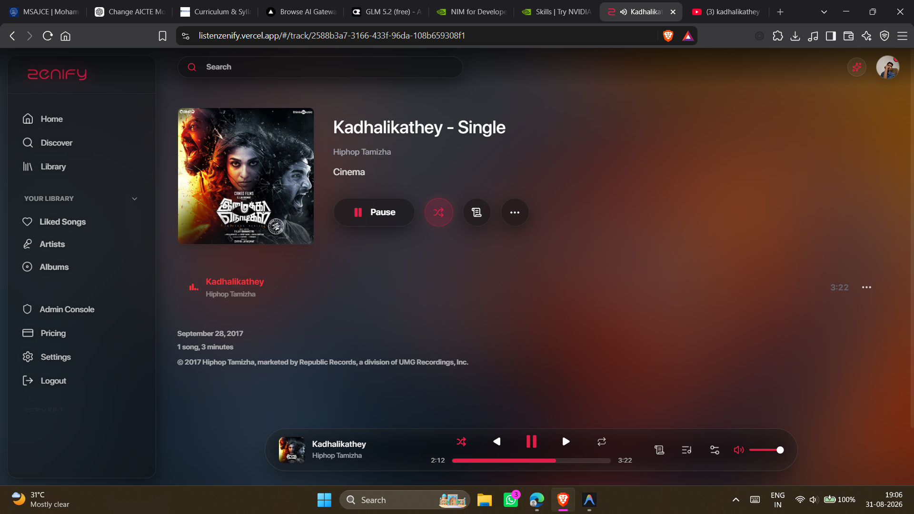
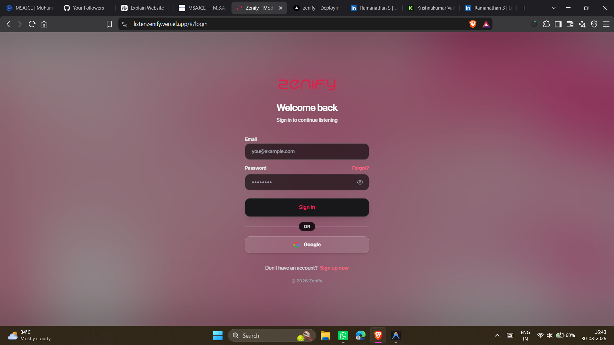
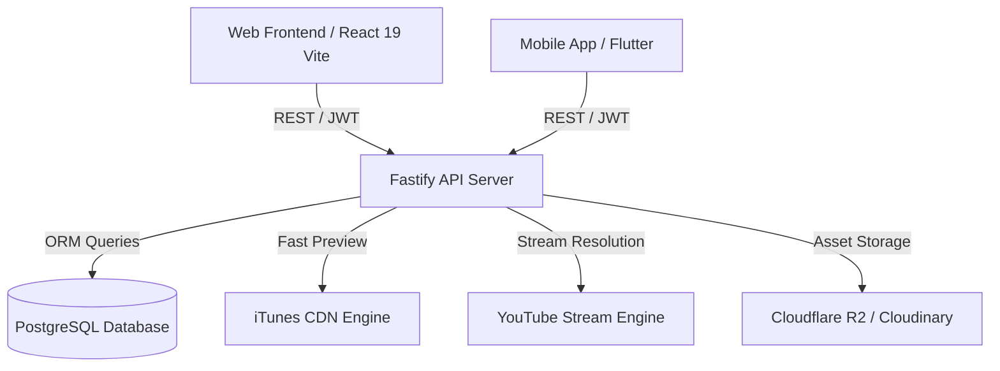

<div align="center">
  <br />
  <a href="https://listenzenify.vercel.app">
    
  </a>
  <br />
  <br />
  <h1>Zenify</h1>
  <p>
    <b>Open-source music streaming app with synced multilingual lyrics and a native Flutter companion app.</b><br/>
    <em>Fast audio stream resolution, synced lyrics for Tamil, Hindi, Tanglish & English, liquid glass UI, and background playback.</em>
  </p>

  <p>
    <a href="https://listenzenify.vercel.app"></a>
    <a href="https://github.com/hackerstudent29/Zenify"></a>
    <a href="https://github.com/hackerstudent29/Zenify/discussions"></a>
    <a href="CONTRIBUTING.md"></a>
    <a href="LICENSE"></a>
    
    
    
    
    
  </p>

  <p>
    <em>Crafted by <a href="https://github.com/hackerstudent29"><b>hackerstudent29</b></a>.</em>
  </p>
</div>

---

> **Disclaimer:** Zenify is a personal, educational open-source project built for music enthusiasts to study audio processing pipelines, Web Audio visualizers, and multilingual lyric synchronization. It is not affiliated with or intended as a commercial replacement for any commercial streaming service.

---

## ⚡ Project Overview

**Zenify** is an open-source web and mobile music player designed with a focus on **synchronized multilingual lyrics** and a responsive **glassmorphic design system**. Most audio platforms work well for standard English tracks but struggle with regional languages, romanized lyrics (Tanglish, Hinglish), or instrumental sections. Zenify pairs a fast React 19 web frontend with a native Flutter Android app and a TypeScript/Fastify backend to provide a seamless audio experience.

---

## ✨ Key Features & Capabilities

### 🎤 Synchronized Multilingual Lyrics
* **Multilingual Phrasing Support:** Sub-second synchronized timestamps (`[mm:ss.xx]`) tuned for English, Tamil, Tanglish, Hindi, and Malayalam songs.
* **Instrumental Gap Protection:** Automatically recognizes non-vocal sections (`[Guitar Solo]`, `[BGM]`, `[Outro]`) to prevent line-stretching during long instrumental passages.
* **Lyrics Studio:** Interactive Karaoke Painter view, segment adjustments, and time-shift offset controls.

### 🎧 Dual-Buffer Audio Engine & Stream Resolution
* **Direct Audio Resolution:** Instant stream lookup via iTunes CDN AAC streams for rapid start-up playback.
* **Stream Fallback & Range Seeking:** HTTP 206 Partial Content range seeking via `/stream-youtube` proxy with stream container header preservation (`ftyp`/`EBML`) for seamless HTML5 `<audio>` demuxing.
* **Dual-Buffer Crossfade:** Isolated dual HTML5 `<audio>` elements for zero-gap track transitions.

### 📱 Native Flutter Mobile Application
* **Glassmorphic Floating Player:** Translucent floating miniplayer with real-time blur (`BackdropFilter`).
* **3D Flip Card:** 90-degree 3D card flip between album art and synced scrolling lyrics.
* **Offline Local Music Player:** Native device file scanner for playing local audio files.
* **Android AudioService Integration:** System notification controls, lock-screen media widget, and Bluetooth media keys.

### 🛡️ Clean Full-Stack Architecture
* **Fastify & Prisma ORM:** High-throughput TypeScript backend powered by Prisma ORM and PostgreSQL.
* **Cloud Storage & Streaming:** Cloudflare R2 bucket integration for audio asset hosting with duration-based safety caps.
* **Security & Auth:** Secure JWT with refresh token rotation, Zod input validation schemas, and rate-limiting guards.

---

## 📸 Interface Showcase & Gallery

<div align="center">

### 🎵 Main Home Dashboard & Glass Miniplayer


<br/>

| 🎤 AI Synchronized Lyrics | 🔮 Fullview Ambient Aura Player |
| :---: | :---: |
|  |  |

<br/>

| 🌟 Artist Spotlight & Discography | 📜 Tamil & Multi-Lingual Lyrics Drawer |
| :---: | :---: |
|  |  |

<br/>

| 🎧 Track Page & Color Aura | 🔑 Secure Auth & Login Screen |
| :---: | :---: |
|  |  |

</div>

---


## 🏗️ System Architecture



---

## 💻 Tech Stack

| Domain | Technology | Purpose |
| :--- | :--- | :--- |
| 🌐 **Web Frontend** | `React 19`, `Vite`, `TypeScript`, `Zustand` | High-performance SPA with client-side routing & Web Audio Engine. |
| 📱 **Mobile App** | `Flutter (Dart)`, `Kotlin` | Cross-platform mobile app with background audio daemon. |
| 🎨 **UI / Styling** | `Tailwind CSS`, `Framer Motion`, `Lucide Icons` | Glassmorphism, liquid UI, color aura extraction. |
| 🚀 **Backend API** | `Fastify 5`, `TypeScript`, `Node.js` | High-performance API server with rate-limiting & security guards. |
| 🗄️ **Database** | `PostgreSQL`, `Prisma ORM` | Relational schema modeling and type-safe query building. |
| ☁️ **Audio & Storage** | `Cloudflare R2`, `Cloudinary` | Low-latency audio streaming & cover image hosting. |
| 🔒 **Security** | `Argon2/Bcrypt`, `JWT`, `Zod` | Encrypted passwords, token rotation, strict schema validation. |

---

## 🚀 Quick Start (Local Development)

### 1. Prerequisites
- Node.js 18+ & npm
- PostgreSQL database
- Flutter SDK (optional, for mobile build)

### 2. Backend Setup
```bash
cd backend
cp .env.example .env
npm install
npx prisma generate
npx prisma db push
npm run dev
```
Backend runs at `http://localhost:3000`.

### 3. Frontend Setup
```bash
cd ../frontend
cp .env.example .env
npm install
npm run dev
```
Web player runs at `http://localhost:5173`.

---

## 💖 Support the Developer & Sponsor Zenify (UPI)

**Zenify** is built with passion as a 100% free, ad-free, open-source audio streaming platform by a solo developer (**Ram / hackerstudent29**). 

Running and scaling Zenify requires recurring domain renewals, backend cloud server infrastructure, and relentless development hours. Beyond code, Ram relies on this project to support his family and maintain independent software engineering full-time.

If Zenify brought joy to your music experience, please consider sponsoring or sending a contribution to keep the project alive!

### 📱 Send Support via Indian UPI (GPay / PhonePe / Paytm / BHIM)
* **UPI ID:** `ramanathanb86@oksbi`
* **Supported Apps:** Google Pay (GPay), PhonePe, Paytm, BHIM, Amazon Pay, & all Indian Bank UPI apps.
* **Purpose:** Domain name renewals (`listenzenify.com`), server hosting fees, and supporting the developer's family.

> *"Every contribution—big or small—helps keep our servers running, pays for domain renewals, and supports a developer working hard to care for his family through open-source software."*

---

## 💼 Commercial Services & Consulting

Need a custom music streaming platform, AI audio synchronization tool, or high-performance Next.js application?

- 🌐 **Live Demo:** [listenzenify.vercel.app](https://listenzenify.vercel.app)
- 👨‍💻 **Developer:** [github.com/hackerstudent29](https://github.com/hackerstudent29)
- 💳 **UPI Sponsor ID:** `ramanathanb86@oksbi`

---

<div align="center">
  <b>Zenify</b> • Built with ❤️ by <a href="https://github.com/hackerstudent29"><b>hackerstudent29</b></a>
</div>

