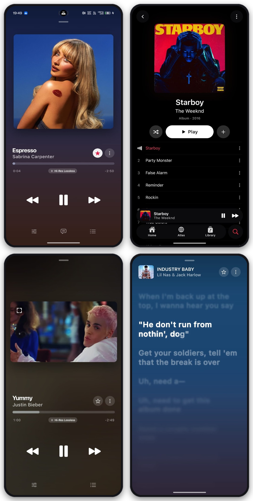
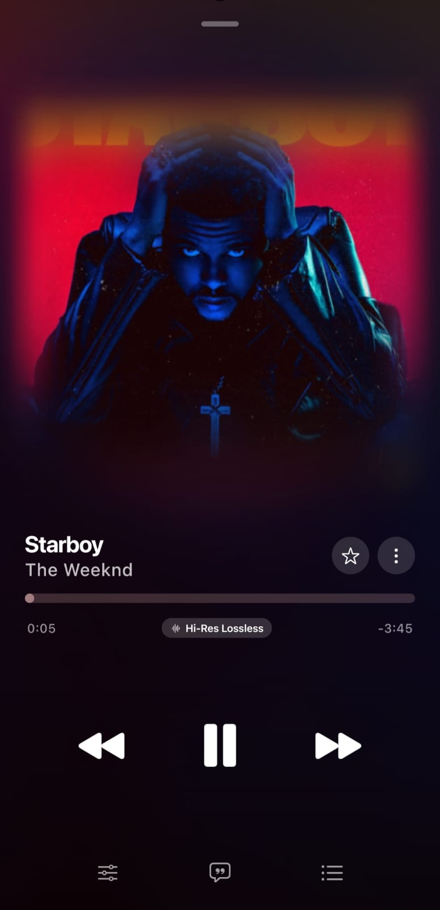
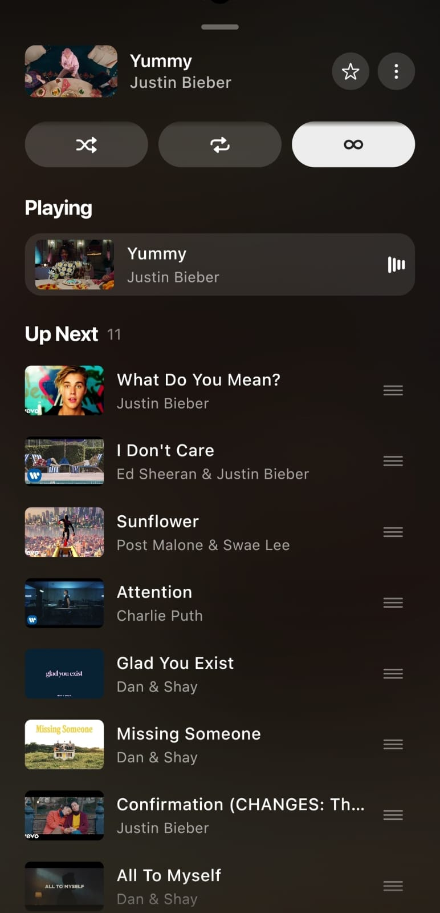
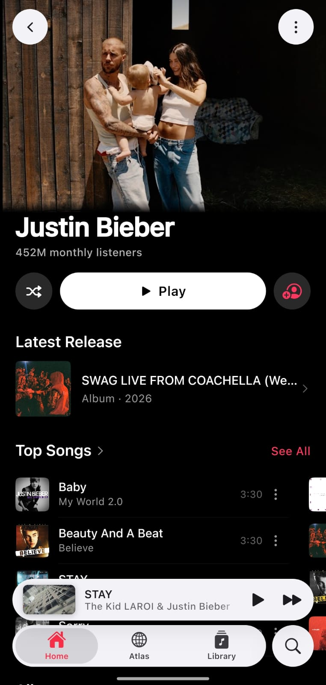
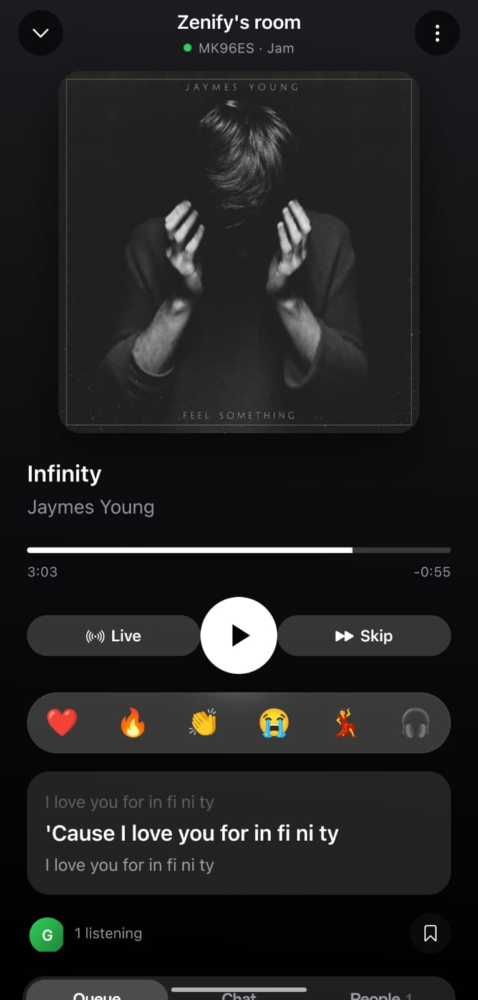
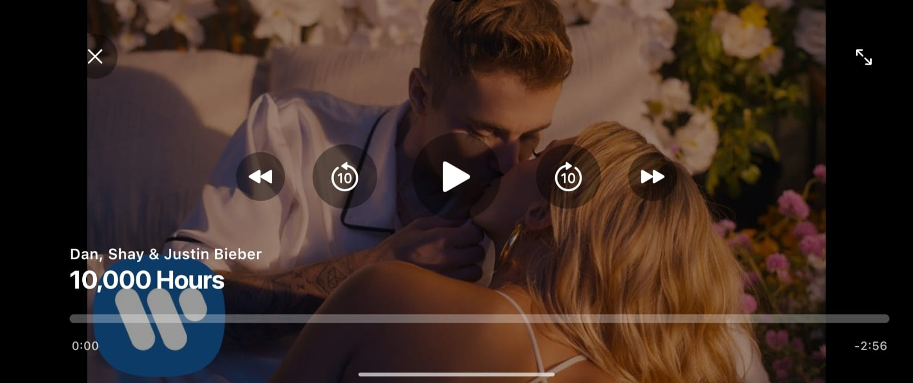

<div align="center">

  <br />

  <!-- Animated Zenify Brand Logo -->
  <a href="https://github.com/hackerstudent29/Zenify">
    
  </a>

  <br /><br />

  <!-- Accent Dot Matrix -->
  

  <h1 align="center" style="font-size: 32px; font-weight: 900; letter-spacing: -0.04em; margin-top: 14px; margin-bottom: 6px;">
    Zenify for Android &nbsp;•&nbsp; <span style="color: #FF375F;">Flutter</span> Native Audio Client
  </h1>

  <p align="center" style="font-size: 16px; font-weight: 700; color: #30D158; letter-spacing: 0.05em; text-transform: uppercase; margin-top: 0px;">
    ✦ Stable Version 1 Official Milestone ✦
  </p>

  <p align="center" style="max-width: 820px; font-size: 15.5px; line-height: 1.65; color: #a1a1aa;">
    <b>Pristine 320kbps Akamai CDN &nbsp;•&nbsp; Hardware Media3 ExoPlayer DSP &nbsp;•&nbsp; 20-Style DJ Crossfade &nbsp;•&nbsp; Strictly Zero Ads</b><br />
    An open-source high-fidelity mobile music & video streaming platform crafted with <b>Flutter 3.44</b>, <b>Dart 3.12</b>, and native <b>Kotlin</b>.<br />
    Featuring Apple-grade fluid gesture physics, Liquid Glass Studio, real-time syllable-synced karaoke lyrics,<br />
    sub-15ms Room Together synchronized listening, and a hardware-accelerated 16:9 video texture engine.<br />
    <i>(Web player is in legacy sunset status; Zenify Android is our primary, full-featured client.)</i>
  </p>

  <br />

  <!-- High-Contrast Interactive CTA Buttons -->
  <p align="center">
    <span style="color: rgba(255,255,255,0.25); font-family: monospace; font-size: 18px;">+</span>
    &nbsp;&nbsp;&nbsp;
    <a href="https://github.com/hackerstudent29/Zenify/releases/download/v1.1.22/zenify-v1.1.22.apk">
      
    </a>
    &nbsp;&nbsp;&nbsp;
    <a href="https://github.com/hackerstudent29/Zenify/releases/tag/v1.1.22">
      
    </a>
    &nbsp;&nbsp;&nbsp;
    <span style="color: rgba(255,255,255,0.25); font-family: monospace; font-size: 18px;">+</span>
  </p>

  <p align="center">
    <code>Android 8.0+ (ARM64-v8a & Universal)</code> &nbsp;•&nbsp; 
    <code>Tested on Android 8 to 15</code> &nbsp;•&nbsp; 
    <code>100% Free & Open Source (MIT)</code>
  </p>

  <br />

  <!-- Signature Rose Spec Capsules -->
  <p align="center">
    
    &nbsp;
    
    &nbsp;
    
    &nbsp;
    
    &nbsp;
    
    &nbsp;
    
  </p>

  <br />

  <!-- Main 4-Screen Hero Showcase -->
  <p align="center">
    
  </p>
  <p align="center">
    <sub><b>Now Playing (Hi-Res Lossless)</b> &nbsp;•&nbsp; <b>Album &amp; Floating Dock</b> &nbsp;•&nbsp; <b>16:9 Video Single Player</b> &nbsp;•&nbsp; <b>Syllable-Synced Karaoke Lyrics</b></sub>
  </p>

  <br />

</div>

---

> [!IMPORTANT]
> **Zenify v1.1.22 (Build 2036) is now available for Android.**  
> Features the new Zendrum instrument branding across Android app icons & transparent rose favicons, fixed Media3 `1.9.2` `LoadControl` audio/video playback stability, plain static Full Lyrics with dock/miniplayer preservation across Lyrics, Credits, and Artist pages, soundtrack album metadata upgrades, and disconnected web AI/R2 keys with **strictly zero ads and zero subscriptions**.

---

## 📱 Inside Zenify — Visual Feature Tour

<table width="100%">
  <tr>
    <td width="33.3%" align="center" valign="top">
      
      <br /><br />
      <b>Bleed Artwork Player</b><br />
      <sub>Zenify features soft-feathered edge-bleeding artwork that melts album covers smoothly into the player canvas, paired with Hi-Res Lossless playback.</sub>
    </td>
    <td width="33.3%" align="center" valign="top">
      
      <br /><br />
      <b>Studio FX &amp; Parametric EQ</b><br />
      <sub>Zenify includes a real-time native audio engine with a 36-band spectrum visualizer, Bass/Mid/Treble EQ, Warmth, Filter, Spatial 8D, and Night Mode.</sub>
    </td>
    <td width="33.3%" align="center" valign="top">
      
      <br /><br />
      <b>20-Style DJ Crossfade Engine</b><br />
      <sub>Zenify lets you preview and customize 20 handcrafted DJ transitions (Auto, Smooth, Bass Swap, Tape Stop, Vinyl Brake) with a live transition curve.</sub>
    </td>
  </tr>
  <tr>
    <td width="33.3%" align="center" valign="top">
      
      <br /><br />
      <b>Smart Queue &amp; Infinite Autoplay</b><br />
      <sub>Zenify gives you a drag-to-reorder Up Next queue with Shuffle, Repeat, and Infinite Autoplay that keeps similar tracks queued automatically.</sub>
    </td>
    <td width="33.3%" align="center" valign="top">
      
      <br /><br />
      <b>Sound Atlas 3D Globe</b><br />
      <sub>Zenify lets you spin an interactive 3D globe across 177 countries and 76 cities to discover trending regional music and global charts.</sub>
    </td>
    <td width="33.3%" align="center" valign="top">
      
      <br /><br />
      <b>Liquid Glass Studio</b><br />
      <sub>Zenify includes a live Glass Customizer to switch between Liquid, Clear, and Frosted glass styles with real-time Blur and Transparency sliders.</sub>
    </td>
  </tr>
  <tr>
    <td width="33.3%" align="center" valign="top">
      
      <br /><br />
      <b>Rich Artist Pages</b><br />
      <sub>Zenify showcases artist headers, monthly listeners, Latest Releases, and Top Songs while keeping your MiniPlayer and floating Dock persistent.</sub>
    </td>
    <td width="33.3%" align="center" valign="top">
      
      <br /><br />
      <b>Offline Downloads Manager</b><br />
      <sub>Zenify supports fast multi-threaded offline downloads with separate Songs and Music Videos tabs, local search, and full playback without internet.</sub>
    </td>
    <td width="33.3%" align="center" valign="top">
      
      <br /><br />
      <b>Zero-Friction Onboarding</b><br />
      <sub>Zenify lets you sign in with Google, Email, or jump straight in with Guest Mode — no mandatory account or tracking required.</sub>
    </td>
  </tr>
  <tr>
    <td width="33.3%" align="center" valign="top">
      
      <br /><br />
      <b>Room Together Hub</b><br />
      <sub>Zenify lets you host or join DJ &amp; Jam Sessions via room code, with quick access to Sound Insights and Achievements.</sub>
    </td>
    <td width="33.3%" align="center" valign="top">
      
      <br /><br />
      <b>Custom Listening Rooms</b><br />
      <sub>Zenify lets hosts customize room artwork, participant limits, public or password access, approval mode, duration timers, and Co-host roles.</sub>
    </td>
    <td width="33.3%" align="center" valign="top">
      
      <br /><br />
      <b>Live Synchronized Jam</b><br />
      <sub>Zenify keeps friends in sub-15ms playback sync with live voice, emoji reactions, synced lyrics, room chat, and participant controls.</sub>
    </td>
  </tr>
</table>

<table width="100%">
  <tr>
    <td width="33.3%" align="center" valign="top">
      
      <br /><br />
      <b>90° Landscape Player Mode</b><br />
      <sub>Zenify rotates smoothly into a dual-pane landscape player with album art on the left and scrubber, controls, and volume slider on the right.</sub>
    </td>
    <td width="33.3%" align="center" valign="top">
      
      <br /><br />
      <b>Landscape Live Lyrics</b><br />
      <sub>Zenify pairs full-height album artwork with real-time syllable-synced karaoke lyrics side by side in widescreen landscape mode.</sub>
    </td>
    <td width="33.3%" align="center" valign="top">
      
      <br /><br />
      <b>Fullscreen 16:9 Video Theater</b><br />
      <sub>Zenify plays hardware-accelerated 16:9 music videos in fullscreen landscape with ±10s skip controls, double-tap seeking, and fit/fill zoom.</sub>
    </td>
  </tr>
</table>

---

## ⚡ Feature Highlights at a Glance

<table width="100%">
  <tr>
    <td width="50%" valign="top">
      <h3><span style="color: #FF375F;">◈</span> 320kbps Akamai CDN Audio</h3>
      Direct pristine stream resolution from Akamai CDN edge servers. <b>Strict anti-snippet policy:</b> zero 30-second previews. Every song plays in full master quality with low-latency PCM buffer decoding.
    </td>
    <td width="50%" valign="top">
      <h3><span style="color: #BF5AF2;">◈</span> 20-Style Hardware DJ Crossfade</h3>
      Dual synchronized ExoPlayer pipeline in native Kotlin (<code>XfFxProcessor.kt</code>). Seamlessly blend songs with 20 distinct DJ transitions: <i>Bass Swap, Stutter Gate, Tape Stop, Vinyl Brake, Slam Cut</i>, and more.
    </td>
  </tr>
  <tr>
    <td width="50%" valign="top">
      <h3><span style="color: #0A84FF;">◈</span> Syllable-Synced Karaoke Lyrics</h3>
      Dual-provider parallel racing (<code>lrc.red</code> + <code>lrclib.net</code>) under 300ms. Features real-time glowing word cursors, automated instrumental countdown dots (<code>• • •</code>), and romanization for non-Latin scripts.
    </td>
    <td width="50%" valign="top">
      <h3><span style="color: #30D158;">◈</span> Room Together Voice Sync</h3>
      Sub-15ms multi-device clock synchronization for listening with friends anywhere globally. Includes integrated ultra-low-latency <b>LiveKit WebRTC spatial voice chat</b> and interactive host/DJ roles.
    </td>
  </tr>
  <tr>
    <td width="50%" valign="top">
      <h3><span style="color: #FF9F0A;">◈</span> Hardware 16:9 Video Engine</h3>
      Zero-overhead native Android <code>SurfaceTexture</code> hardware video rendering. Enjoy authentic 16:9 landscape previews in search, queue, and dedicated video single views with seamless background playback.
    </td>
    <td width="50%" valign="top">
      <h3><span style="color: #FF453A;">◈</span> Studio FX DSP & 8D Spatial Audio</h3>
      3-band parametric hardware equalizer, 360° orbital spatial audio rotation, real-time loudness normalization (-14 LUFS), acoustic reverb spaces (Warehouse & Cathedral), and $(L+R)/2$ mono downmixing.
    </td>
  </tr>
  <tr>
    <td width="50%" valign="top">
      <h3><span style="color: #5E5CE6;">◈</span> Multi-Threaded Offline Downloader</h3>
      Chunked parallel range downloader bypassing CDN rate-limits. Bundles high-bitrate audio (<code>.m4a</code>), high-resolution artwork (<code>.jpg</code>/<code>.webp</code>), and synced lyrics (<code>.lrc</code>) with Wi-Fi Only protection.
    </td>
    <td width="50%" valign="top">
      <h3><span style="color: #64D2FF;">◈</span> Liquid Glass Studio & Pure OLED</h3>
      Live Apple Glass customization playground with real-time blur, specular rim lighting, and chromatic dispersion. Includes Pure OLED <code>#000000</code> Blackout Mode to turn off AMOLED pixels and save battery.
    </td>
  </tr>
</table>

---

## 📊 Zenify vs Commercial Music Platforms

| Capability / Feature | 🌸 **Zenify v1.1.22** | 🟢 Spotify Free | 🍎 Apple Music | 🔴 YouTube Music Free |
|---|:---:|:---:|:---:|:---:|
| **Cost & Subscription** | **100% Free Forever** | Ad-Supported ($11.99/mo) | $10.99/month | Ad-Supported ($10.99/mo) |
| **Advertisements** | **Strictly ZERO Ads** | Audio & Banner Ads | None (Paid) | Video & Audio Ads |
| **Streaming Quality** | **Pristine 320 kbps (Akamai)** | 160 kbps (Capped) | 256 kbps AAC (Paid) | 128 kbps (Capped) |
| **DJ Crossfade Engine** | **20 Handcrafted Styles** | 1 Basic Linear Style | Basic Crossfade | None |
| **Syllable Karaoke Lyrics** | **Sub-300ms Word-by-Word** | Basic / Delayed | Line-by-Line (Paid) | Static / Line-by-Line |
| **Multi-Language Romanization** | **Built-In (Kanji, Hangul, Indic)** | None | Limited | None |
| **16:9 Video Engine** | **Hardware SurfaceTexture** | None | Music Videos (Paid) | Video Ads / Screen Lock |
| **Background Video Playback** | **Included (Screen Off)** | None | None | Blocked Behind Paywall |
| **Social Listening & Voice** | **Sub-15ms + WebRTC Voice** | Jam (Paid Only) | SharePlay (Apple Only) | None |
| **Offline Media Download** | **Full Audio + Art + Synced LRC** | Blocked Behind Paywall | Paid Subscription Only | Blocked Behind Paywall |
| **Hardware Equalizer & 8D Audio** | **3-Band Parametric + 8D Orbit** | Basic Preset EQ | System EQ Only | Basic Preset EQ |
| **Account / Login Requirement** | **Zero (Open & Play)** | Mandatory Account | Mandatory Apple ID | Mandatory Google Account |
| **Data Privacy & Telemetry** | **Zero Tracking / Zero Telemetry** | User Behavioral Tracking | Telemetry Collected | Google Ad Profiling |

---

## 📋 Android Specifications

<table width="100%">
  <thead>
    <tr style="background: rgba(255,255,255,0.05);">
      <th align="left" width="30%">Specification Field</th>
      <th align="left" width="70%">Technical Value / Parameter</th>
    </tr>
  </thead>
  <tbody>
    <tr>
      <td><b>Application Name</b></td>
      <td><code>Zenify</code></td>
    </tr>
    <tr>
      <td><b>Package Identifier</b></td>
      <td><code>com.zenify.mobile</code></td>
    </tr>
    <tr>
      <td><b>Release Milestone</b></td>
      <td><b>v1.1.22</b></td>
    </tr>
    <tr>
      <td><b>Build Number</b></td>
      <td><code>2036</code></td>
    </tr>
    <tr>
      <td><b>Mobile Framework</b></td>
      <td>Flutter 3.44.2 / Dart 3.12.0</td>
    </tr>
    <tr>
      <td><b>Native Platform Subsystem</b></td>
      <td>Kotlin 2.0.21 / Android JVM 17</td>
    </tr>
    <tr>
      <td><b>Media Engine Core</b></td>
      <td>AndroidX Media3 ExoPlayer 1.9.2 with Custom 16-bit PCM AudioProcessor</td>
    </tr>
    <tr>
      <td><b>Minimum Supported OS</b></td>
      <td><b>Android 8.0 (API Level 26 - Oreo)</b> &nbsp;•&nbsp; <i>Covers 96%+ of active Android devices globally</i></td>
    </tr>
    <tr>
      <td><b>Target Supported OS</b></td>
      <td><b>Android 15 (API Level 35 - Vanilla Ice Cream)</b></td>
    </tr>
    <tr>
      <td><b>ARM64 Optimized Split APK</b></td>
      <td><b>16.2 MB</b> (<code>17,008,287</code> bytes) &nbsp;•&nbsp; <i>Recommended for all modern smartphones</i></td>
    </tr>
    <tr>
      <td><b>Universal Multi-ABI APK</b></td>
      <td><b>36.8 MB</b> (<code>38,635,649</code> bytes) &nbsp;•&nbsp; <i>Supports arm64-v8a, armeabi-v7a, and x86_64</i></td>
    </tr>
    <tr>
      <td><b>Supported Bitrate Profiles</b></td>
      <td>320 kbps (Pristine HQ), 160 kbps (Opus), 128 kbps (AAC), 70 kbps (Data Saver)</td>
    </tr>
    <tr>
      <td><b>Video Surface Technology</b></td>
      <td>Hardware <code>SurfaceTexture</code> / <code>TextureRegistry</code> (360p, 480p, 720p, 1080p, 4K 60fps)</td>
    </tr>
    <tr>
      <td><b>Typography</b></td>
      <td>Bundled offline Apple <code>SF Pro Display</code> & <code>SF Pro Text</code> (Zero runtime font downloads)</td>
    </tr>
    <tr>
      <td><b>License</b></td>
      <td><b>Free & Open Source (MIT License)</b></td>
    </tr>
  </tbody>
</table>

---

## ⚡ System Requirements & Performance Footprint

### Hardware & OS Compatibility Matrix

| Hardware Spec | Minimum Requirement (To Run App) | Recommended (Optimal Experience) |
|---|---|---|
| **Android Version** | **Android 8.0 (Oreo / API 26)** | **Android 12 to Android 15 (API 31–35)** |
| **RAM** | **2 GB RAM** | **4 GB RAM or higher** |
| **Free Storage Space** | **100 MB** *(App binary + SQLite index)* | **1 GB – 3 GB+** *(For offline media & HD videos)* |
| **Processor (CPU)** | Quad-Core 1.5 GHz (ARM64-v8a or ARMv7) | Octa-Core 2.0 GHz+ (Snapdragon, MediaTek, Tensor, Exynos) |
| **Display Resolution**| HD (720 × 1280 pixels) | FHD+ (1080 × 2400 pixels) or higher |
| **Display Refresh Rate**| Standard 60 Hz | 90 Hz / 120 Hz ProMotion high-refresh panels |
| **Network (Streaming)**| 1.5 Mbps (3G / 4G / Wi-Fi) | 5–10 Mbps+ (4G LTE / 5G / High-Speed Wi-Fi) |
| **Offline Playback** | None (0 KB/s — Works 100% offline) | None |

### Real-World Resource Profiling

* **RAM Budget**:
  * **Idle & Background Audio**: Consumes only **85 MB to 140 MB of RAM** while streaming 320kbps audio with the native DSP Studio FX pipeline active.
  * **Video Texture & Room Together**: Uses approximately **180 MB to 260 MB of RAM** during concurrent 1080p video rendering and LiveKit WebRTC spatial voice chat.
  * **Hardware Offload**: ExoPlayer delegates audio demuxing and hardware video decoding directly to Android's native `MediaCodec` pipeline, avoiding garbage collection pauses in Flutter.
* **Storage Footprint**:
  * **App Installation**: **~45 MB – 65 MB** (app binary + SQLite index).
  * **Downloaded Song**: **~3 MB to 6 MB** per track (`.m4a` / 320kbps).
  * **100 Downloaded Tracks**: **~400 MB to 550 MB** of storage.
  * **Streaming Buffer Cache**: Auto-capped at **250 MB** by default (customizable between 100 MB to 1.0 GB in *Settings → Storage Management*).

---

## 🌟 360° Comprehensive Deep Dive

### 1. 🎵 Pristine Audio Architecture & Anti-Snippet Policy
* **Zero 30-Second Previews**: Zenify enforces a strict architectural ban on iTunes or promotional 30-second snippets (`mzstatic`, Apple preview URLs). Every track resolves to full-length master streams via pristine 320kbps Akamai CDN edges or unhindered YouTube full-audio streams.
* **Dual-ExoPlayer Overlap**: Coordinated in native Kotlin (`ZenAudioPlugin.kt`), two synchronized ExoPlayer instances (`player` and `fadePlayer`) run in parallel for zero-gap playback, instant pre-warming, and smooth overlapping crossfades.
* **Selectable Bitrate Profiles**:
  * **320 kbps (Lossless / Pristine Akamai CDN)**: Master-grade acoustic fidelity with deep bass impact and pristine vocal definition.
  * **160 kbps (Opus)**: Perceptually transparent streaming at half the bandwidth.
  * **128 kbps (AAC)**: Standard mobile streaming efficiency.
  * **70 kbps (Data Saver)**: Ultra-efficient streaming for low-reception areas or metered mobile networks.
* **Real-Time Volume Normalization (-14 LUFS)**: Automatically scales linear gain ($\text{gain} = 10^{-\text{loudnessDb}/20}$) using incoming loudness metadata, preventing volume spikes between tracks recorded across different eras.
* **Stereo-to-Mono Downmixer**: Accessibility-focused $(L + R) / 2$ audio downmix so listeners using a single earbud never lose panned instruments, guitar licks, or backing vocals.

---

### 2. 🎛️ 20-Style Hardware DJ Crossfade Engine
Engineered directly in native Kotlin (`XfFxProcessor.kt`) and synchronized via Flutter's `CrossfadeController`, transitions between songs can be customized with 20 distinct DJ transition styles:

<details open>
<summary><b>▶ Click to Expand the 20 DJ Crossfade Styles Directory</b></summary>
<br />

| Category | Transition Name | Acoustic Mechanics & Audible Transition Profile |
|---|---|---|
| **Auto** | `Auto Intelligent Blend` | Analyzes BPM, energy, silence, and musical key of outgoing and incoming tracks to automatically choose the best transition curve |
| **Classic** | `Smooth Crossfade` | Equal-power logarithmic volume crossfade maintaining uniform acoustic loudness |
| | `Classic Linear` | Symmetrical linear volume taper between outgoing and incoming audio streams |
| | `Cinematic S-Curve` | Smooth sigmoidal curve with gentle lead-in and gradual exponential fade-out |
| | `Fade Through Dip` | Clean momentary volume dip to silence between songs for dramatic pacing |
| **DJ Blend** | `DJ Blend` | Club DJ blend with gradual high-frequency wash and smooth tempo matching |
| | `Bass Swap` | Cuts bass on outgoing track at midpoint with a resonant -30 dB low-shelf drop while instantly kicking in the incoming bassline |
| | `Filter Sweep` | Sweeps outgoing track through a resonant low-pass filter while opening the incoming track with a high-pass sweep |
| | `Stutter Gate` | Tempo-synced 8th-note audio chopping across the transition window |
| | `Slam Cut` | Instant zero-fade beat drop on the downbeat of the next track |
| | `Riser` | Pitched snare roll riser build leading directly into the incoming drop |
| **Production** | `R&B Glide` | Smooth pitch-glide transition creating a seamless vinyl-style vocal blend |
| | `Echo Out` | Freezes outgoing audio into a tempo-synced delay feedback tail |
| | `Reverb Wash` | Outgoing song washes out into a lush cathedral reverb tail as the next begins |
| | `Tape Stop` | Simulates an authentic analog tape machine motor powering down |
| | `Vinyl Brake` | Emulates a turntable motor brake and tonearm scratch deceleration |
| | `Spin-Up` | Turntable motor spin-up from dead stop to full speed |
| | `Lo-Fi Dive` | Sample-rate bitcrusher hold and filter dive down to vintage 8-bit lofi textures |
| | `Jet Sweep` | Resonant jet flanger sweep across the overlapping transition window |
| | `Radio Tune` | Sweeps across vintage AM/FM analog dial static and frequencies |

</details>

* **Interactive Timeline Preview**: Test transitions between real song pairs on a live visualizer canvas in *Settings → Crossfade* (`CrossfadeStyleSection.dart`) before listening.
* **Duration Slider**: Fine-tune crossfade duration from **1 to 12 seconds** with smart silence skipping.

---

### 3. 🎚️ Hardware Studio FX & Audio Enhancement
* **Parametric Hardware EQ**: 3-band parametric hardware equalizer operating on 16-bit PCM buffers with Low Shelf (32Hz–250Hz), Peaking Mid (250Hz–4kHz), and High Shelf (4kHz–16kHz) with ±12 dB hardware gain adjustment.
* **Spatial 8D Audio Rotation**: Dynamic orbital simulator using ITD (Interaural Time Difference) and IID (Interaural Intensity Difference) panning around the listener's head with customizable rotation speed (0.05–1.0 Hz) and orbital direction (clockwise or counter-clockwise).
* **Acoustic Reverb Presets**: Warehouse (studio room acoustics) and Cathedral (spacious atmospheric decay) with adjustable wet/dry mix.
* **Drive & Warmth**: Analog tube saturation simulation for extra punch.
* **Stereo Width Widener & Delay**: Expand the acoustic soundstage or add stereo echo with custom feedback timing.
* **Vocal Mode Processor**: Real-time vocal boost to enhance lyrics or vocal reduction for impromptu karaoke singing.
* **36-Band FFT Real-Time Spectrum**: Native 30 fps audio spectrum analyzer feeding real-time visualizer data to the player interface.

---

### 4. 🎤 Ultra-Fast Syllable-Synced Karaoke Lyrics
* **Sub-300ms Resolution**: Dual-provider parallel racing between `lrc.red` and `lrclib.net` resolves synchronized lyrics in under 300 milliseconds.
* **Word-by-Word Syllable Timing**: Highlights individual syllables and words in real-time as vocalists sing them with a smooth glowing karaoke cursor.
* **Automated Instrumental Countdown**: Displays clean 3-dot pulse indicators (`• • •`) with countdown timing during musical bridges and instrumental solos.
* **Multi-Language Romanization**: Integrated romanization for non-Latin scripts (Japanese, Korean, Hindi, Tamil, Telugu, and more) so you can sing along in any language.
* **Offline Lyrics Bundling**: Automatically downloads synced `.lrc` lyrics alongside audio tracks for 100% offline singing without internet access.
* **Manual Timing Offset Slider**: Adjust lyric synchronization on-the-fly (±5000 ms in 100 ms increments) to fix poorly timed community lyrics.
* **Full-Screen Lyrics Canvas**: Dedicated fluid lyrics modal sheet with dynamic color wash sampled from the current album art.

---

### 5. 🎬 Hardware-Accelerated 16:9 Video Engine
* **Native SurfaceTexture Rendering**: Allocates a native Android hardware texture (`TextureRegistry.SurfaceTextureEntry`) attached directly to ExoPlayer via `setVideoSurface()`, avoiding HTML or WebView overhead.
* **Authentic 16:9 Landscape Previews**: Video songs display authentic widescreen previews across search results, search history (`76x44`), playback queue (`76x48`), and dedicated Video Single views.
* **Background Audio Streaming**: Minimizing the app or turning off the screen seamlessly transitions video tracks to audio-only playback, conserving GPU battery and preventing playback stutter.
* **Multi-Resolution Video Selector**: Choose stream quality on-the-fly between 360p, 480p, 720p, 1080p, and 4K 60fps.
* **Fullscreen Theater Mode**: Double-tap to rotate, landscape mode, and pinch-to-fill controls.

---

### 6. 🔍 Pure YouTube Music Search Parity & Sound Atlas
* **Complete YouTube Music Parity**: Zero artificial filters. Search queries return complete, unmodified catalog parity across songs, video singles, verified artists, official albums, and community playlists.
* **Instant Live Autocomplete**: Real-time query suggestions as you type, backed by fast debounced caching.
* **Multi-Category Filter Chips**: Switch instantly between `All`, `Songs`, `Videos`, `Albums`, `Artists`, and `Playlists`.
* **YouTube Link Importer**: Paste any YouTube or YouTube Music song, video, playlist, or album link directly into search to stream or import it instantly into your library.
* **Sound Atlas (`AtlasScreen`)**: Visual universe exploration tool allowing listeners to discover music across genres, moods, historical eras, and regional sub-cultures.
* **Tap-to-Play Search History**: Tapping any previously searched track plays it immediately without triggering redundant search network requests.

---

### 7. 💎 Liquid Glass Studio & Apple Glass Aesthetic
* **Live Liquid Glass Studio (`GlassCustomizerScreen`)**: Customization playground to fine-tune blur radius, opacity, border reflection, and specular rim lighting with live background testing across Nature, City, Text, and Album grids.
* **Pure OLED Blackout Mode**: Disabling "Fluid Mesh Canvas" locks the player shell into absolute `#000000` black with zero color wash, turning off AMOLED pixels and maximizing battery life.
* **Harmonic Oscillator Springs**: Every modal sheet, card press, and gesture uses damped physical springs (`SpringDescription`) calibrated to Apple iOS gesture responsiveness.
* **Dynamic Island Header (`DynamicIslandHeader.dart`)**: Expandable floating header pill showing animated live waveform bars, current song title, audio bitrate badge (`320K`, `OPUS`, `AAC`), and video status.
* **Bundled Offline Typography**: Includes offline Apple `SF Pro Display` and `SF Pro Text` fonts, eliminating runtime Google Fonts network downloads and layout shifts.

---

### 8. 💾 Offline Download Manager & Wi-Fi Guardian
* **Parallel Multi-Threaded Chunk Downloader**: Bypasses GoogleVideo CDN 16 KB/s bandwidth throttling by requesting parallel 1 MB byte ranges across multiple concurrent worker threads, downloading full songs at wire speed.
* **Complete 3-in-1 Offline Bundle**: Concurrently downloads High-Bitrate Audio (`.m4a`), High-Resolution Album Artwork (`.jpg`/`.webp`), and Synced Lyrics (`.json`/`.lrc`) into persistent local storage.
* **Wi-Fi Only Guardian**: Detects active network transports via Android's `ConnectivityManager`. When toggled, cellular downloads are blocked automatically to preserve your mobile data plan.
* **Dual Library Tabs**: Independent library shelves for `Songs` and `Music Videos` with instant filtering.
* **Relational SQLite Database (`sqflite 2.4.5`)**: High-performance local database for custom playlists, favorites, play count counters, and offline media indexes.

---

### 9. 👥 Room Together (Real-Time Synchronized Listening)
* **Sub-15ms Multi-Device Clock Sync**: Listen to music with friends anywhere in the world with sub-15ms synchronized playback positions.
* **LiveKit WebRTC Voice Chat**: Ultra-low latency spatial voice chat channel built directly inside the listening room.
* **Interactive DJ Roles**: Host, Co-Host, DJ, and Guest permission tiers for queue additions, track skips, and room moderation.
* **Dynamic Room Themes**: Customize room atmosphere with presets including Midnight, Velvet, Neon, Sunset, Emerald, and Solar.
* **Floating Emoji Reactions**: Send animated floating emojis that react with real-time particle physics across all participants' screens.
* **PIN Protection**: Secure private rooms with custom passcodes.

---

### 10. 📊 Sound Insights, Replay & Social Story Sharing
* **Sound Insights & Weekly Digest (`ReplayScreen`)**: Track your weekly listening minutes, top played artists, favorite genres, and daily listening heatmaps.
* **Milestone Trophy Room**: Unlock achievements and badges as you listen (e.g., Night Owl, Genre Explorer, Century Club).
* **Private Listening Mode**: Toggle incognito listening to enjoy guilty pleasures without affecting your recommendation engine or history stats.
* **Story Card Exporter (`StoryService.dart`)**: Generate editorial Apple-style story cards for Instagram and WhatsApp featuring dynamic album art, lyric quotes, and a QR code linking directly to the song in Zenify.
* **Dedicate a Song**: Create personalized dedication cards with custom messages to share with friends.

---

### 11. 🛡️ Native Android System Integration & Privacy
* **Android 13+ MediaStyle Notifications**: Rich system notification with interactive seek scrub bar, album artwork, play/pause, skip forward/backward, and favorite toggle.
* **Lock-Screen & Bluetooth AVRCP**: Full playback control and metadata synchronization on car head units, smartwatches, and Bluetooth headphones.
* **Headphone Unplug Detection**: Automatically pauses playback when headphones are disconnected and resumes smoothly upon reconnect.
* **Sleep Timer**: Schedule automatic playback pause after 15m, 30m, 45m, 1h, at the end of the current track, or via a custom timer with a gentle audio fade-out.
* **Zero Telemetry & 100% Ad-Free**: Strictly zero advertisements, zero promotional popups, zero background tracking SDKs, and no phone numbers or personal data required.

---

## ⬇️ Download & Installation for Android

### Release Packages (v1.1.22 · Build 2036)

<table width="100%">
  <thead>
    <tr style="background: rgba(255,255,255,0.05);">
      <th align="left">Package</th>
      <th align="left">Target Device & Architecture</th>
      <th align="center">File Size</th>
      <th align="right">Download Link</th>
    </tr>
  </thead>
  <tbody>
    <tr>
      <td><b>🤖 Android ARM64 (Recommended)</b></td>
      <td>ARM64-v8a · <i>Pixel, Galaxy, OnePlus, Xiaomi, Nothing, Vivo, OPPO, Motorola</i></td>
      <td align="center"><code>16.2 MB</code></td>
      <td align="right"><a href="https://github.com/hackerstudent29/Zenify/releases/download/v1.1.22/zenify-v1.1.22.apk"><b>⬇️ Download APK</b></a></td>
    </tr>
    <tr>
      <td><b>🌐 Android Universal</b></td>
      <td>All Architectures (`arm64-v8a`, `armeabi-v7a`, `x86_64`) · <i>Works on all Android devices & emulators</i></td>
      <td align="center"><code>36.8 MB</code></td>
      <td align="right"><a href="https://github.com/hackerstudent29/Zenify/releases/download/v1.1.22/zenify-v1.1.22-universal.apk"><b>⬇️ Download Universal</b></a></td>
    </tr>
    <tr>
      <td><b>📦 All GitHub Releases</b></td>
      <td>Release history, changelogs, and SHA-256 integrity checksums</td>
      <td align="center"><code>Build 2036</code></td>
      <td align="right"><a href="https://github.com/hackerstudent29/Zenify/releases"><b>View Releases</b></a></td>
    </tr>
  </tbody>
</table>

<br />

### 📱 Android Installation Steps

<table width="100%">
  <tr>
    <td width="25%" align="center">
      <h3>1️⃣ Download</h3>
      <p>Tap <a href="https://github.com/hackerstudent29/Zenify/releases/download/v1.1.22/zenify-v1.1.22.apk"><b>Download APK</b></a> on your phone to fetch the ARM64 package.</p>
    </td>
    <td width="25%" align="center">
      <h3>2️⃣ Open Package</h3>
      <p>Tap the download notification or locate <code>zenify-v1.1.22.apk</code> in your <b>Downloads</b> folder.</p>
    </td>
    <td width="25%" align="center">
      <h3>3️⃣ Allow Source</h3>
      <p>If prompted with <i>"Install unknown apps"</i>, tap <b>Settings</b> and toggle <b>Allow from this source</b>.</p>
    </td>
    <td width="25%" align="center">
      <h3>4️⃣ Launch & Enjoy</h3>
      <p>Tap <b>Install</b>, launch Zenify, and enjoy 100% ad-free 320kbps music streaming!</p>
    </td>
  </tr>
</table>

---

## 💻 Developer Setup & Local Build Instructions

### Prerequisites
* [Flutter SDK](https://docs.flutter.dev/) (tested with **Flutter 3.44.2**)
* [Dart SDK](https://dart.dev/) (tested with **Dart 3.12.0**)
* Android Studio / VS Code with Flutter extension
* Android SDK (API 26 / Android 8.0 or higher)

### Setup & Local Execution

```bash
# 1. Clone repository
git clone https://github.com/hackerstudent29/Zenify.git
cd Zenify/mobile

# 2. Fetch Flutter packages
flutter pub get

# 3. Verify code quality
flutter analyze lib/

# 4. Run unit and pipeline test suites
flutter test test/search_pipeline_test.dart

# 5. Launch on connected Android device or emulator
flutter run
```

### Compiling Release APKs

```bash
# Build optimized release APK (Universal)
flutter build apk --release

# Build architecture-split release APKs (ARM64, ARMv7, x86_64)
flutter build apk --split-per-abi --release
```

The compiled binaries will be output to:
* `mobile/build/app/outputs/flutter-apk/app-release.apk` (Universal)
* `mobile/build/app/outputs/flutter-apk/app-arm64-v8a-release.apk` (ARM64 Optimized, ~16.2 MB)

---

## 🌐 Note on the Web Player

> [!NOTE]
> The browser-based web player at [listenzenify.vercel.app](https://listenzenify.vercel.app) is currently in **sunset / legacy status** due to browser audio engine constraints, mobile background playback restrictions, and ISP/CORS stream blockages. All ongoing active feature development, hardware DSP processing, and 16:9 video enhancements are dedicated to the **Zenify Android Flutter application**.

---

## 🛡️ License & Trademarks

Zenify is open-source software licensed under the **[MIT License](file:///d:/Zenify/LICENSE)**.  
All brand elements, icons, and custom Flutter widgets are part of the Zenify Music Project. Third-party open-source components are licensed under their respective MIT, Apache 2.0, and BSD licenses.

<div align="center">
  <sub>Built with ❤️ using Flutter, Dart & Kotlin for music lovers across the globe.</sub>
</div>
