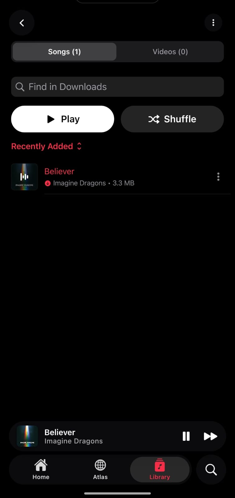
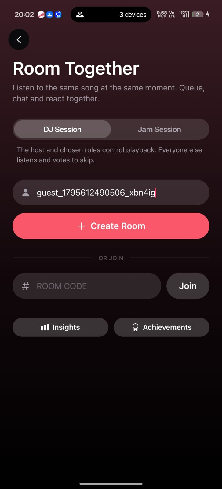
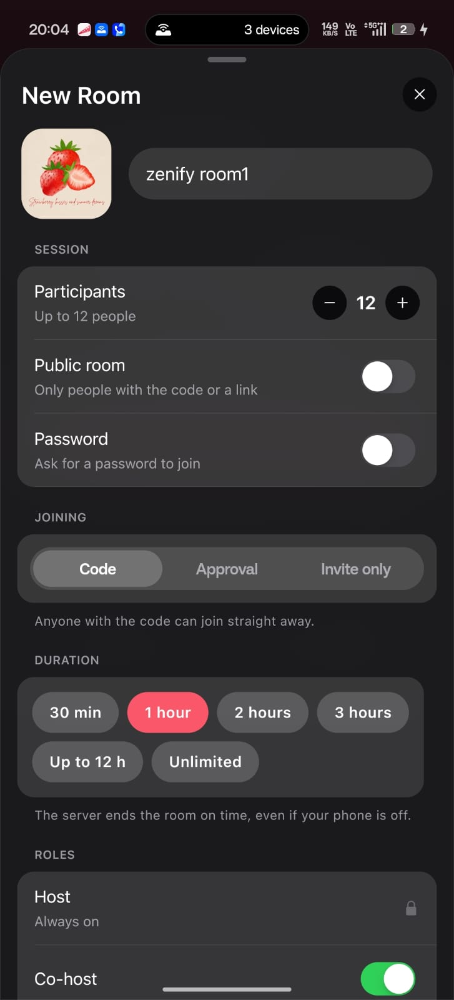
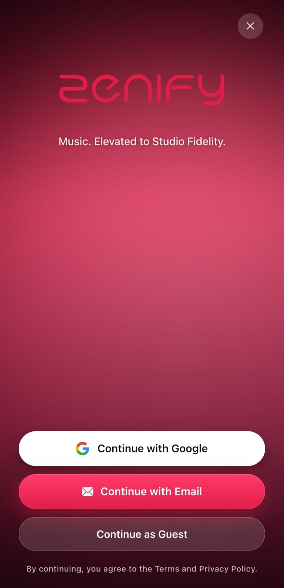
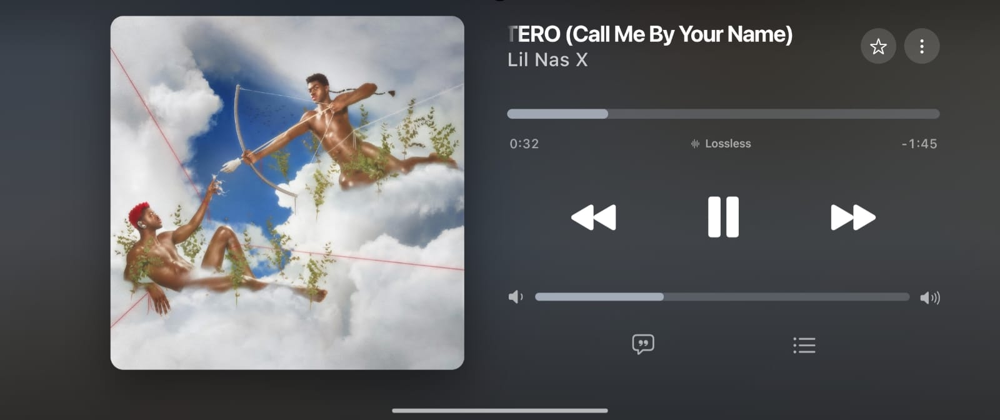
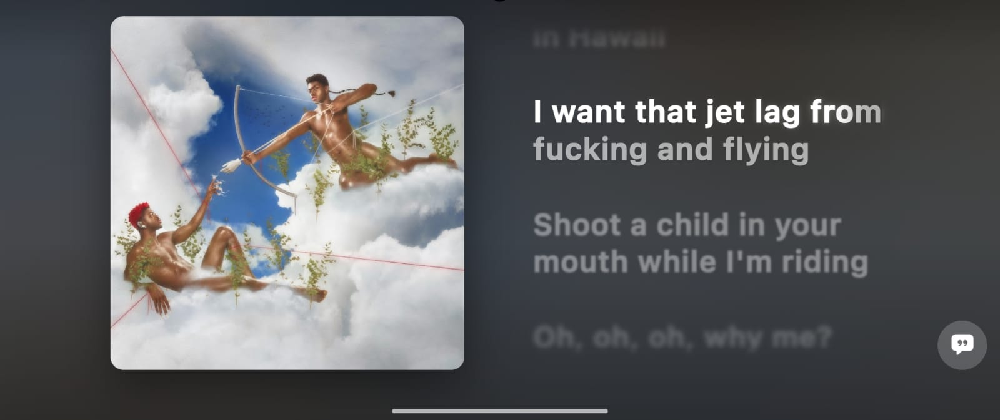

<div align="center">

  <br />

  <!-- Animated Zenify Brand Logo -->
  <a href="https://github.com/hackerstudent29/Zenify">
    
  </a>

  <br /><br />

  <!-- Accent Dot Matrix -->
  

  <h1>Zenify for Android</h1>

  <p><b>320kbps Master Audio &nbsp;•&nbsp; 20-Style DJ Crossfade &nbsp;•&nbsp; Synced Lyrics &nbsp;•&nbsp; 16:9 Music Videos &nbsp;•&nbsp; Strictly Zero Ads</b></p>

  <p>
    An open-source, high-fidelity music and video streaming app crafted for Android with fluid gestures,<br />
    Liquid Glass visuals, word-by-word karaoke lyrics, Room Together synchronized listening, and offline downloads.
  </p>

  <br />

  <!-- Download & Releases CTA -->
  <p>
    <a href="https://github.com/hackerstudent29/Zenify/releases/download/v1.1.22/zenify-v1.1.22.apk">
      
    </a>
    &nbsp;&nbsp;&nbsp;
    <a href="https://github.com/hackerstudent29/Zenify/releases/tag/v1.1.22">
      
    </a>
  </p>

  <p>
    <code>Android 8.0+ (ARM64 &amp; Universal)</code> &nbsp;•&nbsp;
    <code>100% Free &amp; Open Source</code> &nbsp;•&nbsp;
    <code>No Account Required</code>
  </p>

  <br />

  <!-- Spec Badges -->
  <p>
    
    &nbsp;
    
    &nbsp;
    
    &nbsp;
    
    &nbsp;
    
    &nbsp;
    
  </p>

  <br />

  <!-- Main 4-Screen Hero Showcase -->
  <p align="center">
    
  </p>
  <p align="center">
    <sub><b>Now Playing (Hi-Res Lossless)</b> &nbsp;•&nbsp; <b>Album &amp; Floating Dock</b> &nbsp;•&nbsp; <b>16:9 Video Single Player</b> &nbsp;•&nbsp; <b>Syllable-Synced Karaoke Lyrics</b></sub>
  </p>

  <br />

</div>

---

> [!IMPORTANT]
> **Zenify v1.1.22 is now available for Android.**  
> Introduces the new rose Zendrum app icon, smoother audio and video playback startup, Song Credits and clean static View Lyrics pages with persistent Dock &amp; MiniPlayer navigation, smarter Single/Album/Video browsing, 90° portrait-to-landscape transitions with landscape video controls, and offline video downloads — **always free with zero ads**.

---

## 📱 Inside Zenify — Feature Showcase

<table width="100%">
  <tr>
    <td width="50%" align="center" valign="top">
      
      <br /><br />
      <b>Bleed Artwork Player</b><br />
      <sub>Zenify blends album artwork edges seamlessly into the player canvas with soft ambient bleed, lossless badges, and smooth gesture controls.</sub>
    </td>
    <td width="50%" align="center" valign="top">
      
      <br /><br />
      <b>Studio FX &amp; Equalizer</b><br />
      <sub>Shape your sound in real time with a 36-band spectrum visualizer, Bass/Mid/Treble EQ, analog Warmth, Filter, 8D Spatial Audio, and Night Mode.</sub>
    </td>
  </tr>
  <tr>
    <td width="50%" align="center" valign="top">
      
      <br /><br />
      <b>20-Style DJ Crossfade Engine</b><br />
      <sub>Preview and customize 20 handcrafted DJ transitions — including Auto, Smooth, Bass Swap, Tape Stop, and Vinyl Brake — with gapless playback.</sub>
    </td>
    <td width="50%" align="center" valign="top">
      
      <br /><br />
      <b>Smart Queue &amp; Infinite Autoplay</b><br />
      <sub>Reorder tracks effortlessly in Up Next with Shuffle, Repeat, and Infinite Autoplay that keeps matching music playing automatically.</sub>
    </td>
  </tr>
  <tr>
    <td width="50%" align="center" valign="top">
      
      <br /><br />
      <b>Sound Atlas 3D Globe</b><br />
      <sub>Spin an interactive 3D globe covering 177 countries and 76 cities to discover trending regional music and local charts worldwide.</sub>
    </td>
    <td width="50%" align="center" valign="top">
      
      <br /><br />
      <b>Liquid Glass Studio</b><br />
      <sub>Customize the player and navigation bar with Liquid, Clear, or Frosted glass styles, live blur and transparency sliders, or Pure OLED Black mode.</sub>
    </td>
  </tr>
  <tr>
    <td width="50%" align="center" valign="top">
      
      <br /><br />
      <b>Rich Artist &amp; Release Pages</b><br />
      <sub>Browse artist bios, monthly listeners, Latest Releases, Top Songs, Albums, and Singles with your MiniPlayer and floating Dock always in reach.</sub>
    </td>
    <td width="50%" align="center" valign="top">
      
      <br /><br />
      <b>Offline Downloads Manager</b><br />
      <sub>Download full songs and music videos at high speed for completely offline playback, with synced lyrics saved alongside and Wi-Fi Only protection.</sub>
    </td>
  </tr>
  <tr>
    <td width="50%" align="center" valign="top">
      
      <br /><br />
      <b>Room Together Hub</b><br />
      <sub>Start or join synchronized DJ and Jam Sessions with friends using a simple room code, or explore your weekly Sound Insights and Achievements.</sub>
    </td>
    <td width="50%" align="center" valign="top">
      
      <br /><br />
      <b>Custom Listening Rooms</b><br />
      <sub>Set custom room artwork, participant limits, public or password privacy, approval rules, duration timers, and Host/Co-host controls.</sub>
    </td>
  </tr>
  <tr>
    <td width="50%" align="center" valign="top">
      
      <br /><br />
      <b>Live Synchronized Jam</b><br />
      <sub>Listen in sub-15ms real-time sync with live voice chat, floating emoji reactions, synced lyrics, room chat, and collaborative queueing.</sub>
    </td>
    <td width="50%" align="center" valign="top">
      
      <br /><br />
      <b>Open &amp; Play Access</b><br />
      <sub>Sign in with Google or Email to sync playlists across devices, or jump straight in with Guest Mode — no forced login or tracking.</sub>
    </td>
  </tr>
</table>

<br />

<table width="100%">
  <tr>
    <td width="50%" align="center" valign="top">
      
      <br /><br />
      <b>90° Landscape Player Mode</b><br />
      <sub>Rotates cleanly into a dual-pane widescreen player with artwork on the left and scrubber, controls, and volume slider on the right.</sub>
    </td>
    <td width="50%" align="center" valign="top">
      
      <br /><br />
      <b>Landscape Live Lyrics</b><br />
      <sub>View full-height album artwork side by side with real-time syllable-synced karaoke lyrics in landscape orientation.</sub>
    </td>
  </tr>
  <tr>
    <td colspan="2" align="center" valign="top">
      
      <br /><br />
      <b>Fullscreen 16:9 Video Theater</b><br />
      <sub>Watch music videos in smooth widescreen theater mode with ±10s skip controls, double-tap seeking, multi-resolution quality selection, and fit/fill zoom — plus seamless background audio when switching apps.</sub>
    </td>
  </tr>
</table>

---

## ✨ What You Get with Zenify

* **Full Songs Only (Zero Snippets)** — Streams full-length high-bitrate tracks (up to 320 kbps) with smooth loudness normalization and stereo/mono support.
* **Synced & Static Lyrics** — Word-by-word glowing karaoke lyrics, multi-language romanization, manual timing adjustment, and a clean static reading view.
* **20 DJ Crossfades & Studio FX** — Blend tracks smoothly with 20 transition styles, parametric EQ, spatial audio, reverb, and live timeline previews.
* **Music Videos & Offline Listening** — Stream 16:9 music videos or download songs, artwork, lyrics, and videos for zero-data offline playback.
* **Room Together & Story Sharing** — Listen in sync with friends via voice chat and emoji reactions, or export custom story cards for Instagram and WhatsApp.
* **Privacy & System Polished** — Supports lock-screen media controls, Bluetooth head units, headphone pause/resume, audio-focus auto-resume, sleep timer, and zero telemetry.

---

## 📊 Zenify vs Music Platforms

| Feature | 🌸 **Zenify** | 🟢 Spotify Free | 🍎 Apple Music | 🔴 YouTube Music Free |
|---|:---:|:---:|:---:|:---:|
| **Cost** | **100% Free** | Ad-Supported | Paid Subscription | Ad-Supported |
| **Ads** | **Zero Ads** | Audio & Visual Ads | None (Paid) | Video & Audio Ads |
| **Audio Quality** | **Up to 320 kbps** | Capped (160 kbps) | Lossless (Paid) | Capped (128 kbps) |
| **DJ Crossfade Styles** | **20 Styles + Preview** | Basic | Basic | None |
| **Word-Synced Lyrics** | **Included + Romanized** | Basic | Synced (Paid) | Static / Line |
| **16:9 Music Videos & BG Play** | **Included (Screen Off)** | None | Videos (Paid) | Locked Behind Paywall |
| **Offline Downloads** | **Songs, Videos & Lyrics** | Paid Only | Paid Only | Paid Only |
| **Sign-Up & Tracking** | **Optional / Zero Tracking** | Mandatory + Tracked | Mandatory | Mandatory + Tracked |

---

## ⬇️ Download for Android (v1.1.22)

| Package | Best For | Size | Download |
|---|---|:---:|---|
| **Android ARM64** | Modern phones (Pixel, Galaxy, OnePlus, Xiaomi, Nothing, OPPO, Vivo) | `16.2 MB` | [**⬇️ Download APK**](https://github.com/hackerstudent29/Zenify/releases/download/v1.1.22/zenify-v1.1.22.apk) |
| **Android Universal** | Older devices, tablets, and emulators (`arm64`, `armeabi-v7a`, `x86_64`) | `36.8 MB` | [**⬇️ Download Universal**](https://github.com/hackerstudent29/Zenify/releases/download/v1.1.22/zenify-v1.1.22-universal.apk) |
| **All Releases** | Full version history & changelogs *(25 releases — click Next on GitHub to view older pages)* | — | [**View all 25 Releases →**](https://github.com/hackerstudent29/Zenify/releases) |

**How to Install:** Download the ARM64 APK → open it from your Downloads → allow *"Install unknown apps"* if prompted → tap **Install** and enjoy.

---

## 📋 Quick Specs

| Requirement | Minimum | Recommended |
|---|---|---|
| **Android OS** | Android 8.0 (Oreo) | Android 12 – 15 |
| **RAM** | 2 GB | 4 GB+ |
| **Storage** | 100 MB free | 1 GB+ *(for offline songs & videos)* |
| **Display** | 720p (60 Hz) | FHD+ (90 Hz / 120 Hz) |

<details>
<summary><b>💻 Developer Setup & Building from Source</b></summary>
<br />

```bash
git clone https://github.com/hackerstudent29/Zenify.git
cd Zenify/mobile
flutter pub get
flutter run
```

Build release APKs:

```bash
flutter build apk --split-per-abi --release   # ARM64 / ARMv7 / x86_64
flutter build apk --release                   # Universal APK
```

</details>

---

## 🛡️ License

Zenify is free, open-source software licensed under the **[MIT License](LICENSE)**.

<div align="center">
  <sub>Built with ❤️ for ad-free, high-fidelity music on Android.</sub>
</div>
