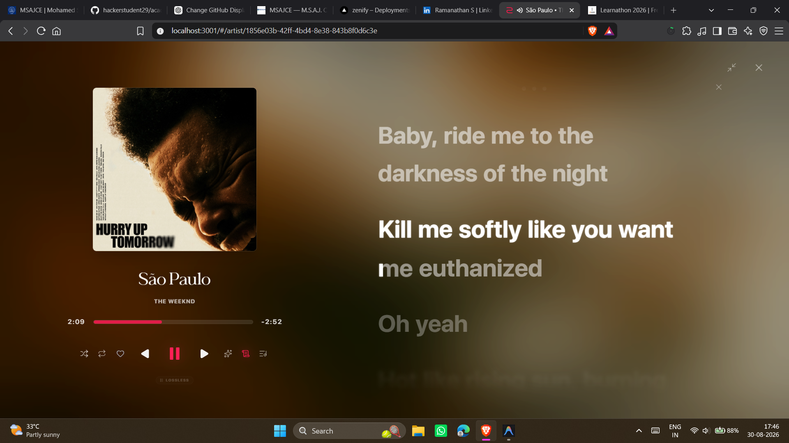
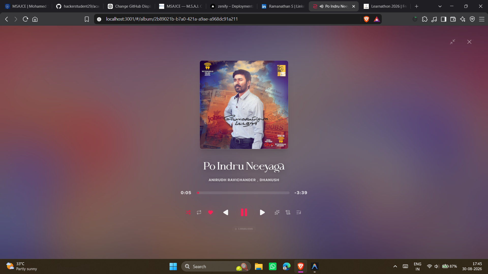

   
  
   
   
  <h1>Zenify: Open-Source Music Streaming with Synced Regional Lyrics</h1>
  

    <b>🎵 Free alternative to Spotify & Apple Music • 🎤 Tamil, Hindi, Malayalam synced lyrics • 🎛️ Professional Studio EQ • 🌐 Web + Android</b>
  

  

    
    
    
    
    
  

  

    <em>Built with ❤️ by <a href="https://github.com/hackerstudent29"><b>Ramanathan S</b></a></em>
  

---

## 📸 Screenshot Preview

| 🏠 Home | 🎤 Synced Lyrics | 🎛️ Studio EQ |
| :---: | :---: | :---: |
|  |  |  |

---

## 🚀 Quick Start

### Web (No Installation)
Visit **[listenzenify.vercel.app](https://listenzenify.vercel.app)** and start playing instantly.

### Install as App
- **PWA**: Click "Install" in your browser (Chrome, Edge, Firefox, Safari)
- **Android APK**: Download from **[Releases](https://github.com/hackerstudent29/Zenify/releases)**
- **Offline Support**: Works without internet for local files + cached content

---

## ⚡ Why Zenify?

| Feature | Zenify | Spotify | Apple Music | JioSaavn | YouTube Music |
| :--- | :---: | :---: | :---: | :---: | :---: |
| **Free Forever** | ✅ | ❌ | ❌ | ✅ | ❌ |
| **Tamil/Hindi Synced Lyrics** | ✅ | ❌ | ❌ | ❌ | ❌ |
| **Studio EQ** | ✅ | ❌ | ❌ | ❌ | ❌ |
| **8D Audio** | ✅ | ❌ | ❌ | ❌ | ❌ |
| **No Ads** | ✅ | ❌ | ❌ | ❌ | ❌ |
| **Local File Playback** | ✅ | ❌ | ❌ | ✅ | ❌ |
| **Open Source** | ✅ | ❌ | ❌ | ❌ | ❌ |
| **Privacy-First** | ✅ | ❌ | ❌ | ❌ | ❌ |

---

## ✨ Core Features

### 🎤 Real-Time Synced Lyrics
- **Sub-second accuracy** for Tamil, Hindi, Malayalam songs
- **Word-level timing** (karaoke-style highlighting)
- **Automatic instrumental markers** (• • •) during breaks
- **Auto-romanization** for Indian scripts
- **Offline cached** lyrics

### 🎛️ Professional Audio Tools
- **3-Band Equalizer**: Bass (110Hz), Mid (1.5kHz), Treble (8kHz) with ±12dB range
- **Reorderable FX Chain**: Drag-drop signal routing (EQ → Filter → Drive → Chorus → Echo → Reverb)
- **8D Spatial Audio**: Immersive bi-directional panning with adjustable orbit speed
- **Vocal Isolation**: Extract vocals or background instruments (zero-latency processing)
- **DJ Controls**: Speed (0.5x-2x) + Pitch shifting (-12 to +12 semitones)
- **Advanced Effects**: Chorus, Echo, Reverb (Small Hall/Cathedral), Warmth/Drive, Stereo Width
- **Night Mode**: Dynamic compression for comfortable late-night listening
- **10+ Presets**: After Hours, Immersive, Bass Boost, Vocal Boost, Lo-Fi, Dream Echo, etc.

### 📁 Local Audio Player
- **Zero Upload**: Play your MP3, FLAC, WAV, M4A, AAC files directly in browser
- **ID3 Tag Extraction**: Automatic cover art and metadata parsing
- **100% Private**: Files never leave your device
- **Studio FX**: Full EQ and effects on local files

### 🎵 Smart Queue System
- **User Queue**: FIFO tracks you add (preserved during shuffle)
- **Context Queue**: Album/playlist tracks
- **Smart Autoplay**: Continues with similar vibes when queue ends
- **Drag-to-Reorder**: Easy playlist management

### 🌈 Beautiful UI
- **Glassmorphism Design**: Modern frosted glass aesthetic
- **Reactive Backgrounds**: Album colors pulse with the beat
- **Responsive**: Works perfectly on mobile, tablet, desktop
- **Dark/Light Themes**: Customizable with accent colors

---

## 🎯 Zenify vs Competition

### vs Spotify/Apple Music
- ✅ **100% Free Forever** (Zenify) vs Premium paywall ($10/mo)
- ✅ **Tamil/Hindi Synced Lyrics** (Zenify only) vs English-only
- ✅ **Studio EQ** (Zenify) vs Limited audio controls
- ✅ **No Ads** (Zenify) vs Ad-supported
- ✅ **Open Source** (Zenify) vs Proprietary black-box

### vs JioSaavn
- ✅ **Better lyrics sync** for Indian languages
- ✅ **Professional audio EQ** vs Basic controls
- ✅ **8D audio + effects** vs Standard playback
- ✅ **Open source** vs Proprietary
- ✅ **Privacy-first** vs Data collection

### vs YouTube Music
- ✅ **Dedicated music player** vs YouTube interface bloat
- ✅ **Synced lyrics** for regional languages
- ✅ **No YouTube account required**
- ✅ **Faster, lighter, cleaner**

---

## 🔧 What's Working Now

### ✅ Implemented & Live
- Synced lyrics for Tamil, Hindi, Malayalam (more languages in progress)
- 3-band parametric EQ (real-time, zero-latency)
- 8D spatial audio with adjustable orbit speed
- Vocal isolation/extraction (karaoke mode)
- DJ-style high-pass/low-pass filter sweep
- Speed control (0.5x-2x) + independent pitch shifting
- Chorus, Echo, Reverb effects with Reverb impulse responses
- Drive/Warmth saturation
- Stereo width control (mono to ultra-wide)
- Night mode dynamics compression
- 10+ working audio presets (fully tested)
- Local file playback (MP3, FLAC, WAV, M4A, AAC)
- Full offline support for PWA
- Gapless playback with configurable crossfade
- YouTube audio streaming as fallback
- iTunes CDN priority for official releases

### 🚀 Coming Soon / In Progress
- Deepgram AI lyric onset verification (more accurate timing)
- More languages: Telugu, Kannada, Bengali, Punjabi, Gujarati
- Artist verification dashboard
- Playlist collaboration features
- Community recommendations

### ❌ Not Implemented
- ~~Direct Spotify/Apple Music integration~~ (licensing restricted)
- ~~Downloaded tracks storage~~ (use local files instead)
- ~~Radio based on current track~~ (autoplay on queue end instead)

---

## 📊 Technology Stack

**Frontend**: React 19 + Vite 6 + Tailwind CSS 4 + Zustand  
**Backend**: Fastify 5.7 + TypeScript + PostgreSQL + Prisma ORM  
**Audio**: Web Audio API (native, no plugins needed)  
**AI**: Deepgram (upcoming, for lyric alignment)  
**Cloud**: Cloudflare R2 (audio storage) + Cloudinary (artwork)  
**Mobile**: Flutter (Android, in progress)

---

## ⚖️ Legal & Content Sources

**Music Sourcing:**
- ✅ iTunes CDN (official, licensed AAC streams)
- ✅ YouTube official audio channels
- ✅ Verified music APIs
- ❌ No pirated/unauthorized streams

**Lyrics:**
- LyrCLib (open-source community lyrics)
- Apple Music LRC format
- User-provided lyrics (optional)

**Responsibilities:**
- You are responsible for local file copyright compliance
- Zenify is not affiliated with Spotify, Apple Music, JioSaavn, or YouTube
- Always use music you have rights to play

---

## 💖 Support & Contribute

Zenify is free, open-source, and maintained by volunteers. You can help by:

- ⭐ **Star this repo** on GitHub
- 🐛 **Report bugs** and suggest features
- 🤝 **Contribute code** - check [CONTRIBUTING.md](CONTRIBUTING.md)
- 📢 **Share** with friends who love music
- 💬 **Join discussions** on GitHub

---

## 🗺️ Roadmap

- **v2.5** ✅ – Studio FX Glass Panel, Cleaned Settings, Fixed Flicker
- **v2.6** 🔄 – More Languages, Deepgram AI Lyrics, Mobile Improvements
- **v2.7** 📅 – Artist Dashboard, Better Recommendations
- **v3.0** 🚀 – Social Features, Advanced Analytics

---

## 🛠️ For Developers

See **[DEVELOPER.md](DEVELOPER.md)** for:
- Architecture & system design
- API documentation (50+ endpoints)
- Self-hosting & Docker guide
- Audio engine deep-dive
- Contributing guidelines

---

## 📜 License

MIT License - See [LICENSE](LICENSE) for details.

---

  <b>Made with ❤️ by <a href="https://github.com/hackerstudent29">Ramanathan S</a></b>
   
  <b><a href="https://listenzenify.vercel.app">Start Listening Now</a></b> • <a href="https://github.com/hackerstudent29/Zenify">View Source</a> • <a href="DEVELOPER.md">Read Docs</a>

