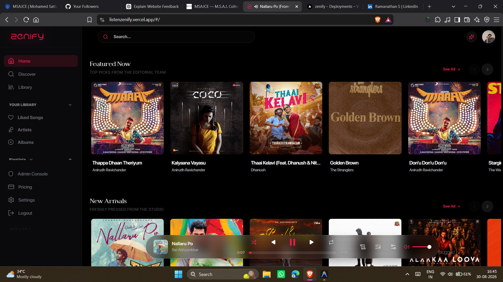
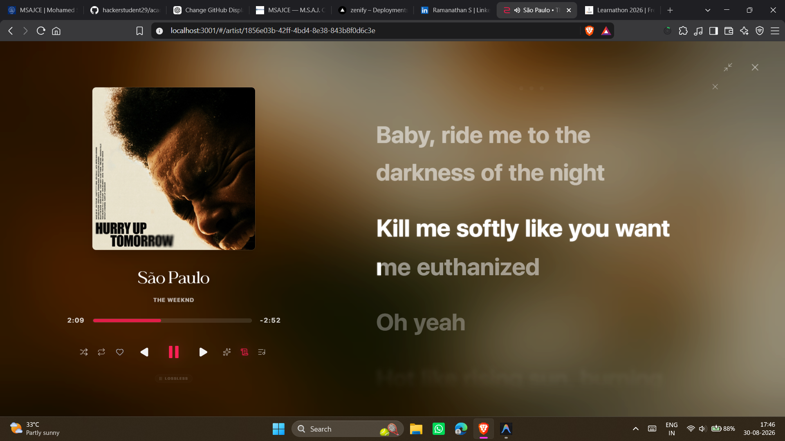
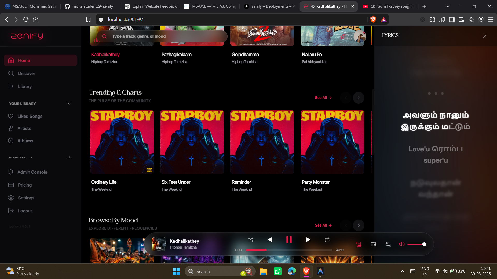

   

  <!-- Animated Full Zenify Transparent Logo -->
  

    

  <!-- Subtle Dot Matrix Accent -->
  

  <h1>Pure sound streaming, on your word</h1>

  

    <b>Lossless 320kbps Akamai CDN playback &nbsp;•&nbsp; Word-by-word synced karaoke lyrics &nbsp;•&nbsp; Strictly zero ads</b> 
    An open-source high-fidelity audio client with Apple-inspired editorial design, persistent Dynamic Island, 
    sub-millisecond collaborative listening rooms, and hardware StudioFX DSP.
  

   

  <!-- Signature Action Buttons -->
  

    +
    &nbsp;&nbsp;
    
    &nbsp;&nbsp;
    
    &nbsp;&nbsp;
    
    &nbsp;&nbsp;
    +
  

  

    <code>Android 8.0+ (ARM64 & Universal)</code> &nbsp;•&nbsp; <code>iOS Safari PWA</code> &nbsp;•&nbsp; <code>macOS & Windows Web</code> &nbsp;•&nbsp; <code>Free & Open Source (MIT)</code>
  

   

  <!-- Signature Rose Spec Capsules -->
  

    
    &nbsp;
    
    &nbsp;
    
    &nbsp;
    
    &nbsp;
    
    &nbsp;
    
  

   

---

   
  

  <h2>On your device, in pure fidelity</h2>
  

    Resolves full-song pristine 320kbps streams straight from high-speed Akamai edge CDNs. 
    Native ExoPlayer audio pipeline with HTTP 206 instant scrubbing, background playback, and an unconditional ban on 30-second preview clips.
  

   

  <!-- Showcase Card 1 -->
  <table width="100%">
    <tr>
      <td width="50%" align="center" valign="top">
        
          
        <b>EDITORIAL PLAYER SHELL · FLUID ARTWORK MESH & STUDIO CONTROLS</b>
      </td>
      <td width="50%" align="center" valign="top">
        
          
        <b>CURATED DISCOVERY · GLOBAL CHARTS & PERSONALIZED MIXES</b>
      </td>
    </tr>
  </table>

 

---

   
  

  <h2>Real-time vocal tracking, word by word</h2>
  

    Apple Music-style vocal glide with word-level micro-timings, romanized pronunciation for Indic scripts 
    (Tamil, Telugu, Hindi, Malayalam, Kannada), and living 3-dot instrumental interlude transitions.
  

   

  <!-- Showcase Card 2 -->
  <table width="100%">
    <tr>
      <td width="50%" align="center" valign="top">
        
          
        <b>CLUSTER-LEVEL VOCAL KARAOKE GLIDE & INTERLUDE TRANSITIONS</b>
      </td>
      <td width="50%" align="center" valign="top">
        
          
        <b>ROMANIZED SCRIPTS & LIVE SCRIPT TRANSLATION SWITCHER</b>
      </td>
    </tr>
  </table>

 

---

   
  

  <h2>Shared sessions, across every screen</h2>
  

    Listen in lock-step with friends using sub-millisecond clock synchronization and shared queues, 
    or export 16 handcrafted editorial story templates directly to Instagram, WhatsApp, and Snapchat.
  

   

  <!-- Showcase Card 3 -->
  <table width="100%">
    <tr>
      <td width="50%" align="center" valign="top">
        
          
        <b>EDITORIAL ARTIST SHOWCASE · COMPLETE RELEASES & SINGLES</b>
      </td>
      <td width="50%" align="center" valign="top">
        
          
        <b>STORY SHARING STUDIO & LISTENING INSIGHTS DASHBOARD</b>
      </td>
    </tr>
  </table>

 

---

  <h2>✦ The Architectural Bento ✦</h2>
  
Engineered for listeners who appreciate refined design, acoustic precision, and uncompromising privacy.

 

<!-- Editorial Bento Grid -->
<table width="100%">
  <tr>
    <td width="50%" valign="top">
      <h3>⚡ Pristine 320kbps Streams</h3>
      
Direct lossless Akamai CDN audio resolution with instant seeking, background lock-screen playback, and a strict ban on 30-second preview clips.

    </td>
    <td width="50%" valign="top">
      <h3>🎙️ Synchronized Karaoke Lyrics</h3>
      
Real-time vocal tracking with cluster-level progress, romanized pronunciation for Indic scripts (Tamil, Telugu, Hindi, Malayalam, Kannada), and breathing 3-dot interlude transitions.

    </td>
  </tr>
  <tr>
    <td width="50%" valign="top">
      <h3>🏝️ Scroll-Linked Dynamic Island</h3>
      
Apple-inspired 3-dock floating header. Collapses gracefully at the top of detail pages and springs open to reveal artist, album, and category titles as content crosses underneath.

    </td>
    <td width="50%" valign="top">
      <h3>👥 Room Together Live Sessions</h3>
      
Listen synchronously with friends across devices. Features sub-millisecond clock alignment, shared democratic queues, live emoji reactions, and voice chat.

    </td>
  </tr>
  <tr>
    <td width="50%" valign="top">
      <h3>🎨 16 Editorial "Add to Story" Templates</h3>
      
Handcrafted layout engines for sharing songs, synced lyrics, artists, albums, and playlists directly to Instagram Stories, WhatsApp, Snapchat, and Facebook.

    </td>
    <td width="50%" valign="top">
      <h3>🎛️ StudioFX & 8D Spatial Audio</h3>
      
Fine-tune your acoustic soundstage with a multi-band equalizer, dynamic spatial panning, acoustic room reverb, and studio peak limiting.

    </td>
  </tr>
</table>

 

---

  <h2>📲 Get Zenify</h2>
  
Available on Android and instantly playable on all modern desktop and mobile web browsers.

 

<!-- Download Matrix Table -->
<table width="100%">
  <thead>
    <tr>
      <th align="left">Platform</th>
      <th align="left">Edition</th>
      <th align="center">Size</th>
      <th align="right">Action</th>
    </tr>
  </thead>
  <tbody>
    <tr>
      <td><b>🤖 Android (Modern)</b></td>
      <td>ARM64 Split APK · <i>Recommended for Pixel, Galaxy, OnePlus, Xiaomi, Nothing</i></td>
      <td align="center"><code>15.2 MB</code></td>
      <td align="right"><a href="https://github.com/hackerstudent29/Zenify/releases/download/v1.0.12/zenify-v1.0.12.apk"><b>⬇️ Download APK</b></a></td>
    </tr>
    <tr>
      <td><b>🌐 Android (Universal)</b></td>
      <td>All Architectures (`arm64-v8a`, `armeabi-v7a`, `x86_64`)</td>
      <td align="center"><code>34.6 MB</code></td>
      <td align="right"><a href="https://github.com/hackerstudent29/Zenify/releases/download/v1.0.12/zenify-v1.0.12-universal.apk"><b>⬇️ Download Universal</b></a></td>
    </tr>
    <tr>
      <td><b>🍎 Web & iOS (PWA)</b></td>
      <td>Instant In-Browser Player · <i>Tap "Add to Home Screen" on iOS Safari</i></td>
      <td align="center"><code>Zero Install</code></td>
      <td align="right"><a href="https://listenzenify.vercel.app"><b>🎧 Launch Player</b></a></td>
    </tr>
    <tr>
      <td><b>📦 GitHub Releases</b></td>
      <td>All Release Packages, Release Notes & SHA-256 Checksums</td>
      <td align="center"><code>Build 16</code></td>
      <td align="right"><a href="https://github.com/hackerstudent29/Zenify/releases"><b>View Releases</b></a></td>
    </tr>
  </tbody>
</table>

 

  
<b>📋 Quick 3-Step Android Installation Guide</b>

   
  <ol>
    <li>Tap <a href="https://github.com/hackerstudent29/Zenify/releases/download/v1.0.12/zenify-v1.0.12.apk"><b>Download APK</b></a> on your Android device.</li>
    <li>When the download completes, tap the notification or open the APK in your device's <b>Files</b> app.</li>
    <li>Allow <i>"Install unknown apps"</i> from your browser if prompted, tap <b>Install</b>, and enjoy pure uninterrupted music!</li>
  </ol>

 

---

  <h2>⚙️ Tech Specs & Architecture</h2>

 

<table width="100%">
  <tr>
    <td width="25%"><b>📱 Mobile Client</b></td>
    <td>Flutter 3 · Custom Spring Physics · Native ExoPlayer Channels · Lock-Screen Service · Hardware DSP Offloading</td>
  </tr>
  <tr>
    <td width="25%"><b>🌐 Web Player</b></td>
    <td>React 18 · Vite · Tailwind CSS · Framer Motion · Web Audio API · Lucide Icons</td>
  </tr>
  <tr>
    <td width="25%"><b>⚡ Backend & API</b></td>
    <td>Node.js · Fastify · TypeScript · Prisma ORM · PostgreSQL (AWS RDS) · WebSocket Cluster</td>
  </tr>
  <tr>
    <td width="25%"><b>🎶 Audio Engines</b></td>
    <td>JioSaavn Pristine 320kbps Akamai CDN · YouTube InnerTube On-Device Engine · Cloudflare R2 Audio Ingest</td>
  </tr>
  <tr>
    <td width="25%"><b>Typography</b></td>
    <td>Apple SF Pro Display / Text · Universal Indic Fallbacks (Noto Sans Tamil, Telugu, Devanagari, Malayalam)</td>
  </tr>
</table>

 

---

  <h3>📄 License</h3>
  
Zenify is open-source software released under the <a href="LICENSE">MIT License</a>.

   
  Designed with care for everyone who loves music in its purest form.

