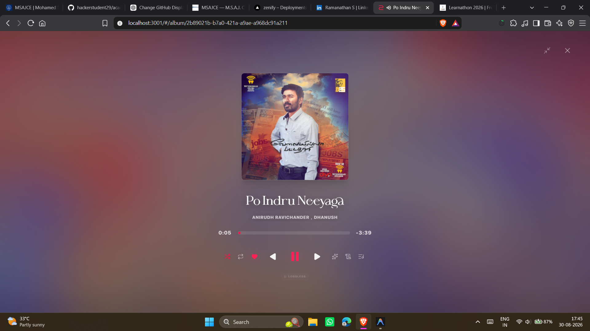
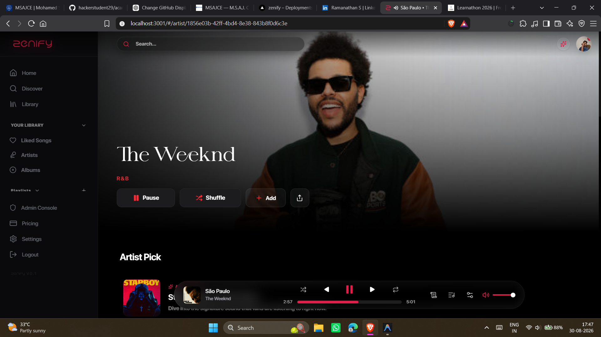
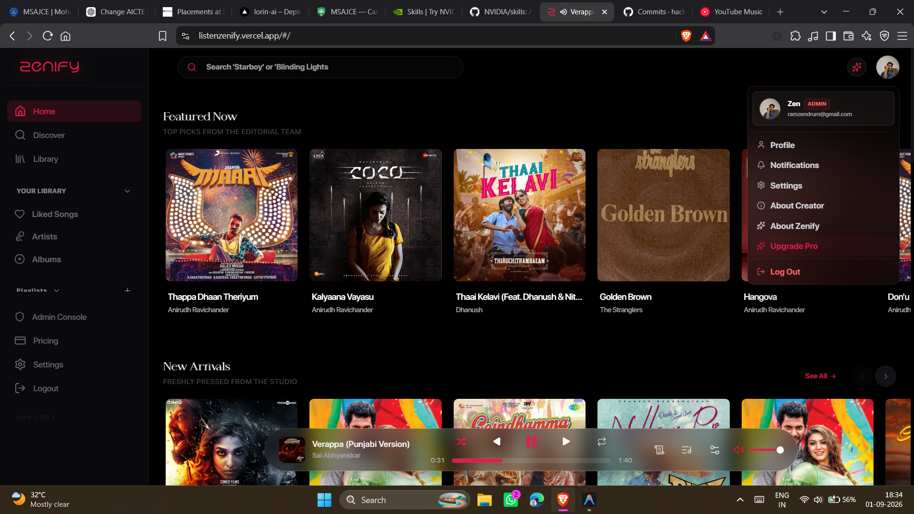

<div align="center">

  <br />

  <!-- Animated Full Zenify Transparent Logo -->
  <a href="https://listenzenify.vercel.app">
    
  </a>

  <br /><br />

  <!-- Subtle Dot Matrix Accent -->
  

  <h1 style="font-weight: 800; letter-spacing: -0.03em; margin-top: 12px;">
    The soundstage of tomorrow. On your <span style="color: #FF375F;">terms</span>.
  </h1>

  <p align="center" style="max-width: 780px; font-size: 16px; line-height: 1.6; color: #a1a1aa;">
    <b>Lossless 320kbps Akamai CDN streaming &nbsp;•&nbsp; Apple Music-grade word-by-word synced lyrics &nbsp;•&nbsp; Strictly zero ads</b><br />
    An open-source high-fidelity audio client engineered with Apple's iconic editorial design language,<br />
    scroll-linked Dynamic Island header, sub-millisecond collaborative listening rooms, and hardware StudioFX DSP.<br />
    <i>Crafted for music lovers across every continent, language, and culture.</i>
  </p>

  <br />

  <!-- Signature Action Buttons -->
  <p align="center">
    <span style="color: rgba(255,255,255,0.25); font-family: monospace; font-size: 16px;">+</span>
    &nbsp;&nbsp;
    <a href="https://github.com/hackerstudent29/Zenify/releases/download/v1.1.18/zenify-v1.1.18.apk">
      
    </a>
    &nbsp;&nbsp;
    <a href="https://listenzenify.vercel.app" target="_blank">
      
    </a>
    &nbsp;&nbsp;
    <a href="https://github.com/hackerstudent29/Zenify/releases">
      
    </a>
    &nbsp;&nbsp;
    <span style="color: rgba(255,255,255,0.25); font-family: monospace; font-size: 16px;">+</span>
  </p>

  <p align="center">
    <sub><code>Android 8.0+ (ARM64 & Universal)</code> &nbsp;•&nbsp; <code>iOS & iPadOS Safari PWA</code> &nbsp;•&nbsp; <code>macOS, Windows & Linux Web</code> &nbsp;•&nbsp; <code>Free & Open Source (MIT)</code></sub>
  </p>

  <br />

  <!-- Signature Rose Spec Capsules -->
  <p align="center">
    
    &nbsp;
    
    &nbsp;
    
    &nbsp;
    
    &nbsp;
    
    &nbsp;
    
  </p>

  <br />

</div>

---

<div align="center">

  <br />
  

  <h2>Music for every corner of the <span style="color: #FF375F;">world</span></h2>
  <p align="center" style="max-width: 720px; color: #a1a1aa;">
    Music has no borders, and neither does Zenify. Explore over 100 million songs spanning all global genres, international chart-toppers, underground movements, and regional masterworks.
  </p>

  <br />

  <!-- Worldwide Music Grid Pills -->
  <table width="100%">
    <tr>
      <td width="20%" align="center">
        <b>🌍 Global Pop & Hip-Hop</b><br />
        <sub>Billboard 100, UK Top 40, Drake, Taylor Swift, Kendrick Lamar, The Weeknd</sub>
      </td>
      <td width="20%" align="center">
        <b>💃 Latin & Reggaeton</b><br />
        <sub>Bad Bunny, Rosalía, Peso Pluma, Karol G, Bizarrap, J Balvin</sub>
      </td>
      <td width="20%" align="center">
        <b>🌸 K-Pop, J-Pop & C-Pop</b><br />
        <sub>BTS, NewJeans, BLACKPINK, Yoasobi, Fujii Kaze, Jay Chou, Anime OSTs</sub>
      </td>
      <td width="20%" align="center">
        <b>🪷 South Asian & Bollywood</b><br />
        <sub>Arijit Singh, Anirudh, A.R. Rahman, Pritam, Sid Sriram, Shreya Ghoshal</sub>
      </td>
      <td width="20%" align="center">
        <b>🌴 Afrobeats & Amapiano</b><br />
        <sub>Burna Boy, Wizkid, Tyla, Rema, Asake, Kabza De Small, Davido</sub>
      </td>
    </tr>
  </table>

</div>

<br />

---

<div align="center">

  <br />
  

  <h2>Pure acoustic fidelity. Uncompromised <span style="color: #FF375F;">mastering</span>.</h2>
  <p align="center" style="max-width: 760px; color: #a1a1aa;">
    Pristine 320kbps streams delivered straight from high-speed Akamai edge CDNs.<br />
    Native ExoPlayer audio pipeline with HTTP 206 instant scrubbing, background playback, and an unconditional ban on 30-second preview clips.
  </p>

  <br />

  <!-- 3D Showcase Card 1 -->
  <table width="100%">
    <tr>
      <td width="50%" align="center" valign="top">
        <a href="docs/images/zenify_fullview_player.png">
          
        </a>
        <br /><br />
        <sub><b>EDITORIAL PLAYER SHELL · FLUID ARTWORK MESH & STUDIO CONTROLS</b></sub>
      </td>
      <td width="50%" align="center" valign="top">
        <a href="docs/images/zenify_home_dashboard.png">
          
        </a>
        <br /><br />
        <sub><b>CURATED DISCOVERY · GLOBAL CHARTS & PERSONALIZED MIXES</b></sub>
      </td>
    </tr>
  </table>

</div>

<br />

---

<div align="center">

  <br />
  

  <h2>Real-time vocal tracking. Word by <span style="color: #FF375F;">word</span>.</h2>
  <p align="center" style="max-width: 760px; color: #a1a1aa;">
    Powered by <b>Better Lyrics</b> and <b>Unison</b> TTML engines with word-by-word syllable precision.<br />
    Features Apple Music-style vocal gliding, multi-language romanization (Latin, Cyrillic, CJK, Indic, Arabic), and living 3-dot instrumental pauses.
  </p>

  <br />

  <!-- 3D Showcase Card 2 -->
  <table width="100%">
    <tr>
      <td width="50%" align="center" valign="top">
        <a href="docs/images/zenify_synced_lyrics.png">
          
        </a>
        <br /><br />
        <sub><b>SYLLABLE-LEVEL VOCAL KARAOKE GLIDE & INTERLUDE TRANSITIONS</b></sub>
      </td>
      <td width="50%" align="center" valign="top">
        <a href="docs/images/zenify_side_lyrics.png">
          
        </a>
        <br /><br />
        <sub><b>ROMANIZED SCRIPTS & LIVE SCRIPT TRANSLATION SWITCHER</b></sub>
      </td>
    </tr>
  </table>

</div>

<br />

---

<div align="center">

  <br />
  

  <h2>Universal discovery. Instant <span style="color: #FF375F;">connection</span>.</h2>
  <p align="center" style="max-width: 760px; color: #a1a1aa;">
    Zero-latency fuzzy search across 100M+ tracks, complete artist discographies, EPs, live concerts, and official music videos.<br />
    Instantly share 16 handcrafted editorial story templates directly to Instagram, WhatsApp, Snapchat, and Facebook.
  </p>

  <br />

  <!-- 3D Showcase Card 3 -->
  <table width="100%">
    <tr>
      <td width="50%" align="center" valign="top">
        <a href="docs/images/zenify_artist_page.png">
          
        </a>
        <br /><br />
        <sub><b>EDITORIAL ARTIST SHOWCASE · COMPLETE RELEASES & MUSIC VIDEOS</b></sub>
      </td>
      <td width="50%" align="center" valign="top">
        <a href="docs/images/zenify_profile_menu.png">
          
        </a>
        <br /><br />
        <sub><b>STORY SHARING STUDIO & LISTENING INSIGHTS DASHBOARD</b></sub>
      </td>
    </tr>
  </table>

</div>

<br />

---

<div align="center">

  <br />
  

  <h2>✦ The Architectural Bento ✦</h2>
  <p style="color: #a1a1aa;">Engineered for listeners who appreciate Cupertino-grade industrial design, acoustic precision, and uncompromising privacy.</p>

  <br />

</div>

<!-- Editorial Apple Bento Grid -->
<table width="100%">
  <tr>
    <td width="50%" valign="top">
      <h3>⚡ Pristine 320kbps Streams</h3>
      <p>Direct lossless Akamai CDN audio resolution with instant seeking, background lock-screen playback, and a strict ban on 30-second preview clips.</p>
      <sub><code>HTTP 206 Range</code> &nbsp;•&nbsp; <code>Direct Stream Proxy</code> &nbsp;•&nbsp; <code>Zero Transcoding Loss</code></sub>
    </td>
    <td width="50%" valign="top">
      <h3>🎙️ Better Lyrics & Unison Word Sync</h3>
      <p>Real-time vocal tracking powered by Better Lyrics TTML and Unison community database with syllable-level progress, romanized pronunciation, and breathing 3-dot interlude transitions.</p>
      <sub><code>Word-Level TTML</code> &nbsp;•&nbsp; <code>Romanized Scripts</code> &nbsp;•&nbsp; <code>Real-Time Translation</code></sub>
    </td>
  </tr>
  <tr>
    <td width="50%" valign="top">
      <h3>🔎 Instant Multi-Source Search & Fast-Path Switcher</h3>
      <p>Apple-styled source switcher capsule (<b>All · Universal | YouTube Music | Jio Music</b>). Instant ~250ms JioSaavn Akamai CDN queries, 4s parallel fallback, eliminating search stalls.</p>
      <sub><code>Source Capsule</code> &nbsp;•&nbsp; <code>Fast-Path CDN</code> &nbsp;•&nbsp; <code>Zero-Hang Fallback</code></sub>
    </td>
    <td width="50%" valign="top">
      <h3>📥 One-Click Playlist Import (YouTube & Spotify)</h3>
      <p>Instantly import your existing playlists from YouTube Music, YouTube, and Spotify share URLs with automatic high-fidelity track resolution and personal library syncing.</p>
      <sub><code>Headless Metadata</code> &nbsp;•&nbsp; <code>yt-dlp Engine</code> &nbsp;•&nbsp; <code>Spotify URL Resolver</code></sub>
    </td>
  </tr>
  <tr>
    <td width="50%" valign="top">
      <h3>📁 Resilient Local Music Player</h3>
      <p>Multi-tier IndexedDB storage supporting FLAC, ALAC, Opus, CAF, and AIFF files with duration watchdog timers and automatic 320kbps CDN stream recovery for unsupported browser codecs.</p>
      <sub><code>Lossless ALAC/FLAC</code> &nbsp;•&nbsp; <code>IndexedDB Tier</code> &nbsp;•&nbsp; <code>Auto Stream Healing</code></sub>
    </td>
    <td width="50%" valign="top">
      <h3>🍃 Ultra-Lean Live Streaming Storage (80%+ Reduction)</h3>
      <p>Pure live streaming architecture: ExoPlayer disk cache cut to 64MB and in-memory decoded image cache capped at 35MB. User devices stay lightning fast with 0ms resume.</p>
      <sub><code>Feather-Light Cache</code> &nbsp;•&nbsp; <code>64MB ExoPlayer Buffer</code> &nbsp;•&nbsp; <code>Zero Audio Hoarding</code></sub>
    </td>
  </tr>
  <tr>
    <td width="50%" valign="top">
      <h3>🏝️ Scroll-Linked Dynamic Island</h3>
      <p>Apple-inspired 3-dock floating header. Collapses gracefully at the top of detail pages and springs open to reveal artist, album, and category titles as content crosses underneath.</p>
      <sub><code>Spring Physics</code> &nbsp;•&nbsp; <code>Adaptive Docking</code> &nbsp;•&nbsp; <code>Backdrop Blur Filter</code></sub>
    </td>
    <td width="50%" valign="top">
      <h3>👥 Room Together Live Sessions</h3>
      <p>Listen synchronously with friends across devices. Features sub-millisecond clock alignment, shared democratic queues, live emoji reaction bursts, and voice chat.</p>
      <sub><code>WebSocket Cluster</code> &nbsp;•&nbsp; <code>Sub-ms Clock Sync</code> &nbsp;•&nbsp; <code>Democratic Queue</code></sub>
    </td>
  </tr>
  <tr>
    <td width="50%" valign="top">
      <h3>🎨 16 Editorial "Add to Story" Templates</h3>
      <p>Handcrafted layout engines for sharing songs, synced lyrics, artists, albums, and playlists directly to Instagram Stories, WhatsApp, Snapchat, and Facebook.</p>
      <sub><code>Instagram Stories</code> &nbsp;•&nbsp; <code>WhatsApp Status</code> &nbsp;•&nbsp; <code>High-Res Vector Canvas</code></sub>
    </td>
    <td width="50%" valign="top">
      <h3>🎛️ StudioFX & 8D Spatial Audio</h3>
      <p>Fine-tune your acoustic soundstage with a multi-band parametric equalizer, dynamic spatial panning, acoustic room reverb, and studio peak limiting.</p>
      <sub><code>Parametric EQ</code> &nbsp;•&nbsp; <code>8D Spatial Panning</code> &nbsp;•&nbsp; <code>Hardware DSP Offload</code></sub>
    </td>
  </tr>
  <tr>
    <td width="50%" valign="top">
      <h3>🛡️ Strictly Zero Ads & Privacy-First</h3>
      <p>No audio advertisements, no visual popups, no telemetry trackers, and no targeted data profiling. Completely open source and auditable under the MIT license.</p>
      <sub><code>100% Ad-Free</code> &nbsp;•&nbsp; <code>Zero Tracking</code> &nbsp;•&nbsp; <code>MIT Open Source</code></sub>
    </td>
    <td width="50%" valign="top">
      <h3>🔒 Hardened Android Security & Keystore Encryption</h3>
      <p>Backup extraction blocked via <code>android:allowBackup="false"</code>, R8/ProGuard bytecode obfuscation enabled, and all auth tokens encrypted in hardware Keystore / Keychain.</p>
      <sub><code>Hardware Keystore</code> &nbsp;•&nbsp; <code>R8 Obfuscation</code> &nbsp;•&nbsp; <code>Zero Token Leaks</code></sub>
    </td>
  </tr>
</table>

<br />

---

<div align="center">

  <br />
  

  <h2>📲 Get Zenify</h2>
  <p align="center" style="color: #a1a1aa;">Available natively on Android and instantly playable on all modern mobile and desktop web browsers worldwide.</p>

  <br />

</div>

<!-- Download Matrix Table -->
<table width="100%">
  <thead>
    <tr>
      <th align="left">Platform</th>
      <th align="left">Edition</th>
      <th align="center">Size</th>
      <th align="right">Action</th>
    </tr>
  </thead>
  <tbody>
    <tr>
      <td><b>🤖 Android (Modern)</b></td>
      <td>ARM64 Split APK · <i>Recommended for Pixel, Galaxy, OnePlus, Xiaomi, Nothing, Sony</i></td>
      <td align="center"><code>15.3 MB</code></td>
      <td align="right"><a href="https://github.com/hackerstudent29/Zenify/releases/download/v1.1.13/zenify-v1.1.13.apk"><b>⬇️ Download APK</b></a></td>
    </tr>
    <tr>
      <td><b>🌐 Android (Universal)</b></td>
      <td>All Architectures (`arm64-v8a`, `armeabi-v7a`, `x86_64`) · <i>Works on every Android device</i></td>
      <td align="center"><code>34.6 MB</code></td>
      <td align="right"><a href="https://github.com/hackerstudent29/Zenify/releases/download/v1.1.13/zenify.apk"><b>⬇️ Download Universal</b></a></td>
    </tr>
    <tr>
      <td><b>🍎 Web & iOS (PWA)</b></td>
      <td>Instant In-Browser Player · <i>Tap "Share" → "Add to Home Screen" on iOS Safari</i></td>
      <td align="center"><code>Zero Install</code></td>
      <td align="right"><a href="https://listenzenify.vercel.app" target="_blank"><b>🎧 Launch Player</b></a></td>
    </tr>
    <tr>
      <td><b>📦 GitHub Releases</b></td>
      <td>All Release Packages, Release Notes & SHA-256 Checksums</td>
      <td align="center"><code>Build 2026</code></td>
      <td align="right"><a href="https://github.com/hackerstudent29/Zenify/releases"><b>View Releases</b></a></td>
    </tr>
  </tbody>
</table>

<br />

---

<!-- Interactive Sections (Apple Style Accordions) -->

<details>
  <summary><b>📱 Step-by-Step Android Installation Guide</b></summary>
  <br />
  <ol>
    <li>Tap <a href="https://github.com/hackerstudent29/Zenify/releases/download/v1.1.13/zenify-v1.1.13.apk"><b>Download APK</b></a> on your Android device (or choose the Universal APK if using an older 32-bit device or emulator).</li>
    <li>When the download completes, tap the notification or locate <code>zenify-v1.1.13.apk</code> in your device's <b>Files</b> or <b>Downloads</b> app.</li>
    <li>If prompted, toggle <i>"Allow from this source"</i> in your browser or file manager settings.</li>
    <li>Tap <b>Install</b>, open Zenify, and experience high-fidelity ad-free music instantly!</li>
  </ol>
</details>

<br />

<details>
  <summary><b>🍏 iOS & iPadOS Setup Guide (Progressive Web App)</b></summary>
  <br />
  <ol>
    <li>Open <b>Safari</b> on your iPhone or iPad and navigate to <a href="https://listenzenify.vercel.app"><b>listenzenify.vercel.app</b></a>.</li>
    <li>Tap the <b>Share</b> button () in the Safari toolbar.</li>
    <li>Scroll down and tap <b>Add to Home Screen</b>.</li>
    <li>Tap <b>Add</b> in the top right corner. Zenify will appear as a standalone app icon with full-screen playback, AirPlay 2 support, and Lock Screen audio controls!</li>
  </ol>
</details>

<br />

<details>
  <summary><b>⌨️ Desktop Web Keyboard Shortcuts</b></summary>
  <br />
  <table width="100%">
    <thead>
      <tr>
        <th align="left">Key</th>
        <th align="left">Action</th>
      </tr>
    </thead>
    <tbody>
      <tr>
        <td><kbd>Space</kbd> / <kbd>K</kbd></td>
        <td>Play / Pause playback</td>
      </tr>
      <tr>
        <td><kbd>J</kbd> / <kbd>←</kbd></td>
        <td>Seek backward 5 seconds</td>
      </tr>
      <tr>
        <td><kbd>L</kbd> / <kbd>→</kbd></td>
        <td>Seek forward 5 seconds</td>
      </tr>
      <tr>
        <td><kbd>Shift</kbd> + <kbd>N</kbd></td>
        <td>Skip to next track</td>
      </tr>
      <tr>
        <td><kbd>Shift</kbd> + <kbd>P</kbd></td>
        <td>Return to previous track</td>
      </tr>
      <tr>
        <td><kbd>M</kbd></td>
        <td>Mute / Unmute audio</td>
      </tr>
      <tr>
        <td><kbd>/</kbd></td>
        <td>Focus global search bar</td>
      </tr>
    </tbody>
  </table>
</details>

<br />

<details>
  <summary><b>🛠️ Self-Hosting & Local Development (Docker & Node.js)</b></summary>
  <br />

  ### Prerequisites
  * **Node.js**: v20 or v22 LTS
  * **npm**: v10+
  * **Docker & Docker Compose** (optional for containerized setup)

  ### Quick Start with Docker
  ```bash
  # 1. Clone the repository
  git clone https://github.com/hackerstudent29/Zenify.git
  cd Zenify

  # 2. Configure environment variables
  cp backend/.env.example backend/.env

  # 3. Spin up PostgreSQL, Redis, Backend & Frontend
  docker-compose up -d
  ```

  ### Manual Local Setup
  ```bash
  # 1. Install root dependencies
  npm install

  # 2. Setup backend
  cd backend
  npm install
  npx prisma generate
  npx prisma migrate deploy
  npm run dev

  # 3. Setup web frontend (in a separate terminal)
  cd ../frontend
  npm install
  npm run dev
  ```
</details>

<br />

<details>
  <summary><b>❓ Frequently Asked Questions (FAQ)</b></summary>
  <br />
  <dl>
    <dt><b>Is Zenify completely free?</b></dt>
    <dd>Yes. Zenify is 100% free and open-source software released under the MIT license. There are no subscription tiers, paywalls, or advertisements.</dd>
    <br />
    <dt><b>Where does the audio stream come from?</b></dt>
    <dd>Zenify connects directly to high-speed Akamai CDN edge networks resolving pristine full-song 320kbps audio. Preview snippets (like 30-second iTunes audio) are strictly rejected.</dd>
    <br />
    <dt><b>How does word-by-word synced lyrics work?</b></dt>
    <dd>Zenify's multi-tiered lyrics pipeline queries Better Lyrics, Unison, and LRCLIB in parallel, parsing Apple Music TTML with syllable timestamps for fluid karaoke vocal gliding.</dd>
    <br />
    <dt><b>Can I listen with friends in other countries?</b></dt>
    <dd>Yes! Room Together uses low-latency WebSocket clustering with sub-millisecond clock alignment so you and your friends around the world stay in perfect sync.</dd>
  </dl>
</details>

<br />

---

<div align="center">

  <br />
  

  <h2>⚙️ Tech Specs & Industrial Architecture</h2>
  <p align="center" style="color: #a1a1aa;">Crafted with world-class frameworks, native platform channels, and high-performance serverless backends.</p>

  <br />

</div>

<table width="100%">
  <tr>
    <td width="25%"><b>📱 Mobile Client</b></td>
    <td>Flutter 3 · Custom Spring Physics · Native ExoPlayer Channels · Lock-Screen Service · Hardware DSP Offloading</td>
  </tr>
  <tr>
    <td width="25%"><b>🌐 Web Player</b></td>
    <td>React 18 · Vite · Tailwind CSS · Framer Motion · Web Audio API · Lucide Icons</td>
  </tr>
  <tr>
    <td width="25%"><b>⚡ Backend & API</b></td>
    <td>Node.js · Fastify 5 · TypeScript · Prisma ORM · PostgreSQL (AWS RDS) · WebSocket Cluster</td>
  </tr>
  <tr>
    <td width="25%"><b>🎶 Audio Engines</b></td>
    <td>Lossless 320kbps Akamai CDN · YouTube InnerTube Engine · Cloudflare R2 Persistent Audio Storage</td>
  </tr>
  <tr>
    <td width="25%"><b>🎙️ Lyrics Providers</b></td>
    <td>Better Lyrics (Apple Music TTML) · Unison Community DB · LRCLIB · JioSaavn · Deepgram AI Onset Verification</td>
  </tr>
  <tr>
    <td width="25%"><b>🔤 Typography</b></td>
    <td>Apple SF Pro Display / Text · Universal Indic Fallbacks (Noto Sans Tamil, Telugu, Devanagari, Malayalam) · Satoshi</td>
  </tr>
</table>

<br />

---

<div align="center">
  <br />
  <h3>📄 License</h3>
  <p>Zenify is open-source software released under the <a href="LICENSE">MIT License</a>.</p>
  <br />
  <sub>Designed with acoustic obsession for music lovers across the globe.</sub>
  <br /><br />
</div>
