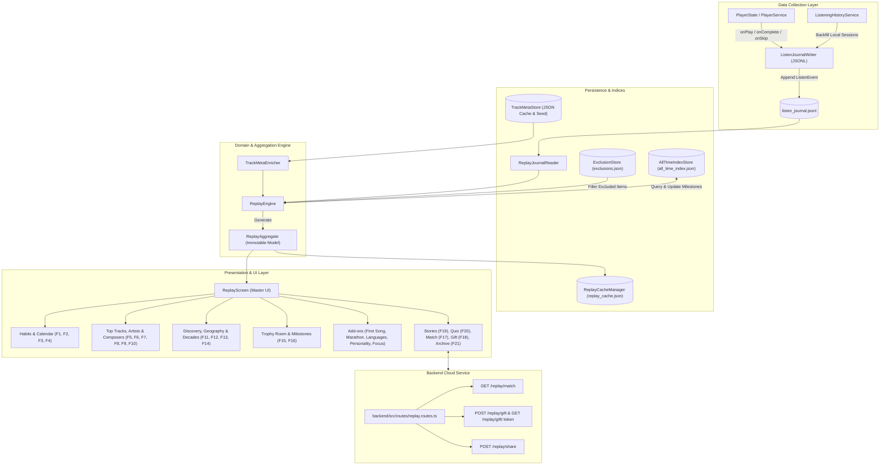

# Zenify Replay & Insights — Complete Project Structure & File Guide

This document provides a comprehensive structural reference for the entire **Zenify Replay & Insights** suite across mobile (Flutter/Dart), backend (Fastify/TypeScript), test suites, seed assets, and services.

---

## 1. System Architecture Overview



---

## 2. Directory Hierarchy

```
Zenify/
├── backend/
│   └── src/
│       └── routes/
│           └── replay.routes.ts                  # Fastify REST endpoints for Replay Match, Gifts & Cards
│
├── mobile/
│   ├── assets/
│   │   └── replay_track_meta_seed.json           # Bundled seed metadata (composers, singers, era, country)
│   │
│   ├── lib/
│   │   ├── features/
│   │   │   └── replay/
│   │   │       ├── data/                         # Caching, file I/O, indices, exclusions & enrichment
│   │   │       │   ├── all_time_index_store.dart # All-time stats, milestone thresholds, first-play indexing
│   │   │       │   ├── exclusion_store.dart      # Private listening & playlist/track exclusion manager
│   │   │       │   ├── replay_cache_manager.dart # In-memory & disk aggregate caching with 1-hr TTL
│   │   │       │   ├── replay_journal_reader.dart# Fast chunked streaming JSONL parser with date filtering
│   │   │       │   ├── track_meta_enricher.dart  # Multi-source metadata resolver (cache + asset + API)
│   │   │       │   └── track_meta_store.dart     # Persistent key-value JSON store for TrackMeta
│   │   │       │
│   │   │       ├── domain/                       # Pure Dart business models, calculations & services
│   │   │       │   ├── all_time_index.dart       # AllTimeIndex data model & milestone calculation
│   │   │       │   ├── listen_event.dart         # Core immutable event logged per play
│   │   │       │   ├── replay_aggregate.dart     # Consolidated aggregate model holding all 27 features
│   │   │       │   ├── replay_engine.dart        # Pure calculations: peak hour, heatmap, top stats, deltas
│   │   │       │   ├── replay_period.dart        # ReplayPeriod enum (week, month, year, all-time, custom)
│   │   │       │   ├── track_meta.dart           # Rich track metadata (language, era, movie, singers)
│   │   │       │   ├── models/
│   │   │       │   │   ├── gift_models.dart      # F18 GiftSong, gift card payload & token model
│   │   │       │   │   ├── match_models.dart     # F17 ReplaySnapshot, ReplayMatchResult & BattleScore
│   │   │       │   │   ├── replay_period.dart    # Model representation of period date bounds
│   │   │       │   │   └── replay_snapshot.dart  # Serialized snapshot for archives and social comparisons
│   │   │       │   └── services/
│   │   │       │       ├── gift_service.dart     # F18 Song dedication & secure token generation service
│   │   │       │       ├── replay_archive_service.dart # F21 Annual & monthly archive serialization
│   │   │       │       ├── replay_match_service.dart   # F17 Weighted Jaccard & taste similarity engine
│   │   │       │       ├── replay_mix_service.dart     # F22 Save top songs as real Zenify playlist
│   │   │       │       └── weekly_digest_service.dart  # F27 Weekly condensed digest generation
│   │   │       │
│   │   │       └── presentation/                 # Flutter UI screens, widgets, modals & visual components
│   │   │           ├── replay_screen.dart        # Master Replay & Insights Screen (docked header, period pill)
│   │   │           ├── archive/
│   │   │           │   └── replay_archive_sheet.dart   # F21 Replay historical archive bottom sheet
│   │   │           ├── quiz/
│   │   │           │   └── replay_quiz_screen.dart     # F20 Interactive 5-question trivia game
│   │   │           ├── social/
│   │   │           │   ├── dedicate_song_sheet.dart    # F18 Dedicate / Gift a Song bottom sheet
│   │   │           │   └── replay_match_screen.dart    # F17 Replay Taste Match & Musical Battle UI
│   │   │           ├── story/
│   │   │           │   └── story_walkthrough_screen.dart # F19 Tap-to-advance Instagram/Apple Music style stories
│   │   │           └── widgets/
│   │   │               ├── completion_focus_card.dart  # Completion rate & deep-listening focus metric
│   │   │               ├── composers_singers_section.dart # F6 Film composers, playback singers & movie table
│   │   │               ├── created_playlists_section.dart # F23 User created playlists summary & plays
│   │   │               ├── day_detail_sheet.dart       # F2 Calendar day detail popup (top song + exact duration)
│   │   │               ├── day_of_week_card.dart       # F3 Weekday listening distribution & personality
│   │   │               ├── daypart_card.dart           # F1 Favorite daypart & peak hour 24h histogram
│   │   │               ├── decades_breakdown_section.dart # F13 Music era distribution (60s to 2020s)
│   │   │               ├── discovery_section.dart      # F11 Newly discovered artists & discovery velocity
│   │   │               ├── first_song_card.dart        # First song played in the selected period
│   │   │               ├── heatmap_calendar.dart       # F2 GitHub-style 5-level intensity calendar grid
│   │   │               ├── languages_bar_card.dart     # Multilingual listening split (Tamil, Telugu, Hindi, etc.)
│   │   │               ├── liked_songs_spotlight.dart  # F24 Most played liked songs in the period
│   │   │               ├── listener_personality_card.dart # Listening archetype badge (Night Owl, Explorer, etc.)
│   │   │               ├── loyalty_timeline_card.dart  # F14 Artist loyalty progression & streak tracking
│   │   │               ├── marathon_session_card.dart  # Longest continuous listening streak & date
│   │   │               ├── milestone_moments_card.dart # F16 1,000th song milestone, milestones ticker
│   │   │               ├── milestones_trophy_room.dart # F15 Gamified Trophy Room (10 unlockable badges + rings)
│   │   │               ├── music_geography_section.dart# F12 Geographic origins of listening catalog
│   │   │               ├── offline_data_saved_card.dart# F25 Offline data saved & bandwidth economizer
│   │   │               ├── on_repeat_section.dart      # F9 Songs on heavy repeat & loop-one streaks
│   │   │               ├── period_delta_pill.dart      # F4 Comparison pill vs previous period (±% time & plays)
│   │   │               ├── private_listening_sheet.dart# F26 Exclude tracks, playlists, or toggle incognito
│   │   │               ├── skip_hall_of_fame_card.dart # F10 Most skipped tracks & skip rate analysis
│   │   │               ├── top_album_card.dart         # F8 Top album showcase with completion percentage
│   │   │               ├── top_artists_section.dart    # F5 Top 5/10 artists with play share & artwork
│   │   │               └── top_songs_section.dart      # F7 Top songs ranked table with real audio play
│   │   │
│   │   └── views/
│   │       ├── insights/
│   │       │   ├── insights_screen.dart          # Canonical adapter forwarding to ReplayScreen
│   │       │   └── widgets/
│   │       │       ├── achievements_card.dart    # Legacy achievements card
│   │       │       ├── breakdown_chart.dart      # Legacy breakdown chart
│   │       │       ├── discoveries_card.dart     # Legacy discoveries card
│   │       │       ├── history_view.dart         # Detailed Listening History Sheet (reused in Replay)
│   │       │       ├── listening_heatmap.dart    # Legacy listening heatmap
│   │       │       ├── listening_timeline.dart   # Legacy listening timeline
│   │       │       ├── personality_card.dart     # Legacy personality card
│   │       │       ├── summary_cards.dart        # Legacy summary metrics
│   │       │       └── top_lists.dart            # Legacy top songs/artists list
│   │       │
│   │       ├── library/library_screen.dart       # Replay category pill integration (_Cat.replay)
│   │       └── profile/profile_screen.dart       # Replay row in user profile menu
│   │
│   └── test/
│       └── replay/                               # Complete 12-phase automated test suite
│           ├── phase1_data_foundation_test.dart  # Tests for ListenEvent, JournalReader & Idempotency
│           ├── phase2_metadata_enrichment_test.dart # Tests for TrackMeta, Seed Asset & Cache
│           ├── phase3_aggregation_engine_test.dart # Tests for ReplayEngine, Qualified plays & Math
│           ├── phase4_time_widgets_test.dart     # Tests for F1, F2, F3, F4 widgets
│           ├── phase5_music_intelligence_widgets_test.dart # Tests for F5, F6, F7, F8, F9, F10 widgets
│           ├── phase6_discovery_widgets_test.dart# Tests for F11, F12, F13, F14 widgets
│           ├── phase7_milestones_and_exclusions_test.dart # Tests for F15, F16, F26 widgets
│           ├── phase8_replay_screen_test.dart    # Integration test for ReplayScreen state & scrolling
│           ├── phase9_delight_features_test.dart # Tests for Stories (F19), Quiz (F20), Mix (F22)
│           ├── phase10_social_viral_test.dart    # Tests for Match (F17) & Gift Song (F18)
│           ├── phase11_addons_test.dart          # Tests for Add-on widgets (First song, Marathon, etc.)
│           └── phase12_hardening_test.dart       # Boundary tests, zero plays, leap years, stress tests
│
├── scripts/
│   └── generate_replay_seed.js                   # Node.js generator for enriched regional music metadata
│
├── REPLAY_RECON.md                               # Reconnaissance of all existing Zenify audio services
└── REPLAY_STATUS.md                              # Implementation status matrix across all 27 features
```

---

## 3. Detailed File Responsibilities

### 3.1 Domain Layer (`mobile/lib/features/replay/domain/`)

| File | Primary Classes / Methods | Responsibility |
|---|---|---|
| `listen_event.dart` | `ListenEvent`, `PlaySource`, `ContextType` | Defines the immutable journal record logged for every track playback. Includes active listened ms, total duration, skip flags, and context. |
| `replay_period.dart` | `ReplayPeriod`, `ReplayPeriodBounds` | Enumerates supported time windows (`thisWeek`, `thisMonth`, `lastMonth`, `thisYear`, `allTime`, `custom`) and calculates local date boundaries. |
| `track_meta.dart` | `TrackMeta` | Holds rich song metadata: language, country, release year, movie title, film composers, and playback singers. |
| `replay_aggregate.dart` | `ReplayAggregate`, `ArtistStat`, `SongStat`, `AlbumStat`, `DaypartStat` | Immutable output of the aggregation engine. Encapsulates all calculated metrics for a given period. |
| `replay_engine.dart` | `ReplayEngine.aggregate(...)` | Core statistical processing engine. Performs qualified play filtering, hour splitting, quartile computation, and ranking. |
| `all_time_index.dart` | `AllTimeIndex`, `TrackAllTimeEntry` | Tracks first-listen dates, all-time play milestones, and milestone moments across a user's entire listening lifetime. |
| `models/match_models.dart` | `ReplaySnapshot`, `ReplayMatchResult`, `ReplayMatchService` | Calculates weighted Jaccard taste overlap and battle scores between two listeners. |
| `models/gift_models.dart` | `GiftSong` | Data structure for dedicated songs, including 140-char sanitized notes and 16-character crypto-safe tokens. |
| `services/gift_service.dart` | `GiftService.createGiftCard(...)` | Generates shareable song dedication URLs and validates tokens. |
| `services/replay_archive_service.dart` | `ReplayArchiveService` | Saves and loads immutable monthly/annual Replay snapshots from local device storage. |
| `services/replay_match_service.dart` | `ReplayMatchService.match(...)` | Computes taste similarity percentages and musical battle winners. |
| `services/replay_mix_service.dart` | `ReplayMixService.createReplayPlaylist(...)` | Takes top songs from an aggregate and creates a real playable playlist in `LibraryStore`. |
| `services/weekly_digest_service.dart` | `WeeklyDigestService.generateDigest(...)` | Generates a quick 7-day condensed summary of hours, top song, and top artist. |

---

### 3.2 Data Layer (`mobile/lib/features/replay/data/`)

| File | Primary Class | Responsibility |
|---|---|---|
| `replay_journal_reader.dart` | `ReplayJournalReader` | High-speed chunked reader for `listen_journal.jsonl`. Parses events within date ranges without loading full history into memory. |
| `track_meta_store.dart` | `TrackMetaStore` | Manages persistent metadata caching in `replay_meta_cache.json`. Fast O(1) in-memory lookup. |
| `track_meta_enricher.dart` | `TrackMetaEnricher` | Resolves metadata from local seed asset (`replay_track_meta_seed.json`), cached store, or fallback heuristics. |
| `all_time_index_store.dart` | `AllTimeIndexStore` | Maintains `all_time_index.json` to know when a track or artist was first heard and to detect lifetime milestones. |
| `exclusion_store.dart` | `ExclusionStore` | Stores excluded track IDs and playlist IDs so private or kids' tracks do not distort listening statistics. |
| `replay_cache_manager.dart` | `ReplayCacheManager` | Caches computed `ReplayAggregate` instances on disk with automatic invalidation when new plays occur. |

---

### 3.3 Presentation Layer (`mobile/lib/features/replay/presentation/`)

| File / Folder | Responsibility |
|---|---|
| `replay_screen.dart` | The central screen housing the full Replay experience. Features sticky Apple Music header, period selector, pull-to-refresh, delightful action buttons (Story, Quiz, Match, History), and a scrollable feed of all cards. |
| `story/story_walkthrough_screen.dart` | Full-screen interactive story presentation with animated progress bars, music playback, and tap-left/tap-right navigation. |
| `quiz/replay_quiz_screen.dart` | 5-question trivia game testing users on their own music listening history with immediate visual feedback. |
| `social/replay_match_screen.dart` | Split-screen battle & taste compatibility screen showing shared artists, shared songs, and comparative stats. |
| `social/dedicate_song_sheet.dart` | Apple-style bottom sheet allowing users to attach a personal note to any top song and generate a shareable link. |
| `archive/replay_archive_sheet.dart` | Bottom sheet listing past months and years of Replay snapshots with one-tap viewing. |
| `widgets/*.dart` | Modular, independent card widgets for each specific feature (F1 through F27 + Add-ons). |

---

### 3.4 Backend Route (`backend/src/routes/replay.routes.ts`)

| Route | Method | Description |
|---|---|---|
| `/replay/match` | `POST` | Computes taste match compatibility and battle scores between two listener snapshots. |
| `/replay/share` | `POST` | Generates a shareable card image or web card summary for external sharing. |
| `/replay/gift` | `POST` | Stores a dedicated song card and returns a unique 16-character token. |
| `/replay/gift/:token` | `GET` | Retrieves dedicated song details, note, and sender name for recipient playback. |

---

## 4. Key Dependencies & Inter-File Communication

```
replay_screen.dart
  ├── reads: ReplayCacheManager / ReplayEngine
  ├── builds: ReplayAggregate
  ├── triggers audio: PlayerState.setQueue(songs, PlaybackContext(...))
  ├── opens: StoryWalkthroughScreen(aggregate)
  ├── opens: ReplayQuizScreen(aggregate)
  ├── opens: ReplayMatchScreen(mySnapshot, friendSnapshot, matchResult)
  ├── opens: DedicateSongSheet(song)
  ├── opens: ReplayArchiveSheet(onSelectPeriod)
  ├── opens: PrivateListeningSheet(exclusionStore)
  └── opens: HistoryView() (from mobile/lib/views/insights/widgets/history_view.dart)
```
